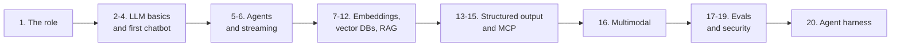

# Forward Deployed Engineer: GenAI Notes

My study notes for becoming a Forward Deployed Engineer (FDE) who builds with generative AI. The notes go from "what is an FDE?" to LLMs, RAG, agents, MCP, evals, security and agent harnesses.

## How to use these notes

Each chapter has its own folder under `chapters/`, with a `README.md` that has the same shape:

1. **In plain words** - a short summary in simple English.
2. The main ideas, with tables and diagrams.
3. **Picture it** - extra visuals (diagrams and examples) to make the idea stick.
4. **Key points to remember** and **Interview angles**.
5. **Further reading** - original papers, official docs and guides for deeper study.

Chapters can hold extra files for deeper topics. Diagrams use [Mermaid](https://mermaid.js.org/), which GitHub shows automatically.

## Contents

| # | Note |
|---|---|
| 1 | [Forward Deployed Engineering: The Role and the Rise of LLMs](chapters/01-forward-deployed-engineering/README.md) |
| 2 | [How LLMs Actually Work: Tokens, Attention and Transformers](chapters/02-how-llms-work/README.md)  Extra: [The Transformer by Example](chapters/02-how-llms-work/transformer-by-example.md) Extra: [The Transformer, step by step (ELI5)](chapters/02-how-llms-work/transformer-explained-simply.md) Extra: ["Attention Is All You Need" explained simply](chapters/02-how-llms-work/attention-is-all-you-need-explained.md) |
| 3 | [Integrating an LLM with Your Application](chapters/03-integrating-llm-with-your-app/README.md) |
| 4 | [Build Your First AI Chatbot: Context Window, Memory and Hallucinations](chapters/04-first-ai-chatbot/README.md) |
| 5 | [Introduction to AI Agents: Build Your First Agent](chapters/05-ai-agents/README.md) |
| 6 | [Build ChatGPT-Style Streaming: How AI Streaming Works](chapters/06-streaming/README.md) |
| 7 | [Vectors and Embeddings: How AI Understands Meaning](chapters/07-vectors-and-embeddings/README.md) |
| 8 | [Build a Netflix-Style Recommendation System with Vector Embeddings](chapters/08-recommendation-with-embeddings/README.md) |
| 9 | [Why We Need Vector Databases: KNN and Vector Search](chapters/09-why-vector-databases/README.md) |
| 10 | [How Vector Databases Actually Work: ANN, HNSW, IVF and Product Quantization](chapters/10-how-vector-databases-work/README.md) |
| 11 | [RAG Explained with a Real Project: AI Customer Support Chatbot](chapters/11-rag/README.md) |
| 12 | [Advanced RAG: Chunking, Hybrid Search, Reranking and More](chapters/12-advanced-rag/README.md) |
| 13 | [Structured Outputs in LLMs: Responses Applications Can Use](chapters/13-structured-outputs/README.md) |
| 14 | [MCP Server Explained: Model Context Protocol for AI Agents](chapters/14-mcp-server/README.md) |
| 15 | [MCP Resources and Prompts Explained: Beyond MCP Tools](chapters/15-mcp-resources-prompts/README.md) |
| 16 | [How AI Understands Images: Build a Multimodal AI App](chapters/16-multimodal-ai/README.md) |
| 17 | [How to Test AI Applications: GenAI Evals, LLM-as-a-Judge and RAG Testing](chapters/17-testing-ai-apps-and-evals/README.md) |
| 18 | [Building and Testing an E-Commerce AI Chatbot: RAG, Tools and AI Evals](chapters/18-ecommerce-chatbot/README.md) |
| 19 | [AI Security and Guardrails: Prompt Injection, Jailbreaks and Safe Tool Use](chapters/19-ai-security-guardrails/README.md) |
| 20 | [Agent Harness: Building Reliable AI Agents](chapters/20-agent-harness/README.md) |

## Suggested study path

## Notes on accuracy

The diagrams, numbers in examples and reading lists were added to help study. The examples (such as probabilities or vector sizes) are for teaching and are not benchmarks. Check the linked sources for exact details.
