# 1. The Transformer by Example: Follow One Sentence

This is page 1 of 3 in the chapter's reading order. The next two pages explain the ideas in more detail (each with its own examples). This page **shows** them first. We take **one small sentence** and follow it through a Transformer, step by step, with tiny numbers you can check with a pencil.

> **The numbers are toys.** Real models use hundreds of numbers per word, and their values are learned, not chosen by hand. We use 2 to 4 numbers and pick them so the story is easy to see. The method is exactly the real one.

**Our sentence:**

> **The cat drank the milk because it was thirsty.**

**Our two questions:**

1. What does the word **"it"** mean? (cat or milk?)
2. If the model has read "The cat drank the", what word should come next?

## The journey in one picture

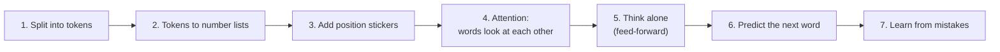

Contents: [1 Tokens](#1-split-the-sentence-into-tokens) · [2 Numbers](#2-each-token-becomes-a-list-of-numbers) · [3 Positions](#3-add-position-stickers) · [4 Attention](#4-attention-what-does-it-mean) · [5 Mask](#5-the-no-peeking-rule-mask) · [6 Many heads](#6-many-heads-many-views) · [7 Feed-forward](#7-the-feed-forward-step) · [8 Next word](#8-predict-the-next-word) · [9 Temperature](#9-the-temperature-knob) · [10 Learning](#10-how-it-learns-one-mistake-at-a-time) · [11 Beam search](#11-greedy-versus-beam-search) · [12 Old way vs new way](#12-why-this-beats-the-old-way)

---

## 1. Split the sentence into tokens

**Analogy.** Break a long chocolate bar into small squares. The model eats **one square (token)** at a time. Most squares are whole words. Long or rare words are cut into pieces.

```text
Sentence:  The cat drank the milk because it was thirsty .

Tokens:    [The] [cat] [drank] [the] [milk] [because] [it] [was] [thirst] [y] [.]
```

Notice: "thirsty" was cut into `thirst` + `y`. That is normal. Each token then gets an **ID number** from the model's dictionary:

| Token | The | cat | drank | the | milk | because | it | was | thirst | y | . |
|---|---|---|---|---|---|---|---|---|---|---|---|
| ID (example) | 464 | 3797 | 12604 | 262 | 7545 | 780 | 340 | 373 | 36329 | 88 | 13 |

(IDs are only an illustration. Try a real tokenizer from the [further reading](#further-reading).)

---

## 2. Each token becomes a list of numbers

**Analogy.** Every word gets a **score card** with a few traits. Similar words get similar score cards. Think of a video game character card: strength, speed, magic, and so on.

Imagine our toy card has just **4 traits**:

| Word | Is it alive? | Is it food or drink? | Is it an action? | Is it a pronoun? |
|---|---|---|---|---|
| cat | 0.9 | 0.0 | 0.1 | 0.0 |
| milk | 0.0 | 0.9 | 0.0 | 0.0 |
| drank | 0.1 | 0.0 | 0.9 | 0.0 |
| it | 0.0 | 0.0 | 0.0 | 0.9 |

Real models do not have names for the traits. The model **finds its own traits** while training. But the idea is the same: **a word becomes a point in "meaning space".**

A simple picture (two traits only):

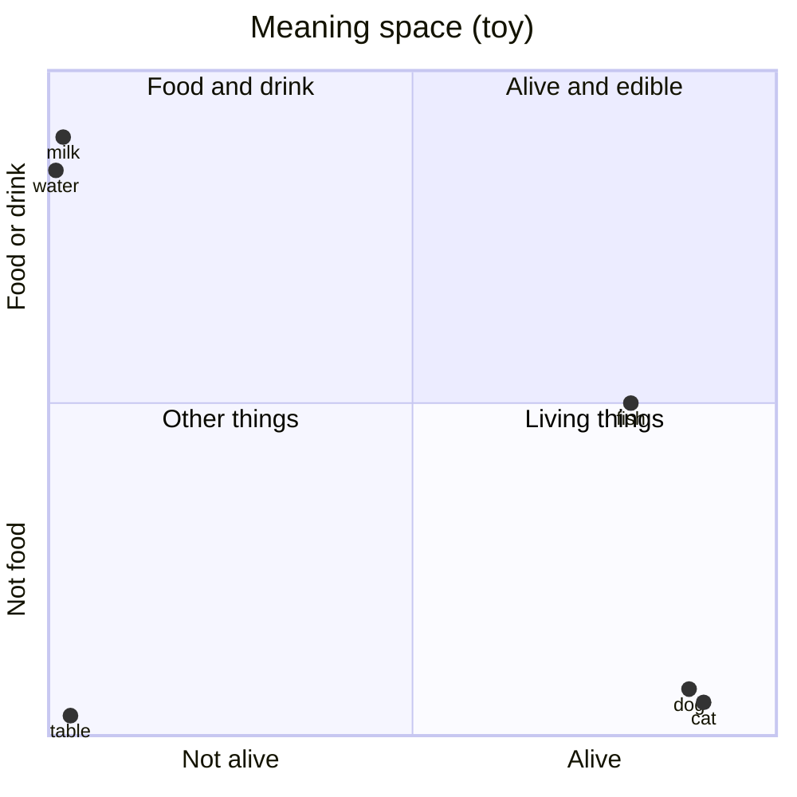

"cat" and "dog" sit close together. "milk" and "water" sit close together. That closeness is what the next steps use.

---

## 3. Add position stickers

**Analogy.** Put the words "dog bites man" in a bag and shake it. You lose who bit whom! So each word gets a sticker: "I am number 0", "I am number 1", and so on.

The paper makes each sticker from sine and cosine waves. Here are real values for a 4-number sticker:

| Position | Sticker (4 numbers) |
|---|---|
| 0 | 0.00, 1.00, 0.00, 1.00 |
| 1 | 0.84, 0.54, 0.01, 1.00 |
| 2 | 0.91, -0.42, 0.02, 1.00 |
| 3 | 0.14, -0.99, 0.03, 1.00 |

Look at the table. The **first two numbers change fast** (a fast wave). The **last two change slowly** (a slow wave). Together they make a **unique fingerprint for each position**, like the hour hand and the minute hand of a clock.

Now **add** the sticker to the word card:

```text
word "cat" (position 1):   0.9, 0.0, 0.1, 0.0
+ sticker for position 1:  0.84, 0.54, 0.01, 1.00
= model input for "cat":   1.74, 0.54, 0.11, 1.00
```

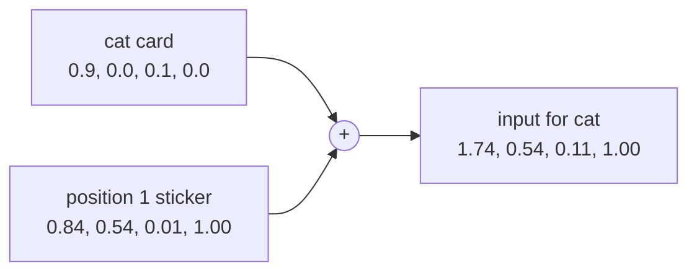

---

## 4. Attention: what does "it" mean?

This is the main event.

**Analogy.** Everyone in a classroom has a **question card** (Query), a **name tag** (Key) and a **backpack of knowledge** (Value). The word "it" holds up its question: "Who am I talking about?" It checks every name tag. The best match shares what is in their backpack.

### Step A: each word makes three small lists

Each word's list is multiplied by three learned tables to get a Query, a Key and a Value. We use 2 numbers each. For this toy, think of the first number as "alive-ness" and the second as "thing-ness".

| Word | Query q | Key k (name tag) | Value v (backpack) |
|---|---|---|---|
| cat | - | (3, 1) | (5, 1) |
| milk | - | (0, 2) | (0, 4) |
| was | - | (1, 0) | (1, 1) |
| **it** | **(2, 1)** | (1, 1) | (2, 2) |

"it" asks: *"I need something alive that did an action."* Its query is **(2, 1)**.

### Step B: score every name tag

Score = multiply the matching numbers of the Query and the Key, then add. A bigger score means a better match.

| Compare "it" with | Calculation | Score |
|---|---|---|
| cat | 2x3 + 1x1 | **7** |
| milk | 2x0 + 1x2 | 2 |
| was | 2x1 + 1x0 | 2 |
| it | 2x1 + 1x1 | 3 |

### Step C: shrink the scores and turn them into percentages

Divide by sqrt of the key size (here sqrt(2) = 1.41; in the real model it is 8). Then apply softmax (a method that makes positive percentages that add up to 100%).

| Word | Score / 1.41 | Attention (percent) | Bar |
|---|---|---|---|
| cat | 4.95 | **89.5%** | ██████████████████ |
| milk | 1.41 | 2.6% | █ |
| was | 1.41 | 2.6% | █ |
| it | 2.12 | 5.3% | █ |

The model decided that "it" is **almost entirely about "cat"**. Nobody told it a rule about cats. The numbers made it happen.

### Step D: mix the backpacks

Take each backpack and scale it by its percentage, then add:

```text
0.895 x (5, 1)  = (4.48, 0.90)    cat's backpack, loud
0.026 x (0, 4)  = (0.00, 0.10)    milk's backpack, quiet
0.026 x (1, 1)  = (0.03, 0.03)    was's backpack, quiet
0.053 x (2, 2)  = (0.11, 0.11)    it's own backpack, quiet
                  --------------
new "it" list   = (4.61, 1.13)    which is very close to cat's value (5, 1)
```

**Result:** the word "it" has a new list of numbers that **is almost the "cat" list**. In the next layers, the model "knows" that it means the cat.

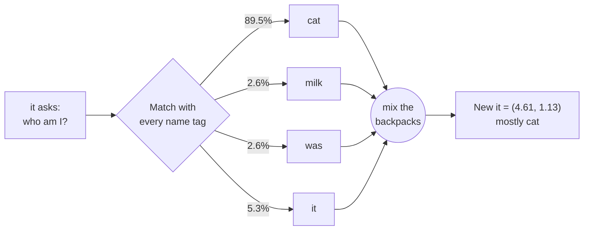

### What if the sentence said "...because it was delicious"?

Now "it" should match **milk**. The query changes, because the model reads the words around "it" in earlier layers. The attention bars flip:

| Sentence ends with | Where "it" looks most |
|---|---|
| "...because it was **thirsty**" | cat (a living thing gets thirsty) |
| "...because it was **delicious**" | milk (food is delicious) |

This is why attention is so powerful: **the same word "it" gets different meanings in different sentences.**

### Why do we divide the scores? (a safety brake)

Without the division, big scores make softmax act like a hard switch. Take three scores 8, 16, 24 (real models easily have such numbers):

| | Without dividing | After dividing by 8 |
|---|---|---|
| Scores | 8, 16, 24 | 1, 2, 3 |
| Softmax result | 0.0000, 0.0003, **0.9997** | 0.09, 0.24, **0.67** |
| What this means | One word gets everything, the others get zero, and the model **cannot learn** (learning signal is too small) | A healthy spread; the model can still learn from all words |

---

## 5. The no-peeking rule (mask)

**Analogy.** In a spelling test, you must not look at the answers on the next line. When the model **writes** a sentence, it must not look at the words it has not written yet.

We hide the future by giving those scores a value of "minus infinity". After softmax, that becomes exactly 0%.

When the model writes **"The cat drank the milk"**, here is who may look at whom (yes = allowed, X = hidden):

| Writing → looks at ↓ | The | cat | drank | the | milk |
|---|---|---|---|---|---|
| **The** | yes | X | X | X | X |
| **cat** | yes | yes | X | X | X |
| **drank** | yes | yes | yes | X | X |
| **the** | yes | yes | yes | yes | X |
| **milk** | yes | yes | yes | yes | yes |

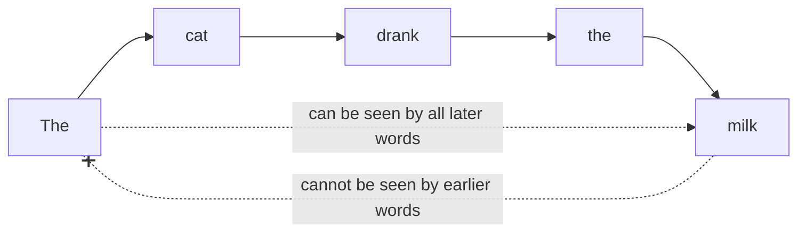

The model reads the **whole question** with free looking (encoder), but writes the **answer** with the mask (decoder). That is how it learns to predict, without cheating.

---

## 6. Many heads, many views

**Analogy.** To understand a story, one friend watches **who** is doing things, another watches **what** is happening, a third watches **when**. Then they combine notes.

The paper uses **8 heads**. Each has its own tables, so each head pays attention to something different. Below are made-up attention patterns for the word **"it"** in three heads (higher % = more attention):

| Word | Head 1: "who is it?" | Head 2: "what just happened?" | Head 3: "what is the mood?" |
|---|---|---|---|
| cat | **90%** | 5% | 5% |
| drank | 3% | **70%** | 5% |
| milk | 3% | 20% | 5% |
| thirsty | 4% | 5% | **85%** |

Head 1 links "it" to the cat. Head 2 links it to the action. Head 3 links it to the feeling. The model **glues the three views together** into one richer list.

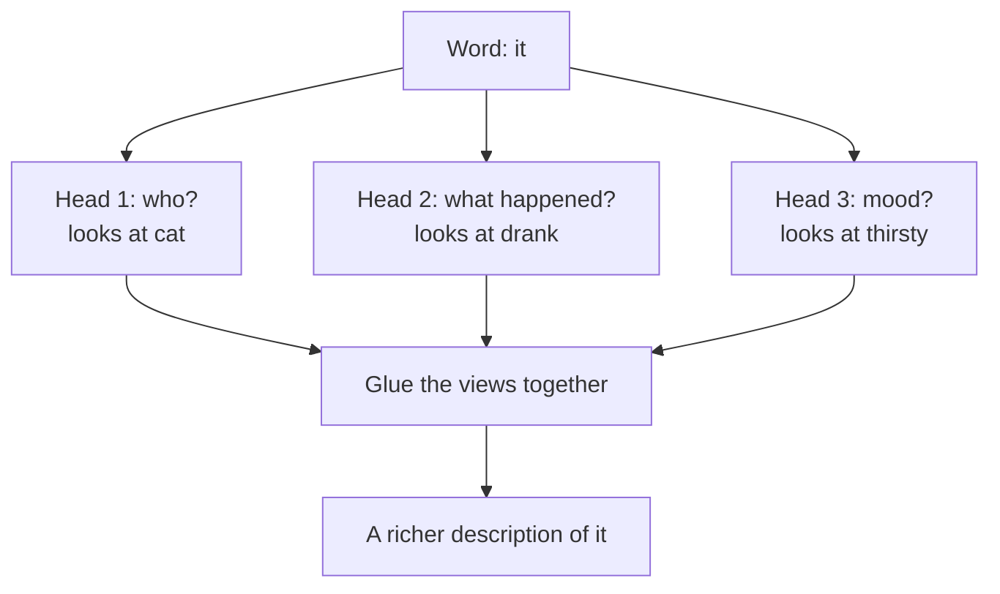

(Heads do not really have clean human names like these. But researchers do see heads that follow grammar, links between nouns and pronouns, and other patterns.)

---

## 7. The feed-forward step

**Analogy.** After the class discussion (attention), each student goes to their desk and **thinks alone** about what they heard. Everyone follows the same thinking recipe. Nobody talks during this part.

A tiny example for **one** word's list, using one layer and the "ReLU" rule (negative numbers become 0):

```text
Input list:         (4.61, 1.13)
Multiply by a table, add a nudge:  (2.0, -1.5, 0.7)
Apply ReLU (negative -> 0):        (2.0,  0.0, 0.7)
Multiply by a second table:        (3.1, 0.9)      <- new list, same size as the input
```

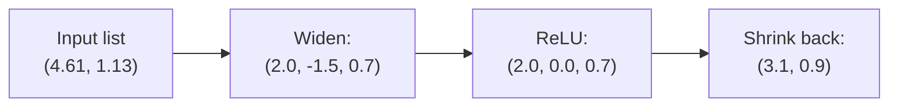

In the real model the list goes from **512 to 2048 and back to 512**.

The attention step and the thinking step, plus the shortcut and tidy-up, form **one layer**. The paper stacks **6 layers**. Layer by layer, the meaning gets deeper: early layers learn simple things (grammar), later layers learn bigger things (who did what).

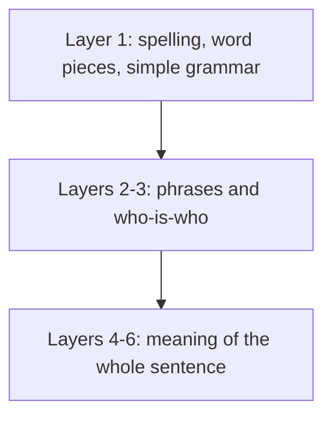

---

## 8. Predict the next word

**Second question:** the model has read **"The cat drank the ___"**. What comes next?

The last list from the final layer goes through a **linear layer**. This makes one score (a *logit*) for **every word in the dictionary**. We show only four words:

| Word | Raw score (logit) |
|---|---|
| milk | 4.0 |
| water | 3.0 |
| cat | 1.0 |
| car | 0.0 |

**Softmax** turns scores into percentages:

| Word | Probability | Bar |
|---|---|---|
| **milk** | **69.6%** | ██████████████ |
| water | 25.6% | █████ |
| cat | 3.5% | █ |
| car | 1.3% | |

The model picks **"milk"** (or sometimes "water", if it samples). Then "milk" is added to the text and the whole process repeats for the next word. **This is how ChatGPT-style models write: one word, then the next, then the next.**

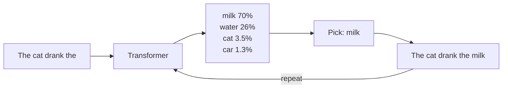

---

## 9. The temperature knob

**Analogy.** Imagine a dice with unfair sides. **Low temperature = a very strict teacher** who always picks the top answer. **High temperature = a wild artist** who may pick surprising answers.

Same four scores, three temperatures:

| Word | Low (0.5) | Normal (1) | High (2) |
|---|---|---|---|
| milk | **88%** | 70% | 51% |
| water | 12% | 26% | 31% |
| cat | 0.2% | 3.5% | 11% |
| car | 0% | 1.3% | 7% |

- **Low:** safe, repeatable. Good for facts, support answers and code.
- **High:** creative, but may say strange things. Good for brainstorming.

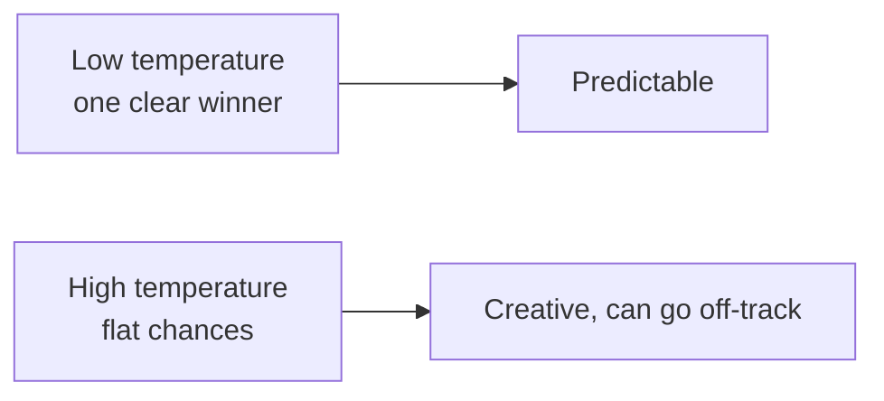

---

## 10. How it learns, one mistake at a time

**Analogy.** A student answers a quiz question. The teacher says how wrong they were. The student fixes their thinking a tiny bit. After millions of questions, the student is very good.

Training text: **"The cat drank the milk"**. We show the model "The cat drank the" and the right next word is **milk**.

| Moment | Model's chance for "milk" | Loss (how wrong: -ln of the chance) |
|---|---|---|
| Start (random model) | 10% | **2.30** (very wrong) |
| After some learning | 40% | 0.92 |
| After lots of learning | 90% | **0.11** (very good) |

- **Loss** is just a "how wrong" number. Lower is better.
- **Backpropagation** is the method that tells every table in the model how to change a little so the loss gets smaller.

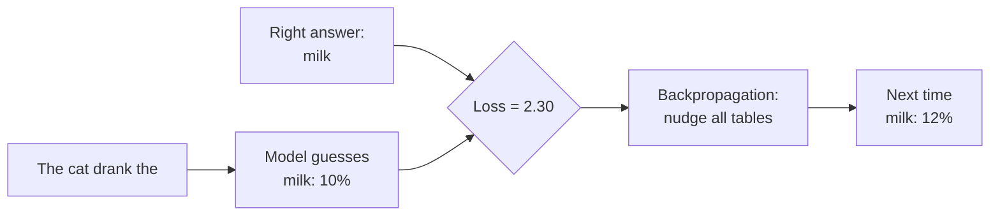

The paper also uses **label smoothing**: instead of saying "the answer is 100% milk", it says "milk 92%, and 2% for each of four other words". This stops the model from becoming too sure and helps it on new sentences.

The learning speed (learning rate) is also planned: it **climbs for 4000 steps** (gentle warm-up) and then **slowly falls**:

| Training step | Learning rate (relative) | What is happening |
|---|---|---|
| 1 | almost 0 | The model is brand new. Tiny steps. |
| 1,000 | 0.00017 | Warming up |
| 4,000 | **0.00070 (peak)** | Full speed |
| 16,000 | 0.00035 | Slowing down to fine-tune |
| 100,000 | 0.00014 | Small careful changes |

---

## 11. Greedy versus beam search

When writing a whole sentence, we can choose words in two ways.

**Greedy:** always take the best word right now.
**Beam search:** keep the best **2 (or more)** partial sentences at each step and decide later.

Example: translating a sentence into English. The chance of each next word:

| Step 1 | Chance |
|---|---|
| "The" | 45% |
| "A" | 40% |

| Step 2 | Chance | Whole-sentence chance |
|---|---|---|
| "The" then "cat" | 40% | 0.45 x 0.40 = **0.18** |
| "The" then "dog" | 30% | 0.45 x 0.30 = 0.135 |
| "A" then "cat" | 90% | 0.40 x 0.90 = **0.36** |

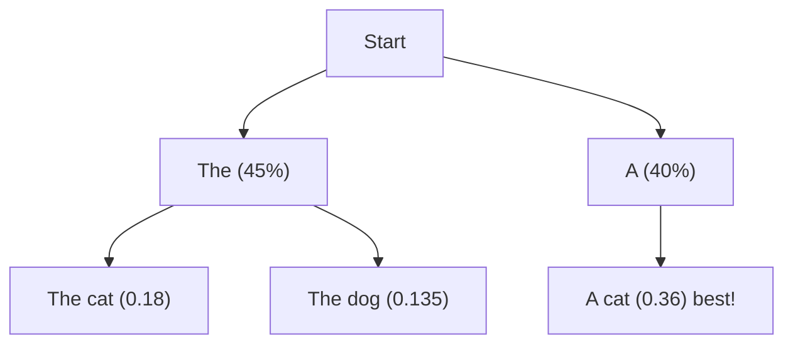

- **Greedy** picks "The" first (45% beats 40%), then "cat". It ends with **0.18**.
- **Beam search (width 2)** keeps both "The" and "A". At step 2 it finds **"A cat" with 0.36**, which is twice as likely.

Greedy got stuck with an early choice. Beam search is more careful. The paper used beam size **4**.

---

## 12. Why this beats the old way

The old models (RNNs) read **one word at a time and pass a memory along**, like the game of telephone.

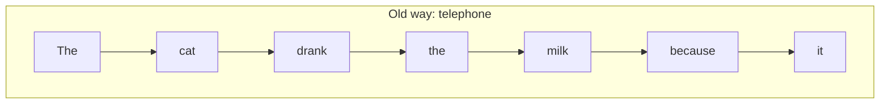

For "it" to learn about "cat", the message must pass through **5 hands** (drank, the, milk, because, and so on). Each hand can blur it a little.

With attention, "it" can **look straight at "cat"**: **1 hop**.

| | Old way (RNN) | Attention |
|---|---|---|
| Steps between "cat" and "it" | 5 | **1** |
| Can words be processed at the same time? | No, one after another | **Yes** |
| Risk of forgetting the start of a long text | High | Low |
| Training on many GPUs | Slow | **Fast** |

**That is the whole idea of the paper**: let every word look directly at every other word, and do it for all words together.

---

## Mini quiz (check yourself)

1. In "The cat drank the milk because it was thirsty", which word gets the most attention from "it", and why?
   *Answer: "cat", because its Key matches the "it" Query best (score 7 vs 2 and 3).*
2. What would the mask do while writing "The cat"?
   *Answer: "The" can see only itself. "cat" can see "The" and "cat". Nobody sees future words.*
3. Why do we divide scores by sqrt(key size)?
   *Answer: Big scores make softmax too sharp (one word gets 99.97%), so the model cannot learn. Dividing keeps the spread healthy.*
4. Low temperature or high temperature for a customer-support bot?
   *Answer: Low, because we want safe and repeatable answers.*
5. Why does beam search sometimes beat greedy?
   *Answer: Greedy locks in the best first word. Beam search keeps other options, so a better whole sentence can win later.*

## Further reading

- [OpenAI Tokenizer](https://platform.openai.com/tokenizer) - type any text and see the tokens.
- [The Illustrated Transformer (Jay Alammar)](https://jalammar.github.io/illustrated-transformer/) - original pictures.
- [Attention Is All You Need (arXiv)](https://arxiv.org/abs/1706.03762) - the paper.
- [Back to chapter 2](README.md) · Next: [2. The Illustrated Transformer, step by step](02-illustrated-transformer-explained.md) · then [3. "Attention Is All You Need" explained](03-attention-is-all-you-need-explained.md)
