# 3. "Attention Is All You Need" Explained

This page explains the research paper [Attention Is All You Need](https://arxiv.org/abs/1706.03762) (Vaswani, Shazeer, Parmar, Uszkoreit, Jones, Gomez, Kaiser and Polosukhin, 2017). It is the paper that introduced the **Transformer**, the design behind today's large language models.

It follows the paper's own section order, in plain words, with pictures and everyday analogies. All words and diagrams here are written from scratch. Read the first two pages in this chapter before this one if you can: they show how the model computes things.

> **Reading order in this chapter:** 1) [The Transformer by Example](01-transformer-by-example.md), 2) [The Illustrated Transformer, step by step](02-illustrated-transformer-explained.md), 3) this page. Every section below has a **worked example**.
>
> **How to read this page.** Each section has **Analogy**, **The real idea** and a **picture**. If you are short on time, read only the Analogy parts and the one-page summary at the end.

## Contents

1. [The story in one minute](#1-the-story-in-one-minute)
2. [Introduction: what was wrong before](#2-introduction-what-was-wrong-before)
3. [Background: other ways people tried to fix it](#3-background-other-ways-people-tried-to-fix-it)
4. [Model architecture](#4-model-architecture)
5. [Why self-attention? (the comparison table)](#5-why-self-attention-the-comparison-table)
6. [Training](#6-training)
7. [Results](#7-results)
8. [What the experiments taught](#8-what-the-experiments-taught-model-variations)
9. [Beyond translation: parsing](#9-beyond-translation-parsing)
10. [Conclusion and what came next](#10-conclusion-and-what-came-next)
11. [One-page summary and glossary](#11-one-page-summary-and-glossary)

---

## 1. The story in one minute

**Analogy.** Before this paper, computers read a sentence like a child reading with a finger: **one word at a time, left to right**. That is slow, and by the end of a long sentence the child may forget the start. The authors said: "Let the computer look at **all the words at once** and decide which words matter to each other." That trick is called **attention**. They built a whole model from it and it was faster and better.

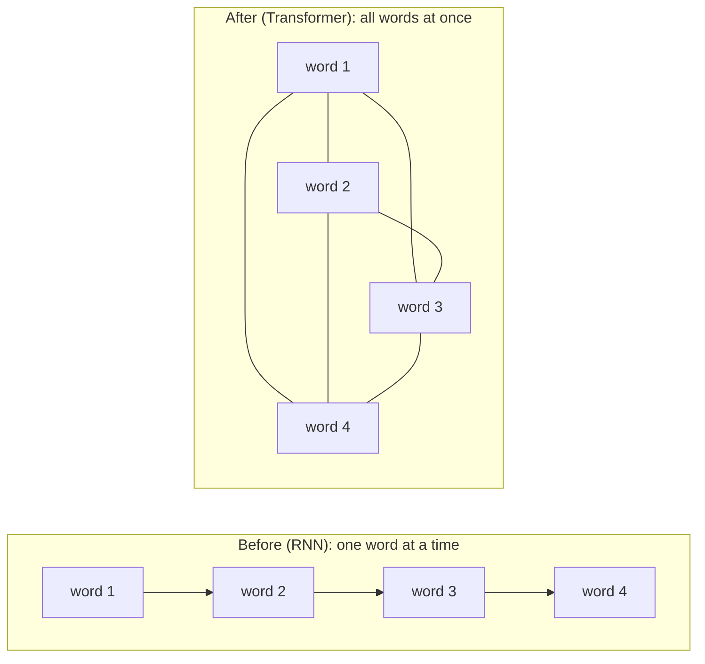

**The claims in the abstract**

| Claim | Meaning |
|---|---|
| No recurrence, no convolution | The model uses only attention (plus simple layers) |
| Better quality | Higher translation scores than earlier systems |
| More parallel | Many steps can run at the same time on a GPU |
| Faster to train | Much less training time |

### Example: one long sentence

*"The cat that my neighbour adopted last week drank the milk."*

| Model | Time to read it |
|---|---|
| Old (one word at a time) | 12 steps in a row. The 12th cannot start before the 11th |
| Transformer | All 12 words are processed **at the same time** in one big table step |

On a GPU that has thousands of small workers, the second way keeps them all busy.

---

## 2. Introduction: what was wrong before

**Analogy.** Imagine passing a secret message down a line of 100 kids. Each kid whispers to the next. By kid 100 the message is changed, and the whole line has to wait for each kid in turn. That is how older models (RNNs, LSTMs, GRUs) worked.

**The real idea.**

- Older models for language were **recurrent**: to process word 5 they first needed the result for word 4. This **sequential** work cannot be split across many chips, so it is slow, especially for long sentences.
- Attention already existed, but people used it **together with** recurrence.
- This paper uses **attention alone** to connect any word with any other word, however far apart. It reached top quality after about **12 hours on 8 GPUs**.

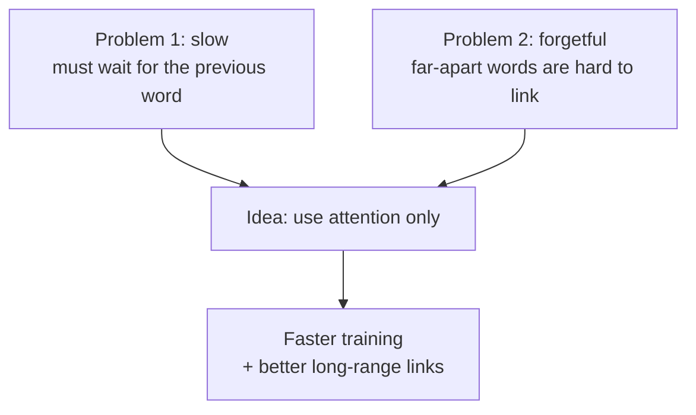

### Example: the telephone game

A line of 6 kids passes the message "the cat drank the milk". The 6th kid hears "the cat dank the silk". Every hand can change the message a little.

| Method | Chance the first word is remembered well at word 6 |
|---|---|
| Passing it hand to hand (recurrent) | Lower: it went through 5 hands |
| Looking straight at it (attention) | Higher: 1 direct look |

---

## 3. Background: other ways people tried to fix it

Some models (Extended Neural GPU, ByteNet, ConvS2S) used **convolutions** to read many words at once. A convolution looks at a small window of neighbours. To connect two words far apart, you need many layers.

| Model type | Steps needed to link two far-apart words |
|---|---|
| ConvS2S | Grows in a straight line with distance |
| ByteNet | Grows slowly (logarithm of distance) |
| **Transformer** | **A constant number (one step)** |

The price: when attention averages over many words, the picture gets a little blurry. The paper fixes this with **multi-head attention** (many separate views at once).

The paper also names its key tool, **self-attention**: a sentence pays attention to **itself** to understand each word in context. It says the Transformer is the **first** model that relies **completely** on self-attention to turn one sequence into another.

### Example: how many steps to connect two words?

Sentence of 16 words. Connect word 1 with word 16.

| Model | Steps needed | Why |
|---|---|---|
| Recurrent | 15 | Pass along every word |
| Convolution with window 3 (ConvS2S style) | about 8 | Window grows by 2 words per layer, so about 8 layers are needed |
| Convolution with doubling windows (ByteNet style) | about 4 | Windows double: 1, 2, 4, 8 |
| **Transformer** | **1** | Direct look |

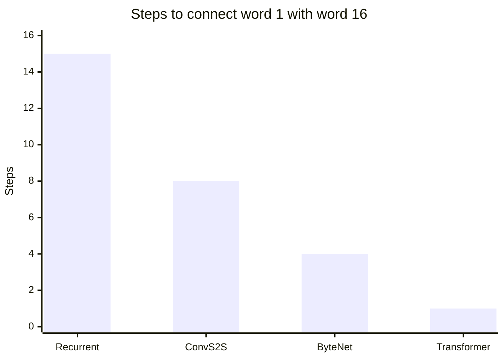

---

## 4. Model architecture

**Analogy.** A translation office with two teams. The **reader team** (encoder) reads the input sentence and writes notes. The **writer team** (decoder) uses the notes to write the answer, **one word at a time**, and each new word can use the words already written.

### 4.1 Encoder and decoder stacks

| Part | What it has |
|---|---|
| Encoder | **6** identical layers. Each layer: multi-head self-attention, then a feed-forward network |
| Decoder | **6** identical layers. Each layer: masked self-attention, attention over the encoder output, then a feed-forward network |
| Around every sub-layer | A shortcut (residual connection) plus layer normalization |
| Width of everything | **512** numbers (`d_model`) |

The formula for each sub-layer is: **LayerNorm( x + Sublayer(x) )**. The "x +" part is the shortcut.

In the decoder, self-attention is **masked**: position *i* may only see positions before it. The outputs are also shifted by one position. Together this means a word is predicted using **only earlier words**, never the answer.

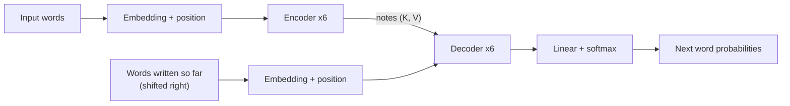

### 4.2 Attention

**Analogy.** Library idea: you hold a **question** (Query). Every book has a **label** (Key) and **contents** (Value). Match your question to the labels, then read the best books' contents.

**The real idea.** Attention takes a query and a set of key-value pairs and returns a **weighted sum of the values**. The weights come from how well the query matches each key.

#### Scaled dot-product attention

```text
Attention(Q, K, V) = softmax( Q x K-transposed / sqrt(d_k) ) x V
```

| Piece | Plain meaning |
|---|---|
| Q x K-transposed | Match score between every question and every label |
| divide by sqrt(d_k) | Keep scores small (d_k = 64, so divide by 8) |
| softmax | Turn scores into percentages that add up to 100% |
| x V | Mix the contents using those percentages |

**Why divide by the square root of d_k?** Suppose each number in a query and key is a random value with average 0 and spread 1. A dot product adds up `d_k` such products, so its spread grows with `d_k`. Big scores push softmax into a flat zone where it gives almost all weight to one word and nearly zero learning signal (a tiny gradient). Dividing by sqrt(d_k) keeps the scores in a healthy range.

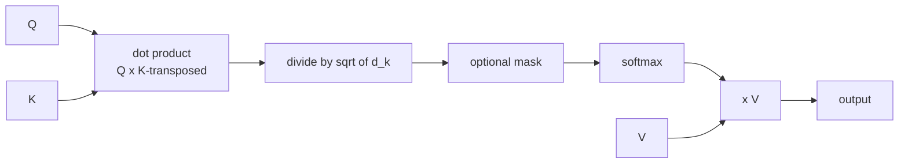

#### Multi-head attention

**Analogy.** One pair of eyes sees one thing. Eight pairs of eyes see eight things.

**The real idea.** Instead of one big attention, the model runs **h = 8** smaller attentions in parallel. Each head has its own learned tables that squeeze Q, K and V down to **64** numbers (`d_k = d_v = 512 / 8`). The 8 results are glued together and passed through one more table (`W^O`). Because each head is small, the **total cost is about the same** as one full-size head, but the model gets several different views.

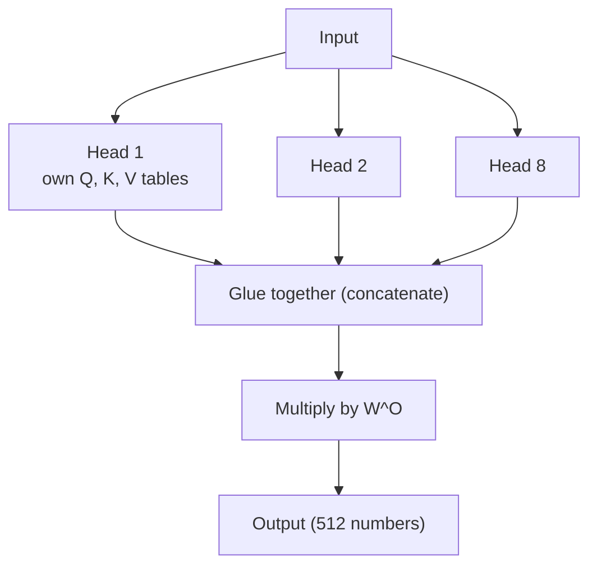

#### Three places attention is used

| Where | Queries come from | Keys and values come from | Purpose |
|---|---|---|---|
| Encoder-decoder attention | Decoder layer below | Encoder output | Every output word can look at the whole input sentence |
| Encoder self-attention | Previous encoder layer | Previous encoder layer | Input words look at each other |
| Decoder self-attention (masked) | Previous decoder layer | Previous decoder layer | Output words look only at earlier output words (future scores set to minus infinity) |

### 4.3 Feed-forward network

**Analogy.** After the words talk, each one goes into a private thinking room to work on what it heard.

A small two-layer network is applied to each position separately: `FFN(x) = max(0, x W1 + b1) W2 + b2`. It goes from 512 numbers up to **2048** and back down to 512. The `max(0, ...)` part is called ReLU: it turns negative numbers into zero. Each layer has its own weights.

### 4.4 Embeddings and softmax

- Words become 512-number lists using **learned** embeddings.
- At the end, a **linear layer + softmax** turns the decoder output into next-word probabilities.
- The paper **shares one weight table** between the two embedding layers and the final linear layer, which saves memory.
- In the embedding layers the weights are multiplied by **sqrt(512)**.

### 4.5 Positional encoding

**Analogy.** "Dog bites man" and "man bites dog" use the same words but mean different things. Attention itself has no sense of order, so each word gets a **position sticker**.

**The real idea.** A position vector is **added** to each word embedding. The paper uses fixed sine and cosine waves of many speeds:

```text
PE(pos, 2i)   = sin( pos / 10000^(2i / 512) )
PE(pos, 2i+1) = cos( pos / 10000^(2i / 512) )
```

| Question | Answer |
|---|---|
| Why waves? | For any fixed jump of *k* positions, the vector at `pos + k` is a simple linear mix of the vector at `pos`. So "3 words later" is easy to learn |
| Does it have to be waves? | No. The authors also tried **learned** position vectors and got almost the same results |
| Why choose waves? | They might work for sentences **longer** than any seen in training |

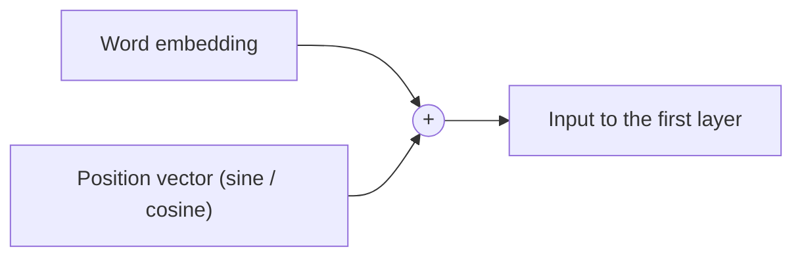

### Example: one sentence through the Transformer base model

Input: **"I am a student"** (4 tokens).

| Stage | Table size (rows x columns) | What it is |
|---|---|---|
| Token IDs | 4 | One number per token |
| Embeddings (x sqrt(512)) | 4 x 512 | Each token becomes 512 numbers |
| + Position stickers | 4 x 512 | Same size, now with order |
| One head: Q, K, V | 4 x 64 each | 64 numbers per token |
| One head: scores | 4 x 4 | Every token against every token |
| 8 heads glued together | 4 x 512 | 8 x 64 = 512 |
| After W^O | 4 x 512 | Back to model size |
| Feed-forward middle | 4 x 2048 | The "thinking room" is wider |
| Feed-forward out | 4 x 512 | Shrunk back |
| After 6 layers | 4 x 512 | Same size all the way up |
| Linear to vocabulary | 4 x 37,000 | One score per word piece (English-German vocabulary) |
| Softmax | 4 x 37,000 | Percentages for each next word |

**Why multiply embeddings by sqrt(512) = 22.6?** Learned embedding numbers are small, for example 0.04. The position stickers contain numbers up to 1. Without scaling, the sticker would drown the meaning.

| | Meaning part | Position part |
|---|---|---|
| Before scaling | 0.04 | up to 1.0 (too loud) |
| After scaling (x 22.6) | 0.9 | up to 1.0 (fair) |

**Shortcut + tidy-up example** (`LayerNorm(x + Sublayer(x))`): x = (1.0, 2.0), Sublayer(x) = (0.5, -1.0). Sum = (1.5, 1.0). Average 1.25, spread 0.25. Result = **(1.0, -1.0)**.

**Attention example** (`softmax(QK^T / sqrt(d_k)) V`) for the word "it" with two candidate words:

| | cat | milk |
|---|---|---|
| Score (Q dot K) | 7 | 2 |
| Divide by sqrt(2) = 1.41 | 4.95 | 1.41 |
| Softmax | **97%** | 3% |
| Value | (5, 1) | (0, 4) |
| Result: 0.97 x (5, 1) + 0.03 x (0, 4) | **(4.85, 1.09)** | |

**Why divide by sqrt(d_k)?** Scores 8, 16, 24 give softmax 0.0000, 0.0003, **0.9997** without dividing (winner takes all, almost no learning) and 0.09, 0.24, **0.67** after dividing by 8.

**Position sticker example** (4-number toy):

| Position | Sticker |
|---|---|
| 0 | 0.00, 1.00, 0.00, 1.00 |
| 1 | 0.84, 0.54, 0.01, 1.00 |
| 2 | 0.91, -0.42, 0.02, 1.00 |
| 3 | 0.14, -0.99, 0.03, 1.00 |

**The decoder mask while writing "I am a student":**

| Writing | Allowed to see |
|---|---|
| I | I |
| am | I, am |
| a | I, am, a |
| student | I, am, a, student |

---

## 5. Why self-attention? (the comparison table)

The paper compares three layer types on three questions:

1. How much **computation** per layer?
2. How many steps **must run one after another** (less is better, because many steps can then run in parallel)?
3. How long is the **path** between two words (shorter is better for learning long-range links)?

Here `n` = sentence length, `d` = vector size, `k` = convolution window size.

| Layer type | Work per layer | Steps in sequence | Longest path between two words |
|---|---|---|---|
| **Self-attention** | n x n x d | **1** | **1** |
| Recurrent | n x d x d | n | n |
| Convolutional | k x n x d x d | 1 | about log(n) |
| Self-attention, limited to r neighbours | r x n x d | 1 | n / r |

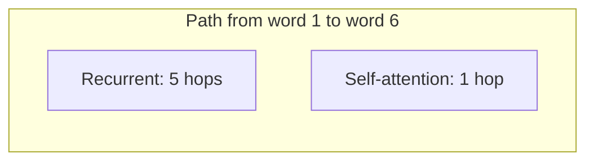

**Key lessons**

- Self-attention is **cheaper than recurrence when the sentence is shorter than the vector size** (n < d). This is usual for sentences made of word pieces, where n is often dozens or hundreds and d is 512.
- It lets any two words connect in **one hop**, so long-range links are easier to learn.
- For very long inputs the n x n part gets costly. The authors suggest looking only at **nearby** words in that case (future work).
- Bonus: attention weights can be drawn as pictures, which may help people **see** what a head is doing. The paper's appendix shows heads that track long-distance links and sentence structure.

### Example: real numbers for the comparison table

Take word-piece sentences of **n = 50** tokens and vector size **d = 512**.

| Layer type | Formula | Work |
|---|---|---|
| Self-attention | n x n x d | 50 x 50 x 512 = **1.3 million** |
| Recurrent | n x d x d | 50 x 512 x 512 = **13.1 million** |

Here attention is about **10 times cheaper**, because n (50) is smaller than d (512).

Now a very long text of **n = 1,000** tokens:

| Layer type | Work |
|---|---|
| Self-attention | 1,000 x 1,000 x 512 = **512 million** |
| Recurrent | 1,000 x 512 x 512 = **262 million** |

For very long inputs attention becomes the costlier one (n is bigger than d). That is why the paper suggests looking only at nearby tokens for long inputs.

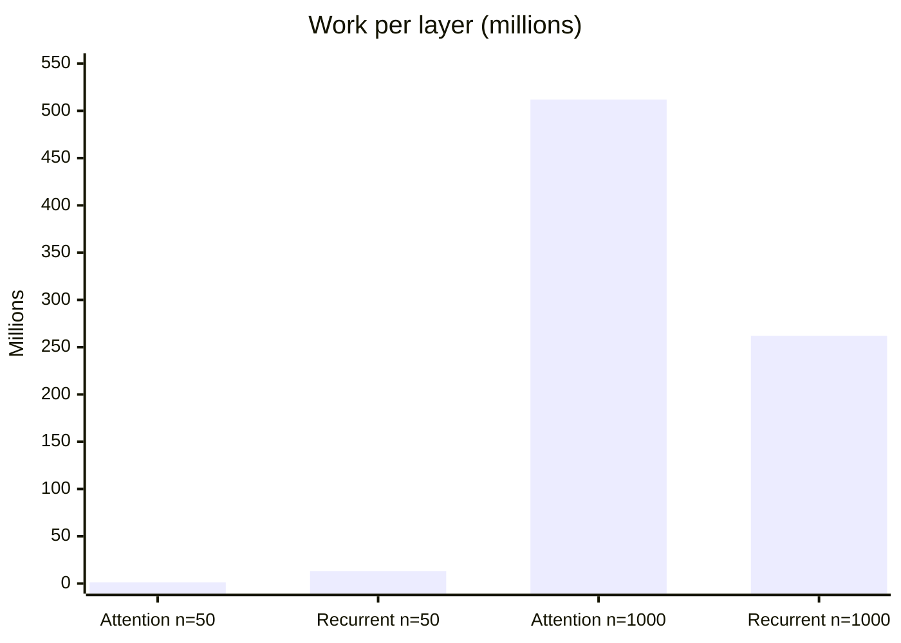

---

## 6. Training

**Analogy.** Show the model millions of sentence pairs (input and the right translation). It guesses, checks, and adjusts its numbers. It does this many thousands of times.

| Item | English to German | English to French |
|---|---|---|
| Data | WMT 2014, about **4.5 million** sentence pairs | WMT 2014, **36 million** sentences |
| Word pieces | Byte-pair encoding, shared vocabulary of about **37,000** | **32,000** word pieces |
| Batches | Grouped by length; about 25,000 source and 25,000 target tokens each | Same |

### Hardware and time

| Model | Time per step | Steps | Total |
|---|---|---|---|
| Base | about 0.4 seconds | 100,000 | **about 12 hours** |
| Big | about 1.0 second | 300,000 | **about 3.5 days** |

All on one machine with **8 NVIDIA P100 GPUs**.

### Optimizer and learning rate

The paper uses the **Adam** optimizer (beta1 = 0.9, beta2 = 0.98, epsilon = 10^-9) with a learning rate that follows a "warm up, then cool down" shape:

```text
lrate = d_model^(-0.5) x min( step^(-0.5), step x warmup^(-1.5) )     warmup = 4000 steps
```

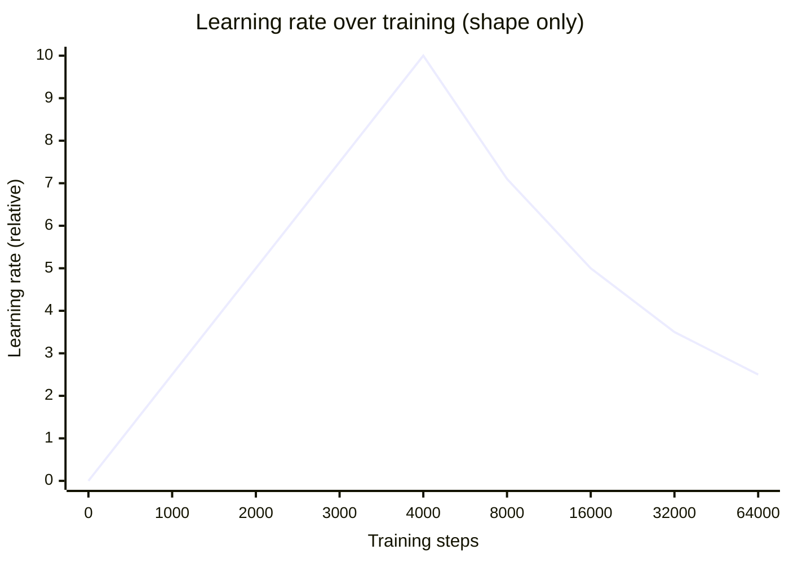

- For the first **4000 steps** the rate **goes up** in a straight line (warm-up: start gently).
- After that it **goes down** slowly, in proportion to 1 / sqrt(step).

### Regularization (ways to stop memorizing)

| Trick | Setting | Plain meaning |
|---|---|---|
| Residual dropout | 0.1 (base model) | Randomly switch off some numbers during training so the model cannot lean on any one of them |
| Label smoothing | 0.1 | Do not be 100% sure of the right answer. The model becomes less over-confident. It lowers the sharpness (perplexity) score a little, but helps translation quality |

### Example: word pieces, batches and the learning rate

**Word pieces.** Long or rare words are split, so the vocabulary stays small:

| Word | Pieces |
|---|---|
| cat | cat |
| unbelievable | un + believ + able |
| thirsty | thirst + y |

**A batch.** About 25,000 source tokens + 25,000 target tokens go through together. That is roughly 1,000 sentences of 25 tokens each. The base model repeats this **100,000 times** (about 12 hours).

**Warm-up learning rate**

| Step | Learning rate | Why |
|---|---|---|
| 1 | almost 0 | New model; tiny careful steps |
| 1,000 | 0.00017 | Speeding up |
| 4,000 | **0.00070 (peak)** | Full speed |
| 16,000 | 0.00035 | Slowing to fine-tune |
| 100,000 | 0.00014 | Small final changes |

**Label smoothing (0.1)** with 5 candidate words, correct word = milk:

| Word | Normal target | Smoothed target |
|---|---|---|
| milk (correct) | 100% | **92%** |
| each of 4 others | 0% | 2% each |

The model is never asked to be 100% sure, so it stays humble on new sentences.

---

## 7. Results

### Translation quality (BLEU score, higher is better)

BLEU compares the model's translation with human translations. 100 would be a perfect match.

| Task | Transformer (big) | What the paper says |
|---|---|---|
| English to German | **28.4** | More than 2 points above the best earlier results, including ensembles of several models |
| English to French | **41.8** | New best single-model result, trained 3.5 days on 8 GPUs, at a small fraction of the cost of earlier top models |

The smaller "base" model also beat all earlier published models and ensembles on English to German, at lower training cost.

### How translations were produced

- **Beam search** with beam size **4** and a length penalty of **0.6**.
- Maximum output length = input length + 50.
- The final model averages the weights of the last few saved checkpoints (the last 5 for base, the last 20 for big).

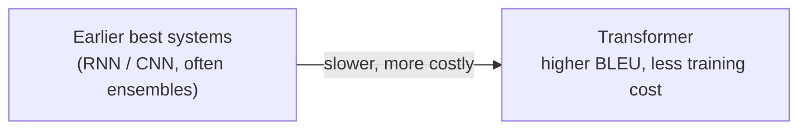

### Example: reading a BLEU score

| | Text |
|---|---|
| Human translation | the cat sat on the mat |
| Machine translation | the cat is on the mat |
| Matching words | the, cat, on, the, mat = 5 of 6 |
| Simple match score | 5 / 6 = 0.83 |

Real BLEU also checks matching phrases of 2, 3 and 4 words and is shown out of 100.

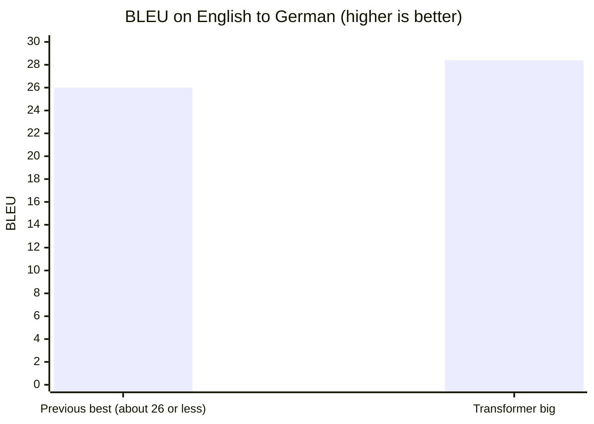

The paper says the big Transformer beat earlier results by more than 2 BLEU. The bar for the earlier systems is shown as "about 26" here to illustrate that gap. Check the paper's Table 2 for the exact earlier scores.

---

## 8. What the experiments taught (model variations)

The authors changed one thing at a time on a base model and watched the score. The findings, in plain words:

| What they changed | What happened | Lesson |
|---|---|---|
| Number of heads (1, 4, 8, 16, 32) while keeping total size fixed | 1 head was about **0.9 BLEU worse**. Too many heads (32) also got worse | A middle number such as 8 or 16 is best |
| Smaller key size `d_k` | Quality dropped | Judging a match is not trivial; a smarter match function than a plain dot product might help |
| Fewer layers or smaller width | Worse | **Bigger models are better** |
| More width or bigger feed-forward | Better | Same lesson |
| No dropout | Clearly worse (overfitting) | Dropout helps |
| Learned position vectors instead of waves | **Nearly identical** | Either choice works |

(The exact table of numbers is in the paper, Table 3.)

### Example: choosing the number of heads

| Heads | Size of each head | Effect (paper's test) |
|---|---|---|
| 1 | 512 | About 0.9 BLEU worse than the best |
| 8 | 64 | Good (the paper's choice) |
| 16 | 32 | About the same as 8 |
| 32 | 16 | A little worse again |

Think of 512 colour pencils shared among painters. One painter with all 512 pencils paints one picture. Eight painters with 64 pencils each paint eight pictures, and then you blend them. With 32 painters each has only 16 pencils, which is too few for a good picture.

---

## 9. Beyond translation: parsing

To test whether the Transformer is only good at translation, the authors tried **English constituency parsing** (finding the grammar tree of a sentence). They used a 4-layer Transformer with almost no tuning.

| Training data | Score (F1) |
|---|---|
| Small: about 40,000 sentences (WSJ only) | **91.3** |
| Large: about 17 million sentences (semi-supervised) | **92.7** |

The results were strong and beat most earlier models. Only one specialised model scored higher. This shows the Transformer **generalizes** to other language tasks.

### Example: what "parsing" means

Sentence: **"The cat drank milk"**. A parser draws the grammar tree:

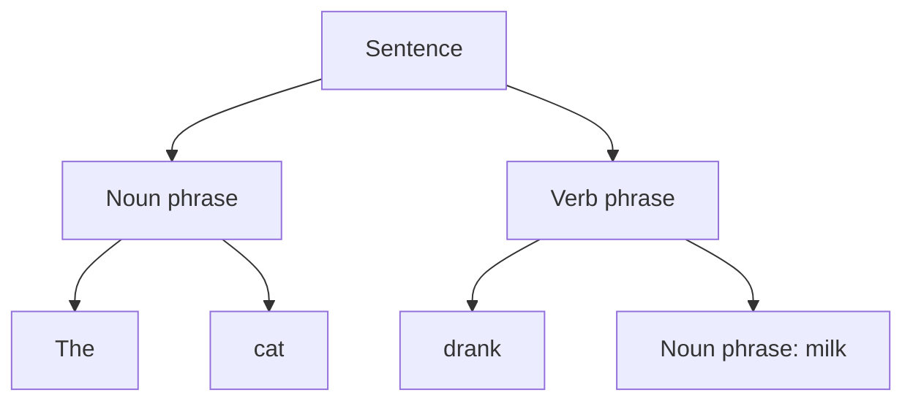

The Transformer was trained to output this tree as text. Because it did well, with almost no special tuning, the authors argued it is a **general** tool and not just a translator.

---

## 10. Conclusion and what came next

The paper says the Transformer is the **first sequence-to-sequence model built entirely on attention**. It trains much faster than recurrent or convolutional models and set new records on both translation tasks.

**The authors' plans for the future**

| Plan | What happened later |
|---|---|
| Use it for images, audio and video | Vision Transformers, speech models, and multimodal models (see chapter 16) |
| Look only at nearby positions for long inputs | Many "efficient attention" methods |
| Make generation less step-by-step | An active research area |
| Share the code | The code was released in the Tensor2Tensor library |

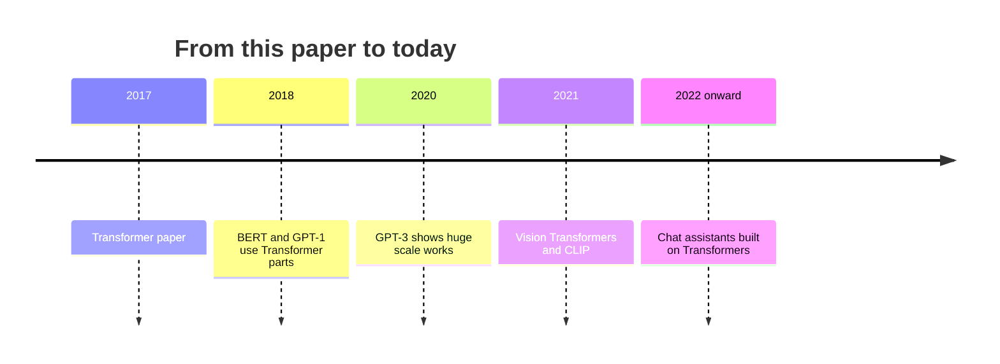

---

## 11. One-page summary and glossary

### Summary in 8 lines

1. Older language models read **one word after another**, which was slow and forgetful over long distances.
2. The Transformer lets **every word look at every other word at once** (attention).
3. Attention = compare a **Query** with all **Keys**, turn scores into percentages with **softmax**, and mix the **Values**.
4. Scores are divided by **sqrt(d_k)** so softmax does not saturate.
5. **8 heads** give 8 different views, and their results are glued together.
6. **Position waves** are added because attention does not know word order.
7. **Residual shortcuts + layer norm + feed-forward** layers are stacked 6 times in both the encoder and decoder.
8. Result: **better translation, far less training time**, and a design that scaled into modern LLMs.

### Glossary

| Word | Meaning |
|---|---|
| Sequence transduction | Turning one sequence into another (for example English to German) |
| Recurrent (RNN, LSTM, GRU) | Reads one word at a time, passing a memory forward |
| Convolution | Looks at a small window of neighbours |
| Self-attention | A sentence looks at itself to understand each word |
| Query, Key, Value | Question, label, contents |
| Head | One copy of attention with its own tables |
| Mask | Hides future words so the model cannot cheat |
| Positional encoding | Position stickers added to word vectors |
| Residual connection | A shortcut that adds the input to the output |
| Layer normalization | Keeps numbers in a healthy range |
| BLEU | A score for translation quality (higher is better) |
| Beam search | Keeping several good candidate sentences while writing |
| Label smoothing | Not being 100% sure about the right answer, to avoid over-confidence |
| Dropout | Randomly switching off numbers during training to prevent memorizing |
| F1 | A score that mixes precision and recall (used for parsing here) |

---

## Go further

- [Attention Is All You Need (arXiv)](https://arxiv.org/abs/1706.03762) - the paper itself.
- [The Illustrated Transformer (Jay Alammar)](https://jalammar.github.io/illustrated-transformer/) - a picture-rich walk-through.
- [The Annotated Transformer (Harvard NLP)](https://nlp.seas.harvard.edu/annotated-transformer/) - the paper with working code, line by line.
- [Tensor2Tensor](https://github.com/tensorflow/tensor2tensor) - the library where the authors released their code.
- [Back to chapter 2](README.md) and the earlier pages: [1. The Transformer by Example](01-transformer-by-example.md), [2. The Illustrated Transformer, step by step](02-illustrated-transformer-explained.md).
