# The Transformer, Step by Step (in Simple Words)

This is a plain-English walk through the Transformer. It follows the same order as Jay Alammar's famous article, [The Illustrated Transformer](https://jalammar.github.io/illustrated-transformer/). Read that article for the original pictures. Here the words, diagrams and examples are written again from scratch so that a beginner can follow.

> **Find it hard? Start here:** [The Transformer by Example](transformer-by-example.md) follows one sentence through every step with small numbers and pictures. Come back to this page afterwards.
>
> **How to read this page.** Each step has three parts: **ELI5** (like you are five), **The real idea**, and a **picture**. If you only want the big idea, read the ELI5 parts.

## Contents

1. [The big picture](#1-the-big-picture)
2. [Words become numbers](#2-words-become-numbers)
3. [Adding word order (positional encoding)](#3-adding-word-order-positional-encoding)
4. [Self-attention](#4-self-attention-the-heart-of-the-transformer)
5. [Self-attention with a real calculation](#5-self-attention-with-a-small-calculation)
6. [Self-attention for all words at once (matrices)](#6-self-attention-for-all-words-at-once)
7. [Many heads](#7-many-heads-multi-head-attention)
8. [Residual connections and layer norm](#8-residual-connections-and-layer-norm)
9. [The feed-forward layer](#9-the-feed-forward-layer)
10. [The decoder](#10-the-decoder)
11. [Picking the word: linear + softmax](#11-picking-the-word-linear--softmax)
12. [How the model learns (training)](#12-how-the-model-learns-training)
13. [Greedy search and beam search](#13-greedy-search-and-beam-search)
14. [Cheat sheet and glossary](#14-cheat-sheet-and-glossary)

---

## 1. The big picture

**ELI5.** Imagine a translation office with two rooms. In the first room, a team **reads** a French sentence and writes notes about what it means. In the second room, another team uses those notes to **write** the English sentence, one word at a time.

**The real idea.** The original Transformer was made for translation. It has two parts:

- an **encoder stack** that reads the input sentence, and
- a **decoder stack** that writes the output sentence.

The paper uses **6 encoders** and **6 decoders**. Six is just a choice; there is nothing magic about it. The layers are stacked, and each layer has its **own weights** (they are not shared).

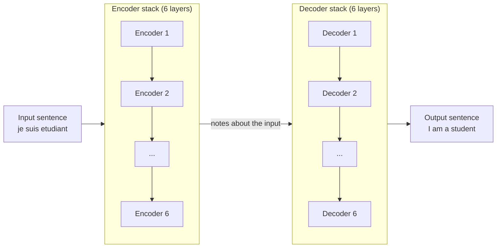

What is inside one layer?

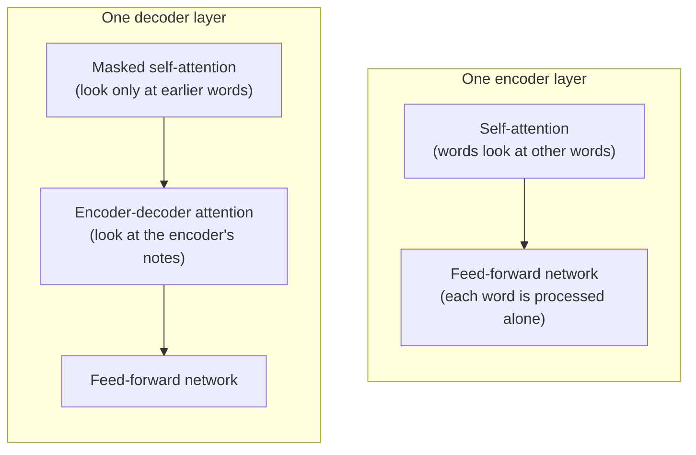

> Many modern chatbots (GPT, Claude and similar) use only the **decoder-style** part. The ideas below still apply.

---

## 2. Words become numbers

**ELI5.** Computers cannot read words. So we give every word a **secret code made of numbers**, like a nickname card. Words with similar meaning get similar cards.

**The real idea.**

- Each word is turned into a list of **512 numbers** (an *embedding*).
- Only the **first (bottom) encoder** gets these word embeddings. Every other encoder gets the output of the encoder below it.
- Every encoder takes a list of 512-number vectors, one per word.

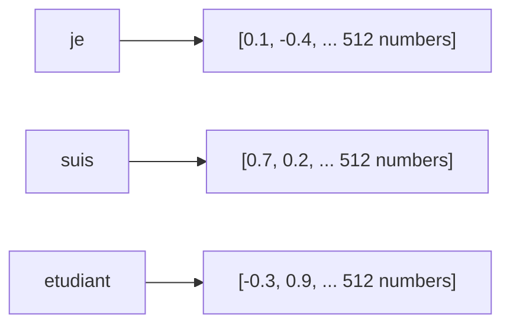

**Important detail.** Each word moves up through the encoder on its **own path**. Self-attention is the only place where these paths talk to each other. The feed-forward layer has no cross-talk, so all paths can be computed **in parallel**. This is why Transformers are fast to train.

---

## 3. Adding word order (positional encoding)

**ELI5.** If I shuffle the words "dog bites man" into "man bites dog", the meaning changes a lot. The model must know **who comes first**. So we stick a small **position sticker** on each word card: "I am word 1", "I am word 2", and so on.

**The real idea.**

- Self-attention by itself does not know order.
- So we **add** a *positional vector* to each word embedding. It has the same size (512) so the two can be added.
- The vectors follow a fixed pattern made of **sine and cosine waves**. Different positions get different patterns, and the model learns to read them.
- A nice benefit: the pattern can continue for sentences **longer** than any seen in training.

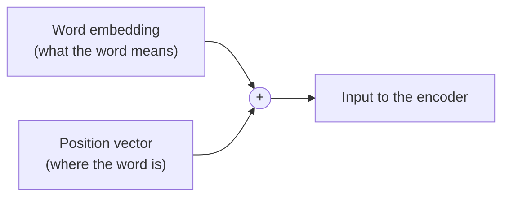

---

## 4. Self-attention: the heart of the Transformer

**ELI5.** Read this sentence:

> "The animal did not cross the street because **it** was too tired."

What is "it"? You know it means **the animal**, not the street, because streets do not get tired. Self-attention lets the computer do the same. While reading the word "it", the model **looks back at all the other words** and decides which ones matter most. It "pays attention" mostly to "animal".

**The real idea.** For each word, self-attention mixes in information from the other words. The more related a word is, the more it adds. The result is a new vector for "it" that already carries a bit of "animal" inside.

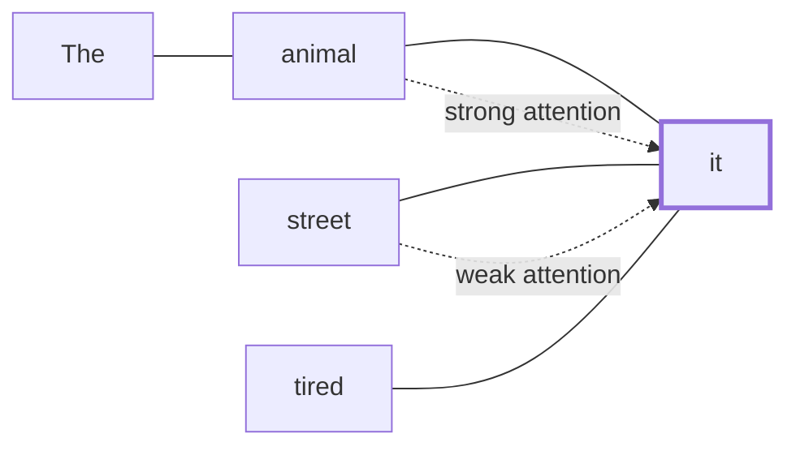

### The library idea: Query, Key and Value

Think of a library.

| Name | Library idea | What it does |
|---|---|---|
| **Query (Q)** | The question on your sticky note: "I need books about animals" | What this word is looking for |
| **Key (K)** | The label on the front of each book | What each word offers, used for matching |
| **Value (V)** | The content inside the book | The information that is actually passed on |

You compare your **query** with every **key**. Good matches get a high score. Then you read the **values** of the best matches.

Where do Q, K and V come from? Each word's 512-number vector is multiplied by **three weight tables** (called WQ, WK and WV). These tables are learned during training. Each result has **64** numbers. (64 is smaller than 512 by design. It keeps the cost of many heads about the same. It does not have to be smaller.)

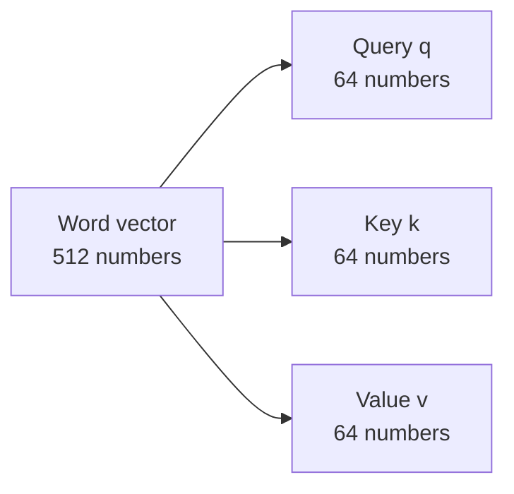

### The six steps (for one word)

Say we are computing the result for the word "it".

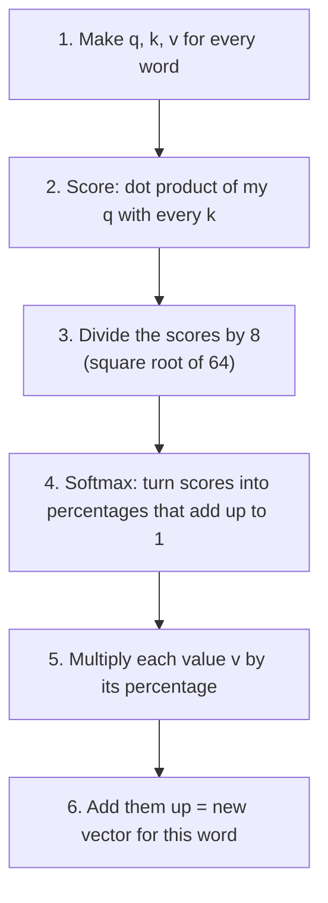

In simple words:

1. **Make Q, K, V** for each word.
2. **Score** every word: how well does my question match its label? (A *dot product* is just "multiply matching numbers and add them". Bigger means a better match.)
3. **Divide by 8.** This keeps the numbers from getting too big, so learning stays stable. (8 is the square root of 64.)
4. **Softmax.** This turns scores into percentages. All percentages are positive and add up to 100%.
5. **Weight the values.** Multiply each word's value by its percentage. Important words stay loud. Unimportant words get very quiet.
6. **Add** the weighted values. That is the output for this word.

---

## 5. Self-attention with a small calculation

Let us do it with tiny numbers so you can see it work. We use vectors with only **2 numbers** (instead of 64). We compute the result for "it" in the sentence with three words: **animal**, **street**, **it**. These numbers are made up for teaching.

| Word | Key k | Value v |
|---|---|---|
| animal | (3, 1) | (5, 1) |
| street | (0, 2) | (0, 4) |
| it | (1, 1) | (2, 2) |

Query of "it": **q = (2, 1)**

**Step 2: scores (dot product).**

| Compare q with | Calculation | Score |
|---|---|---|
| animal | 2x3 + 1x1 | 7 |
| street | 2x0 + 1x2 | 2 |
| it | 2x1 + 1x1 | 3 |

**Step 3: divide by square root of the key size.** Here the key size is 2, so we divide by 1.41 (in the real model we divide by 8).

| Word | Score / 1.41 |
|---|---|
| animal | 4.95 |
| street | 1.41 |
| it | 2.12 |

**Step 4: softmax** (make percentages).

| Word | Percentage |
|---|---|
| animal | **92%** |
| street | 3% |
| it | 5% |

**Steps 5 and 6: weight the values and add.**

```text
0.92 x (5, 1)  =  (4.60, 0.92)
0.03 x (0, 4)  =  (0.00, 0.12)
0.05 x (2, 2)  =  (0.10, 0.10)
                  -------------
new vector for "it" = (4.70, 1.14)
```

The new vector for "it" is almost the same as the value of "animal" (5, 1). So the word "it" now **carries the meaning of "animal"**. That is exactly what we wanted.

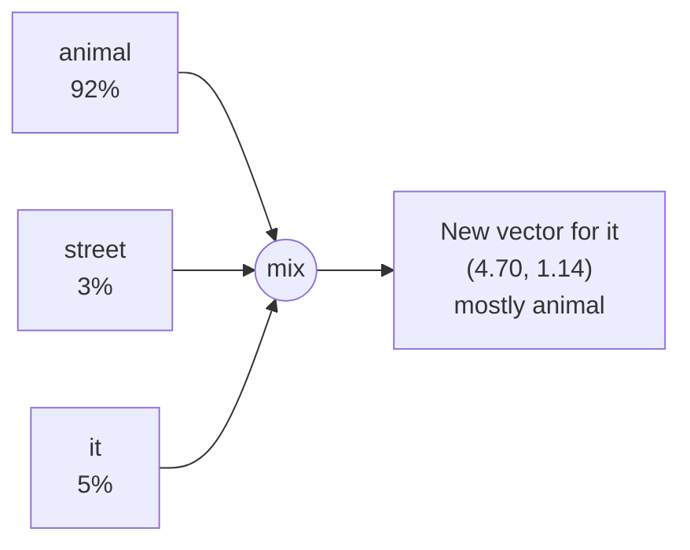

---

## 6. Self-attention for all words at once

**ELI5.** Instead of one kid doing the math word by word, the whole class does it **at the same time** using a big table.

**The real idea.** In real code we do not loop over words. We stack all the word vectors into a table (a *matrix*) **X**, with one row per word.

1. Multiply X by the three weight tables to get three tables: **Q, K, V**.
2. Compute everything in one line:

```text
Z = softmax( Q x K-transposed / 8 ) x V
```

`Z` has one new row per word. This is the same six steps from above, done for all words together. GPUs are very good at this kind of table math, which is why it is fast.

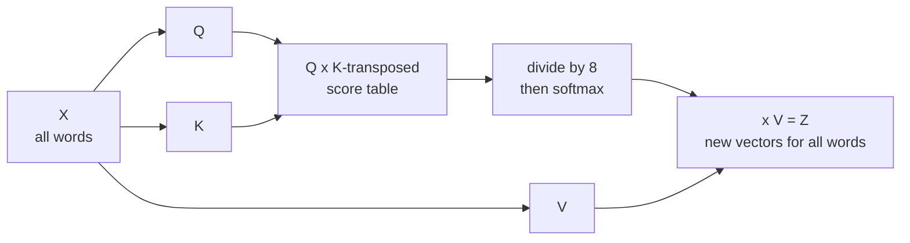

The score table has one row and one column per word. Row "it" shows how much "it" looks at each other word.

---

## 7. Many heads (multi-head attention)

**ELI5.** One pair of eyes may look at one thing only. Eight pairs of eyes can look at **eight different things**. One pair may watch "who did it?", another may watch "what happened?", another may watch "when?".

**The real idea.** The model does the attention calculation **8 times**, each with its **own** set of Q, K, V weight tables. Each run is called a *head*. Why?

1. Different heads can focus on **different words** (for example, one head links "it" to "animal", another links "it" to "tired").
2. Each head learns a **different way of looking** at the sentence (a different "representation subspace").

Steps:

1. Run 8 heads. You get 8 result tables (Z0 to Z7).
2. **Glue them side by side** (concatenate).
3. Multiply by one more weight table (**WO**) to shrink back to the normal size.
4. Send the result on to the feed-forward layer.

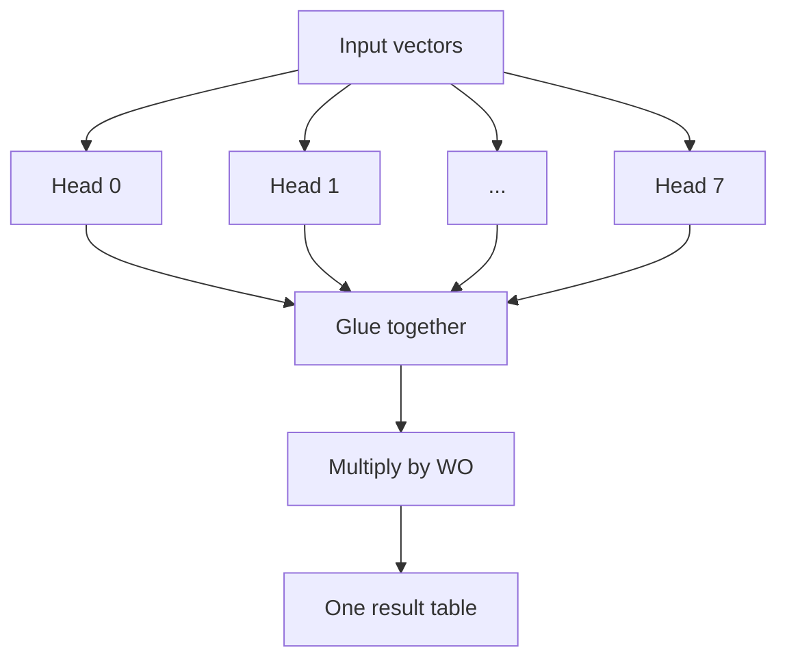

---

## 8. Residual connections and layer norm

**ELI5.** Imagine copying a drawing through 12 tracing papers. By the end it may be blurry. A **shortcut** lets the original drawing travel along the side, so you never lose it. Then a **tidy-up step** keeps all the numbers in a neat size range.

**The real idea.** Around **every** sub-layer (self-attention and feed-forward), two things happen:

1. **Residual connection:** add the sub-layer's *input* to its *output*. Information and learning signals can skip the layer, which makes deep networks easier to train.
2. **Layer normalization:** rescale the numbers so they stay in a healthy range.

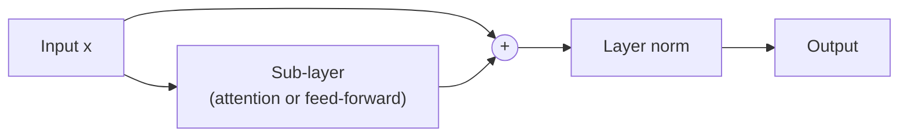

The decoder uses the same pattern around its sub-layers.

---

## 9. The feed-forward layer

**ELI5.** After the words have talked to each other (attention), each word goes to a small **private thinking room** to process what it just heard. Every word uses the **same room design**, but goes in alone.

**The real idea.** A small neural network is applied to **each position separately**, with the same weights for every position. Words do not mix here. Mixing happens only in attention.

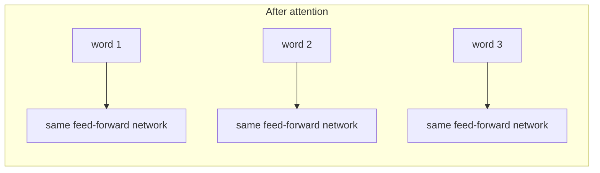

(The original paper makes the inside of this network 4 times wider than 512, which is 2048. This detail comes from the paper, not from the article.)

---

## 10. The decoder

**ELI5.** The decoder is the **writer**. It writes the answer **one word at a time**. For each new word it does two things: (1) it re-reads what it has written so far, and (2) it peeks at the reader team's notes (the encoder output).

### How the encoder hands over its notes

When the encoder stack finishes, its top output is turned into two sets of vectors, **K** and **V**. Every decoder layer uses them in its "encoder-decoder attention" step.

### Writing step by step

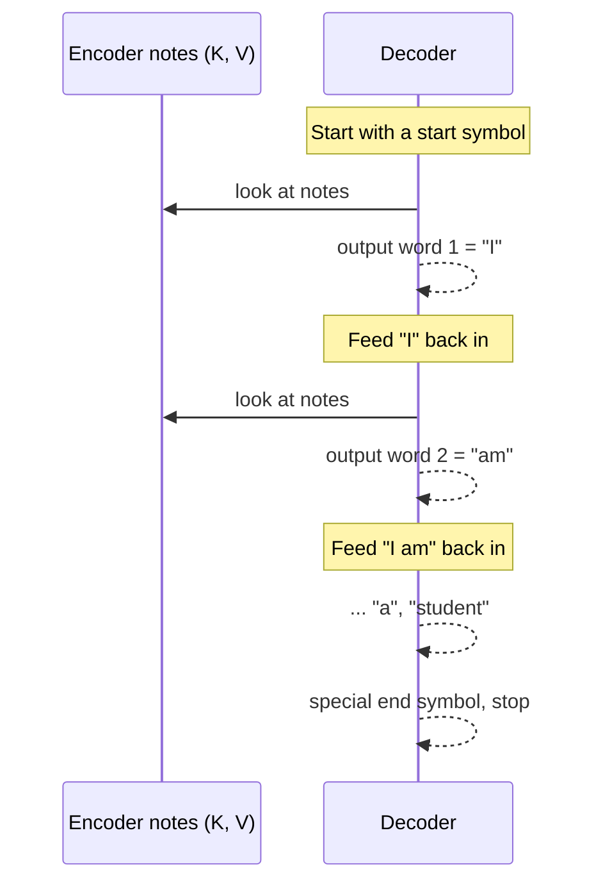

Each output word is fed back as input for the next step. The inputs also get embeddings and position vectors, just like on the encoder side.

### Two differences from the encoder

**1. Masked self-attention ("no peeking at the future").**
While writing word 3, the decoder must not look at word 4, because word 4 does not exist yet in real life. So we **hide** future positions. Technically, their scores are set to **minus infinity** before softmax, which makes their percentage exactly 0.

| Writing word | can see: I | am | a | student |
|---|---|---|---|---|
| I | yes | hidden | hidden | hidden |
| am | yes | yes | hidden | hidden |
| a | yes | yes | yes | hidden |
| student | yes | yes | yes | yes |

**2. Encoder-decoder attention ("ask the reader team").**
This works like multi-head attention, but the three parts come from different places:

- **Queries (Q)** come from the decoder layer below (the writer's question: "what do I need next?").
- **Keys (K) and Values (V)** come from the **encoder output** (the reader team's notes).

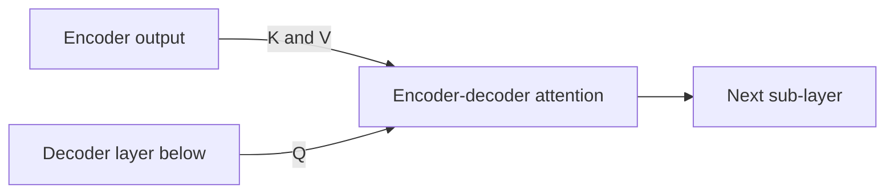

---

## 11. Picking the word: linear + softmax

**ELI5.** At the end, the decoder has a number list but we need a **word**. Think of a scoreboard with one box for every word in the dictionary. The model gives each word a score. We turn scores into percentages. We pick the word with the highest percentage.

**The real idea.**

1. **Linear layer:** a simple fully connected layer that turns the decoder's vector into a much longer list called **logits**. It has one score per word in the vocabulary (for example 10,000 words).
2. **Softmax:** turns logits into percentages (all positive, adding up to 100%).
3. Choose the word with the highest percentage for this step.

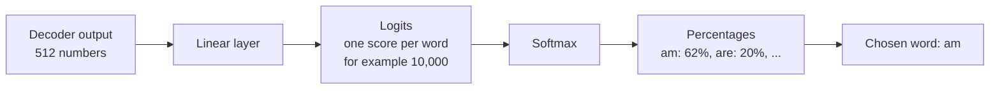

---

## 12. How the model learns (training)

**ELI5.** A student takes a quiz. The teacher knows the right answer. The student sees how wrong they were and adjusts their thinking. They repeat this a very large number of times until they get good.

**The real idea.** Training runs the same steps as above, but we **know the correct answer**, so we can measure the error.

### The toy vocabulary

Imagine a tiny dictionary with six words: `a`, `am`, `i`, `thanks`, `student`, `<eos>` (end of sentence). Each word can be written as a **one-hot vector**: a list with a 1 in its own spot and 0 everywhere else.

| Word | a | am | i | thanks | student | eos |
|---|---|---|---|---|---|---|
| **am** as one-hot | 0 | 1 | 0 | 0 | 0 | 0 |

### The loss

- The model outputs a percentage list for each position.
- The correct answer is a one-hot list (100% on the right word).
- A **loss function** measures how far apart the two lists are. (The usual choice is *cross-entropy*.)
- **Backpropagation** then nudges all the weights a tiny bit so next time the output is closer to the target.

Example: input `je suis etudiant`, target `i am a student <eos>`. That is five output positions, and each one has a target that peaks at the correct word.

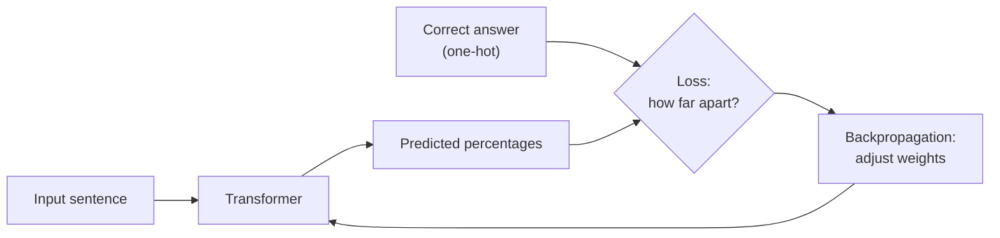

After many examples, the model puts most of the percentage on the right word. Real vocabularies are much bigger (about 30,000 to 50,000 words or word pieces).

---

## 13. Greedy search and beam search

Once the model is trained, how do we choose the output words?

**Greedy search.** At each step, pick the single best word and forget the rest. It is simple and fast, but one early mistake can ruin the sentence.

**Beam search.** Keep several good candidates alive at the same time.

- `beam_size` = how many partial sentences to keep at each step (for example 2).
- `top_beams` = how many finished sentences to return (for example 2).

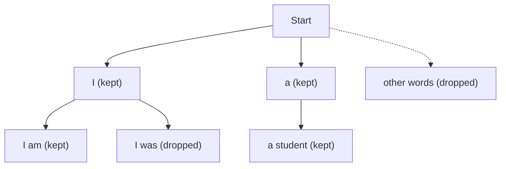

At every step, extend each kept sentence with every possible next word, score the results, and keep only the best `beam_size`. Beam search often gives better sentences than greedy search because it can recover from a weak first choice.

---

## 14. Cheat sheet and glossary

### The numbers in the original paper

| Item | Value |
|---|---|
| Encoder layers | 6 |
| Decoder layers | 6 |
| Word vector size | 512 |
| Query, key, value size per head | 64 |
| Number of heads | 8 |
| Divide scores by | 8 (square root of 64) |
| Feed-forward inner size (from the paper) | 2048 |

### One-paragraph summary

Words become number lists and get a position sticker. In **self-attention**, every word asks a question (**Query**), compares it with the labels (**Keys**) of all words, turns scores into percentages, and mixes in the contents (**Values**) of the best matches. Eight **heads** do this in parallel from different angles. A **residual shortcut** and **layer norm** keep training stable, and a **feed-forward** network processes each word alone. This is repeated through a stack of layers. The **decoder** adds a **mask** (no peeking ahead) and **encoder-decoder attention** (look at the encoder's notes). A **linear layer + softmax** picks the next word. The model learns by comparing its guess with the right answer and adjusting its weights.

### Glossary

| Word | Simple meaning |
|---|---|
| Token / word piece | A small chunk of text the model reads |
| Embedding | A list of numbers that stands for a word's meaning |
| Attention | Looking at other words and deciding how much each one matters |
| Query, Key, Value | The question, the label, and the content in the library idea |
| Dot product | Multiply matching numbers and add them up; a match score |
| Softmax | Turns any scores into percentages that add up to 100% |
| Head | One separate copy of the attention calculation |
| Mask | A hide-the-future rule so the model cannot cheat |
| Residual connection | A shortcut that adds the input to the output |
| Layer norm | A tidy-up step that keeps numbers in a healthy range |
| Logits | The raw scores for every word in the dictionary |
| Loss | A number that says how wrong the model was |
| Backpropagation | The method that adjusts weights to reduce the loss |
| Beam search | Keeping several good candidate sentences while decoding |

---

## Go further

- [The Illustrated Transformer (Jay Alammar)](https://jalammar.github.io/illustrated-transformer/) - the original article this page follows, with his pictures.
- [Attention Is All You Need (2017)](https://arxiv.org/abs/1706.03762) - the research paper.
- [The Annotated Transformer (Harvard NLP)](https://nlp.seas.harvard.edu/annotated-transformer/) - the paper with working code, line by line.
- [Hugging Face: How to generate text](https://huggingface.co/blog/how-to-generate) - greedy, beam search and sampling.
- [Back to chapter 2](README.md)
