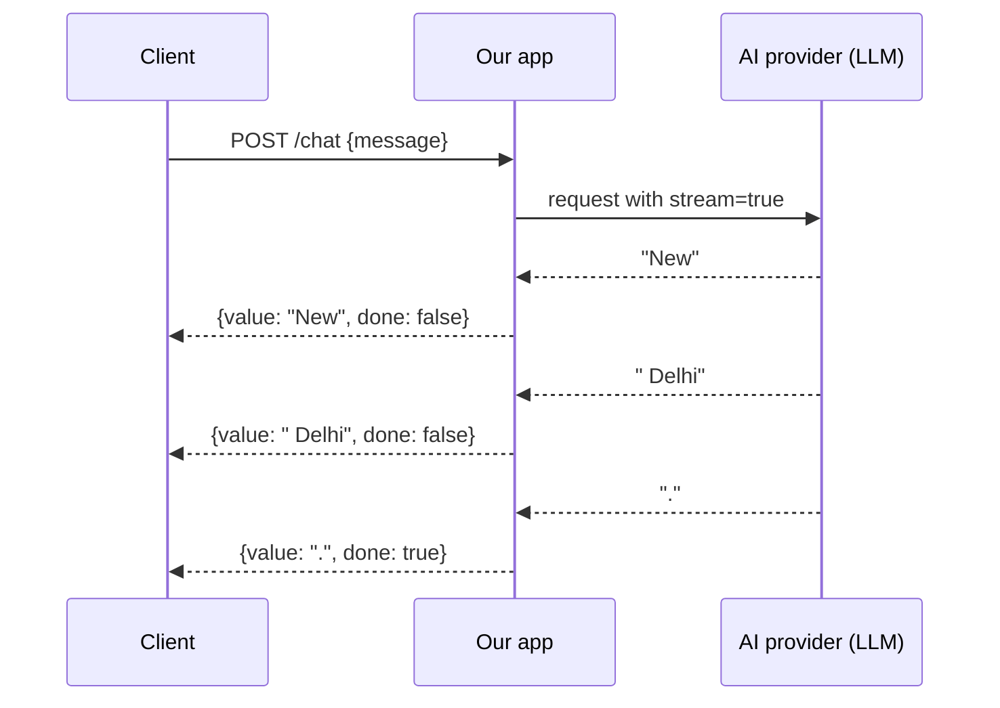
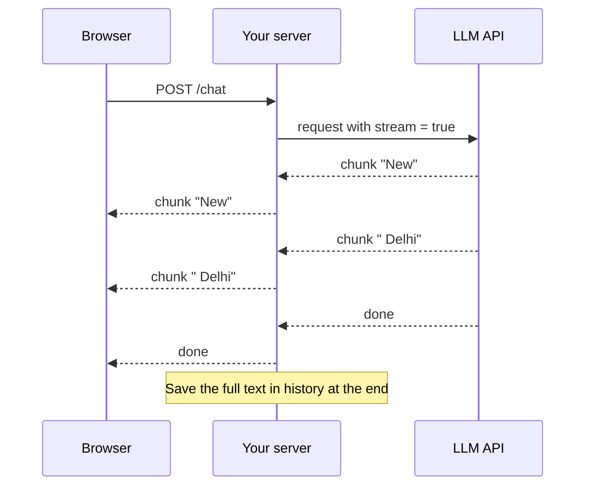

# 6. Build ChatGPT-Style Streaming: How AI Streaming Works

> **In plain words:** Streaming means showing the answer word by word while the model is still writing it. The user sees the first words in under a second, instead of waiting for the full answer.

## The problem: waiting for the whole answer

A normal request waits until the model finishes. If generation takes about **8 seconds**, the user stares at a blank screen for 8 seconds. ChatGPT feels fast because words appear as they are produced.

| Metric | Meaning |
|---|---|
| **Time to first token (TTFT)** | How long until the first piece appears |
| **Total generation time** | How long until the whole answer is done |

Streaming does not shorten total time much; it slashes **TTFT**, which is what users perceive.

## Two hops, both can stream

1. **LLM to our app**: the provider SDK streams events (the Python demo reads `response.output_text.delta` events).
2. **Our app to the client**: the server forwards each chunk as it arrives instead of buffering.

The Python demo also **accumulates** the full text while yielding chunks, then stores it in history once finished, so memory still works.

## Transport choices

| Option | Direction | Fit |
|---|---|---|
| **SSE / streaming HTTP** (Server-Sent Events) | Server to client only | Simple; ideal for token streams |
| **WebSockets** | Two-way | More power, more complexity; useful for rich real-time apps |

Chunk shape: `{ value: "New", done: false }`, with `done: true` on the last one so the UI knows to stop.

## Picture it

### Without streaming and with streaming

```mermaid
gantt
  title Time until the user sees text (example)
  dateFormat  s
  axisFormat %S s
  section No streaming
  Model writes full answer :a1, 0, 8s
  User sees everything     :milestone, 8, 0s
  section Streaming
  Model writes answer      :b1, 0, 8s
  First words appear       :milestone, 1, 0s
```

### How chunks travel

### Which transport?

| Option | Direction | Good for | Note |
|---|---|---|---|
| Server-Sent Events (SSE) | Server to browser | Chat answers | Simple, works over HTTP |
| Chunked fetch stream | Server to browser | Chat answers | Read with the Streams API |
| WebSocket | Both ways | Live, two-way apps | More work to run |

## Key points to remember

- Streaming improves **perceived speed** (TTFT), not necessarily total time.
- Forward chunks as they arrive; do not buffer on the server.
- SSE is usually enough for one-way token streaming; WebSockets are for two-way needs.
- Collect the complete response server-side to save it to history.
- Plan for client disconnects and errors mid-stream.

## Interview angles

- "Why stream LLM output?": lower TTFT; the user can start reading, and can cancel early.
- "SSE or WebSockets?": SSE for simple one-way streaming; WebSockets when you need bidirectional messaging.
- "What can go wrong mid-stream?": partial answers, dropped connections, and needing to persist only completed messages.

## Further reading

- [OpenAI: Streaming responses](https://platform.openai.com/docs/guides/streaming-responses) - Stream events from the OpenAI API.
- [Anthropic: Streaming Messages](https://docs.anthropic.com/en/api/messages-streaming) - Stream events from the Claude API.
- [MDN: Using server-sent events](https://developer.mozilla.org/en-US/docs/Web/API/Server-sent_events/Using_server-sent_events) - How SSE works in the browser.
- [MDN: Streams API](https://developer.mozilla.org/en-US/docs/Web/API/Streams_API) - Read a response piece by piece.
- [MDN: WebSockets API](https://developer.mozilla.org/en-US/docs/Web/API/WebSockets_API) - Two-way live connection.
- [FastAPI: StreamingResponse](https://fastapi.tiangolo.com/advanced/custom-response/#streamingresponse) - Stream from a Python backend.
