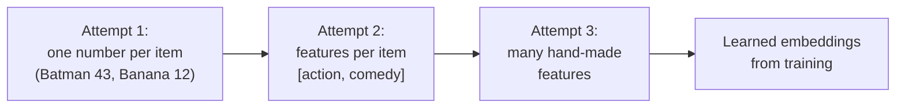
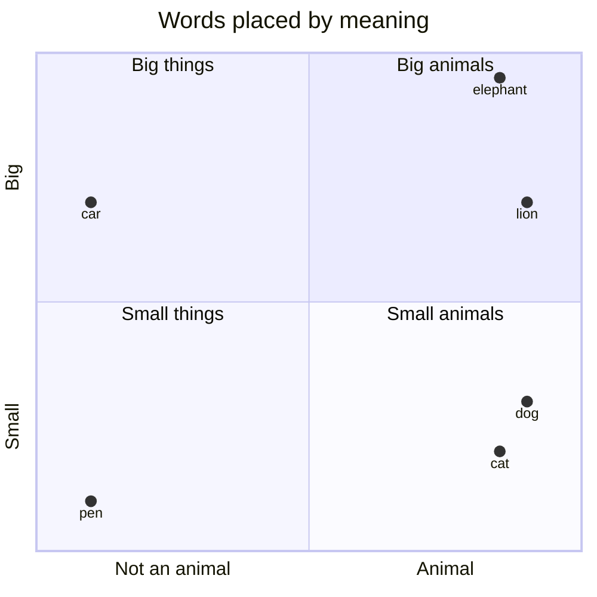
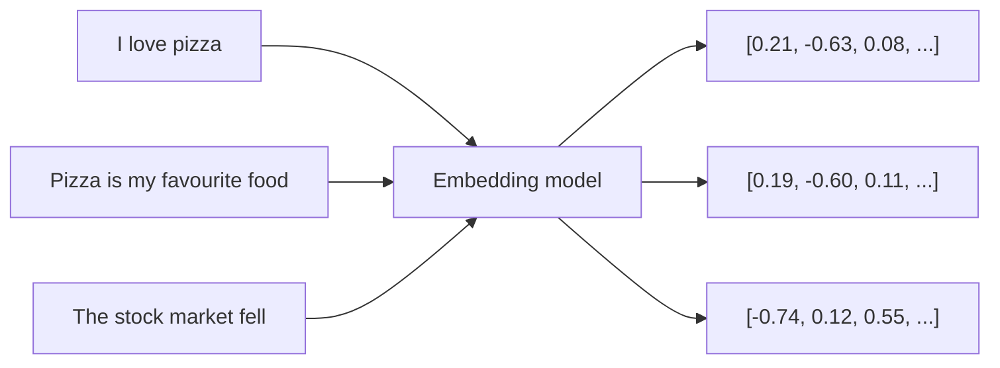

# 7. Vectors and Embeddings: How AI Understands Meaning

> **In plain words:** An embedding turns text into a list of numbers. Texts with similar meaning get lists that are close to each other. This lets a computer search by meaning, not just by exact words.

## Why we need "meaning" as numbers

Computers compare things exactly: `"Batman" == "Batman"` is true, `"Batman" == "Superman"` is false. But "I forgot my password" and "I lost my credentials" mean nearly the same. We want **similarity**: Batman is closer to Superman than to Banana. Numbers allow maths (addition, multiplication, distances, angles, probabilities); labels do not.

## Building up to embeddings

1. **One number per item** (Batman 43, Superman 23, Banana 12): arbitrary; the distance means nothing.
2. **Scores on meaningful features.** The "1990s Netflix" idea: rate movies on Action (Avengers 10, Batman 9, Interstellar 6, Titanic 2, Hera Pheri 2). Similarity can be `|10 - 9| = 1`. Add a second axis, Comedy, and movies become **points**: Avengers `[10, 7]`, Hera Pheri `[2, 10]`.
3. **More features**: action, comedy, romance, darkness, violence, mystery. Batman `= [9, 1, 2, 9, 8, 7]`. Each item is now a **vector** in a high-dimensional space.

## Measuring similarity

| Measure | Formula / idea | Reading |
|---|---|---|
| **Euclidean distance** | `sqrt((x2-x1)^2 + (y2-y1)^2)` | Smaller means closer |
| **Dot product** | `A.B = |A||B| cos(theta)` | Mixes angle and magnitude |
| **Cosine similarity** | `A.B / (|A||B|)`, range -1 to +1 | 1 = same direction, 0 = unrelated, -1 = opposite |

## Why hand-crafted features fail

| Problem | Detail |
|---|---|
| **How many dimensions?** | Action, thriller, romance, comedy, sci-fi ... plus "space? family? time? VFX?" It never ends |
| **Features depend on the problem** | Movies need box office, budget, actor popularity; houses need different ones |
| **Natural language** | What are the features of "bank"? Building height? Money? River? Words have no obvious fixed feature list |

This is called **feature engineering**, and it does not scale.

## Learned embeddings: let the machine find the features

Instead of designing features, **learn** the vectors. Give each word a random starting vector (`king = [0.2, -0.7]`, `queen = [-0.8, 0.3]`, `banana = [0.9, 0.1]`, `apple = [-0.1, -0.5]`) and train a model so useful relationships emerge.

**Training idea (self-supervised):** "You shall know a word by the company it keeps."

- "The king wears a crown", "The king lives in a palace", "The queen wears a ____".
- "I ate a banana", "The banana is a fruit", "The apple is a fruit".

Loop: feed input (king), the model predicts, compare with the right output (queen), measure the **error/loss**, **adjust parameters**, repeat across huge text. Words used in similar contexts drift to similar vectors. Result:

- `similarity(king, queen)` is high, `similarity(king, banana)` is low.
- The dimensions are **latent**: not named by humans, discovered by the model. Typical size: hundreds to thousands (for example **1024** dimensions).

The tool that does this is an **embedding model**: text in, vector out.

## Picture it

### A tiny map of meaning (example)

Real embeddings have hundreds or thousands of dimensions, not two. The idea is the same: near means similar.

### From text to a number list

The first two lists are close. The third is far away.

### Reading the cosine score

| Cosine similarity | Meaning |
|---|---|
| Close to 1 | Very similar meaning |
| Around 0 | Not related |
| Close to -1 | Opposite direction |

## Key points to remember

- An **embedding** is a vector that places an item so that similar meaning means nearby position.
- **Cosine similarity** is the standard way to compare embeddings (direction, not length).
- Hand-built features do not scale to language; **learned latent features** do.
- Embedding models are trained to predict context, so "company a word keeps" defines meaning.

## Interview angles

- "What is an embedding?": a learned vector representation where distance reflects semantic similarity.
- "Cosine vs Euclidean?": cosine ignores magnitude and compares direction; common for text embeddings.
- "Why can't we hand-design embeddings?": too many features, problem-specific, language is open-ended.

## Further reading

- [Efficient Estimation of Word Representations in Vector Space (word2vec)](https://arxiv.org/abs/1301.3781) - The paper that made word embeddings popular.
- [Jay Alammar: The Illustrated Word2vec](https://jalammar.github.io/illustrated-word2vec/) - Easy pictures of how embeddings are learned.
- [Google Machine Learning Crash Course: Embeddings](https://developers.google.com/machine-learning/crash-course/embeddings) - Free lesson with exercises.
- [OpenAI: Embeddings guide](https://platform.openai.com/docs/guides/embeddings) - Create and use embeddings with an API.
- [Wikipedia: Cosine similarity](https://en.wikipedia.org/wiki/Cosine_similarity) - The formula and its meaning.
