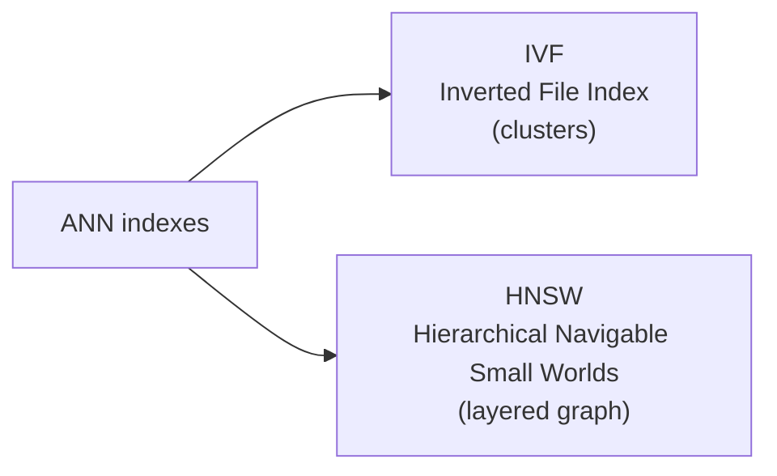
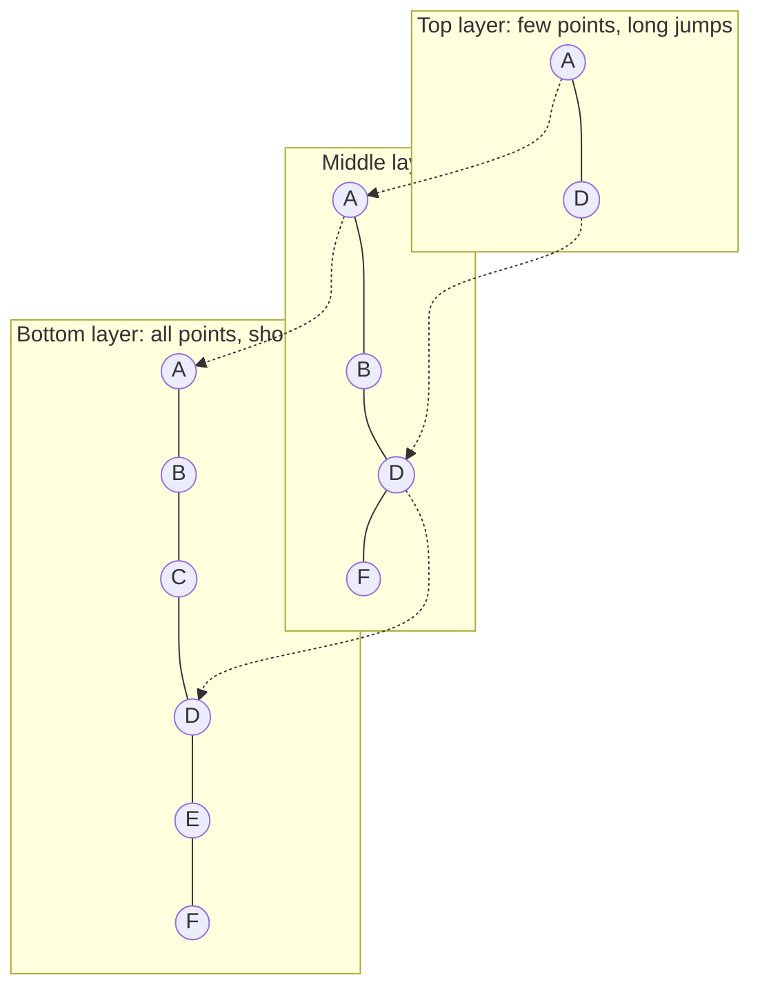
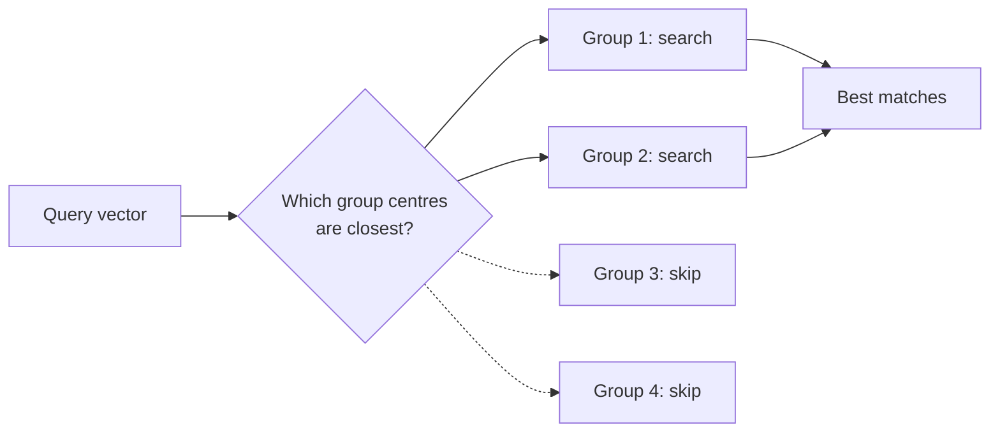
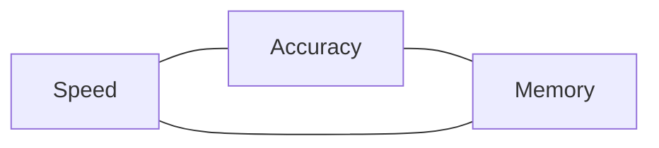

# 10. How Vector Databases Actually Work: ANN, HNSW, IVF and Product Quantization

> **In plain words:** Vector databases search approximately. They use smart structures such as HNSW (a layered graph) or IVF (groups of nearby vectors). They also shrink vectors with product quantization (PQ) to save memory.

## Exact vs approximate

Exact **KNN** compares the query to all `N` vectors (100M vectors x 1536 dims is about 150 billion multiplications per query). Real systems accept **ANN, Approximate Nearest Neighbours**: return neighbours that are *almost* the true ones, far faster.

Analogy: Rohit in Delhi wants the nearest coffee shop; he does not measure to every shop in India.

### Recall@K: how "approximate" is measured

True top 10 (KNN) = A B C D E F G H I J. ANN returned A B C D **X** F G H I **Y**. Eight match, so **Recall@10 = 8/10 = 80%**. Production targets are often around 95%+.

## Two main ANN families



### IVF (Inverted File Index): cluster, then search only nearby clusters

1. **Offline:** run **k-means** to group the vectors into clusters, each with a **centroid**. Example: 1,000,000 vectors in 1000 clusters, about 1000 vectors each.
2. **Query:** compare `Q` with the 1000 centroids (cheap), pick the nearest cluster(s), and search only the vectors inside them (about 1000 instead of 1,000,000).
3. **Caveat:** the true neighbour may sit just across a boundary in another cluster. So **probe several clusters** (for example 5), trading a bit of speed for recall.

### HNSW: a road network for vectors

Like roads: highways between cities (Delhi to Mumbai), then city roads, then streets. A graph with **layers**:

1. Start at the **top layer** with few nodes; make **large jumps** toward the query.
2. When no neighbour is closer, **drop a layer** and continue with smaller jumps.
3. At the bottom layer, a **fine-grained search** lands on the nearest vectors.

Each node stores its vector, metadata and **neighbours**. Alphabet picture: scanning A-B-C-...-Z one by one versus hopping A-F-M-Z then refining.

| | IVF | HNSW |
|---|---|---|
| Idea | Partition space into clusters | Layered proximity graph |
| Comparisons | Only inside chosen clusters | Follows graph edges |
| Memory | Modest | Higher (stores graph links) |
| Tuning | Number of clusters and probes | Graph connectivity, search breadth |

## Memory problem: 100M vectors need about 614 GB

`100,000,000 x 6 KB` is roughly **614 GB** (float32). Compression:

- **Reduce precision:** float32 to float16 to int8.
- **Product Quantization (PQ):** split each vector into chunks, replace each chunk with the ID of its nearest **centroid** in a **codebook**.

### Product Quantization worked through

Small example: an 8-d vector, 4 bytes each = 32 bytes. Split into 4 sub-vectors of 2 dims. For each sub-space, cluster training data (e.g. `A=[0.20,0.80]`, `B=[0.21,0.82]`, `C=[0.18,0.84]` collapse to centroid `C0=[0.20,0.81]`). Store the vector as centroid IDs, `[C0, C1, C17, C23]` becomes `[0, 1, 17, 23]`. With **256 centroids per sub-space, an ID fits in 1 byte** (2^8), so 32 bytes become 4 bytes (**8x** smaller).

At full size: 1536 dims split into **96 chunks of 16 dims**; each chunk becomes 1 byte, so a vector is **96 bytes instead of 6144** (**64x** smaller). It is **lossy** compression: you trade a little accuracy.

## Putting it together

A vector DB record looks like `{ id: "m1", embedding: [...], metadata: { movieName, desc, releaseDate ... } }`. It supports Euclidean, cosine and dot product; uses ANN (IVF, HNSW) for speed and PQ for memory. Example products: **Pinecone, Qdrant, Weaviate**, and **PostgreSQL with pgvector**:

```sql
SELECT * FROM movies
ORDER BY embedding <=> :queryVector   -- distance operator in pgvector
LIMIT 3;
```

## Picture it

### HNSW: take big jumps first, then small steps



Search starts at the top, moves to the closest point, goes down a layer, and repeats until the bottom.

### IVF: search only the nearest groups



The setting `nprobe` says how many groups to search. More groups means better accuracy and slower speed.

### Product quantization: smaller vectors

| Step | Example |
|---|---|
| Original vector | 1,536 numbers x 4 bytes = 6,144 bytes |
| Cut into pieces | 96 pieces of 16 numbers |
| Replace each piece with a 1-byte code | 96 bytes in total |
| Saving | about 64 times smaller |
| 100 million vectors | about 9.6 GB, not 614 GB |

### Speed, accuracy, memory: pick two



## Key points to remember

- **ANN** trades a little accuracy (measured by **recall@K**) for massive speed.
- **IVF** = cluster then search near clusters. **HNSW** = hop through a layered graph.
- **PQ** compresses vectors (up to 64x here) at the cost of precision.
- Vector DBs add **metadata** so you can combine similarity with filters.

## Interview angles

- "How does HNSW work?": top layers for coarse long jumps, lower layers for refinement.
- "IVF vs HNSW?": IVF partitions and probes; HNSW follows graph links and is usually faster/higher recall at higher memory cost.
- "How do you cut vector storage?": lower precision, product quantization, fewer dimensions.
- "How do you evaluate an ANN index?": recall@K against exact KNN, plus latency and memory.

## Further reading

- [Efficient and robust approximate nearest neighbor search using HNSW graphs](https://arxiv.org/abs/1603.09320) - The HNSW paper.
- [Product Quantization for Nearest Neighbor Search](https://inria.hal.science/inria-00514462v2/document) - The PQ paper.
- [FAISS wiki](https://github.com/facebookresearch/faiss/wiki) - Guides to IVF, PQ and HNSW indexes.
- [Pinecone: Hierarchical Navigable Small Worlds (HNSW)](https://www.pinecone.io/learn/series/faiss/hnsw/) - Pictures and code for HNSW.
- [Qdrant documentation](https://qdrant.tech/documentation/) - A vector database with good guides.
- [Weaviate documentation](https://weaviate.io/developers/weaviate) - Another vector database.
- [pgvector](https://github.com/pgvector/pgvector) - HNSW and IVF inside PostgreSQL.
