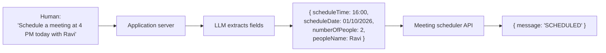
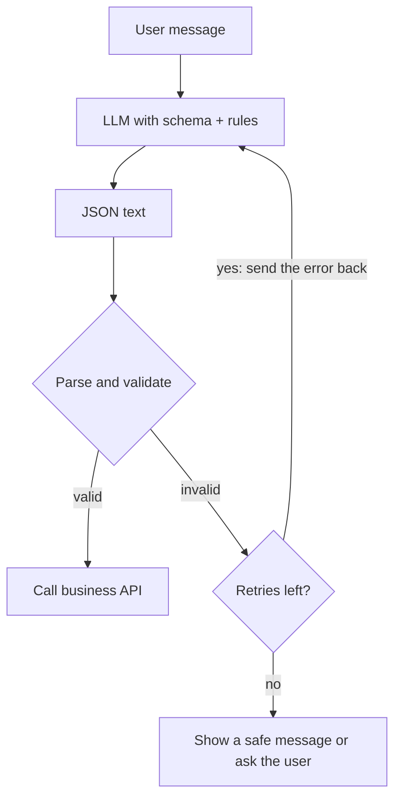

# 13. Structured Outputs in LLMs: Responses Applications Can Use

> **In plain words:** Apps need data in a fixed shape such as JSON, but LLMs write free text. Structured output makes the model return data that matches a schema you define, so your code can use it safely.

## The gap between humans and APIs

Applications talk in **structured data**: `POST /user/details` with `{name, email, mobile}`, or `POST /schedule` with `{username, visitors, timeOfMeet}`. Humans talk in sentences: "Schedule a meeting at 4 PM today with Ravi."

An LLM can bridge the two: it turns free text into the exact structure your backend expects.



## How it is done

1. Define the target type, for example `MeetingDetails { scheduleTime, scheduleDate, numberOfPeople, peopleName }`.
2. Tell the model the rules in the **system prompt**. The demo prompt says (in effect): extract meeting info; today's date is given; convert relative dates (today, tomorrow) to `yyyy-MM-dd`; time to 24-hour `HH:mm`; create a simple title if missing; default duration 30 minutes; **do not invent** attendee, date or time; leave blank if missing.
3. Ask the model API for output **in that schema** (the Python demo uses `responses.parse(..., text_format=MeetingDetails)`; Spring maps straight onto a Java class), and get back a typed object, not a string to hand-parse.

Without a schema, answers like "Sure! The meeting is at 4 PM" are unusable by code.

## Pitfalls and rules

- **Inject context the model cannot know** (today's date) or "tomorrow" cannot be resolved.
- Tell it **not to guess** missing fields; validate afterwards.
- Treat output as untrusted input: validate types and ranges before calling business APIs (see chapter 19).
- The system prompt can also carry data (name, address, skills) so the model can fill fields from known context.

## Picture it

### Free text versus structured data

```text
Free text:   "Sure! Book a table for Ravi, two people, tomorrow at 4 pm."
Structured:  { "personName": "Ravi", "people": 2, "date": "2026-10-01", "time": "16:00" }
```

### Safe flow with validation



### A schema (the contract)

```json
{
  "type": "object",
  "properties": {
    "personName": { "type": "string" },
    "people":     { "type": "integer", "minimum": 1, "maximum": 20 },
    "date":       { "type": "string", "format": "date" },
    "time":       { "type": "string" }
  },
  "required": ["personName", "people", "date", "time"]
}
```

### Tools by language

| Language | Schema tool |
|---|---|
| Python | Pydantic |
| JavaScript / TypeScript | Zod |
| Java | Records or classes with Jackson |

## Key points to remember

- Structured output turns an LLM into a **text-to-API adapter**.
- Define a **schema/type**, state extraction rules, and let the SDK parse into typed objects.
- Give the model the **current date** and forbid invention.
- Always validate before acting.

## Interview angles

- "How do you get reliable JSON from an LLM?": schema-constrained output or parsing APIs plus validation and retries.
- "Why is 'tomorrow' a trap?": the model needs today's date supplied.
- "Where would you use this?": ticket creation, form filling, meeting scheduling, data extraction from emails.

## Further reading

- [OpenAI: Structured Outputs](https://platform.openai.com/docs/guides/structured-outputs) - Force the model to follow a JSON schema.
- [Anthropic: Tool use overview](https://docs.anthropic.com/en/docs/agents-and-tools/tool-use/overview) - Get JSON from Claude by defining a tool.
- [JSON Schema: Understanding JSON Schema](https://json-schema.org/understanding-json-schema) - How to write schemas.
- [Pydantic documentation](https://docs.pydantic.dev/latest/) - Validate data in Python.
- [Zod](https://zod.dev/) - Validate data in TypeScript.
