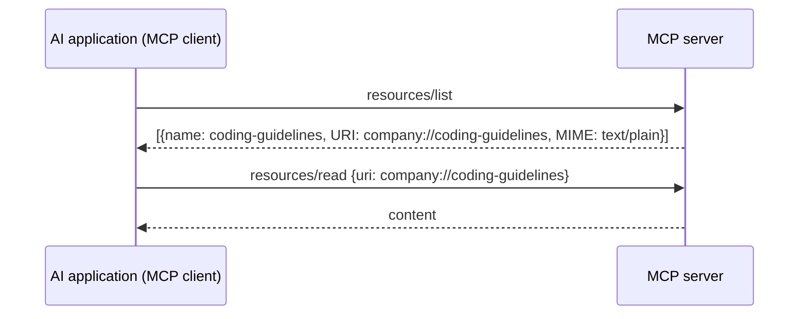
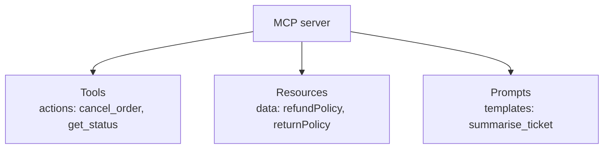
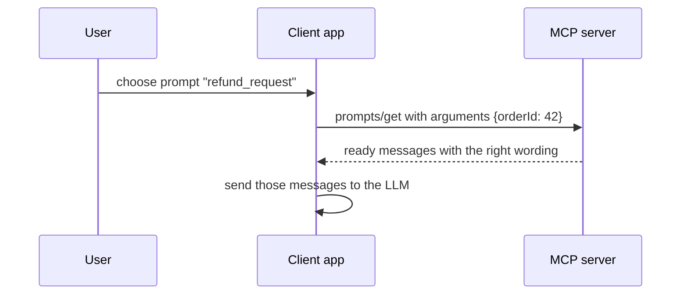

# 15. MCP Resources and Prompts Explained: Beyond MCP Tools

> **In plain words:** An MCP server can offer three things. Tools are actions the model can call. Resources are data the app can read. Prompts are ready-made instruction templates that the user can pick.

## Recap

An MCP server exposes **Tools**, **Resources** and **Prompts**. Tools (chapter 14) are discovered with `tools/list` and run with `tools/call`. This chapter covers the other two, with their own calls: `resources/list` and `resources/read`, and `prompts/list` and `prompts/get`.

## Resources: data the client can discover and read

> An MCP **Resource** is data or content exposed by an MCP server that a client can discover and read as context.

A resource has: **name, description, URI, MIME type** (`text/plain`, `application/json`, `text/html`, `image/png`) and **content**.

- **URI vs URL:** a resource URI such as `company://coding-guidelines` is an **identifier within the MCP server**, not necessarily a web address.
- **Dynamic resources:** URIs can be templates, such as `user://123/profile`, backed by code (for example `getInfoById()` reading MySQL) so each ID returns live data.

### Who controls what?

| Primitive | Controlled by | Meaning |
|---|---|---|
| **Tools** | **The LLM** | The model decides when to call them |
| **Resources** | **The AI application** | The app (or user) decides which context to load |
| **Prompts** | **The user** | The user picks a template |

### Why resources, not just tools or RAG?

Typical uses:

1. **Provide extra context chosen by the user in the UI**, for example the user attaches `src/order.java` and asks "Explain the `createOrder` function".
2. The AI application may **already have the context** (known files or records) and only needs to fetch it.
3. For large bodies, the app can still **chunk (RAG)** before giving it to the LLM.

So resources supply *known, explicitly selected* context; RAG finds *unknown* relevant context by search.

## Prompts: reusable instruction templates

Think "Plan my day" or "Review my workload": a saved, parameterised instruction the user can trigger, like a slash command (`/plan?hours=4`).

1. Client calls `prompts/list` to see the available prompts.
2. User picks one and supplies arguments (`hours = 4`).
3. Client calls `prompts/get` with `name` and `arguments`; the server returns the filled-in prompt messages, which go to the LLM.

Benefit: prompt engineering lives on the server once, and **many clients reuse the same vetted prompt**.

## Picture it

### Three building blocks

### Who decides to use each one

| Building block | Who controls it | Example | Methods |
|---|---|---|---|
| Tool | The model | "Cancel order 42" | `tools/list`, `tools/call` |
| Resource | The application | Show the refund policy file as context | `resources/list`, `resources/read` |
| Prompt | The user | Pick "Summarise this ticket" from a menu | `prompts/list`, `prompts/get` |

### A prompt template in action

### Simple rule

Need the model to **do** something? Use a tool. Need to give it **information**? Use a resource. Need a **repeatable instruction**? Use a prompt.

## Key points to remember

- **Resources = content to read** (`resources/list`, `resources/read`, addressed by URI, typed by MIME).
- **Prompts = reusable templates with arguments** (`prompts/list`, `prompts/get`).
- Control model: **Tools LLM-controlled, Resources application-controlled, Prompts user-controlled**.
- Resources can be **static or dynamic** (URI templates backed by a database call).

## Interview angles

- "When would you use a resource over a tool?": when the app/user chooses what context to supply (attach a file) rather than letting the model decide.
- "Explain the three MCP primitives and who controls each.": tools (model), resources (application), prompts (user).
- "Resource vs RAG?": explicit selection versus similarity search; they combine well.

## Further reading

- [MCP Specification: Resources](https://modelcontextprotocol.io/specification/latest/server/resources) - How resources are listed and read.
- [MCP Specification: Prompts](https://modelcontextprotocol.io/specification/latest/server/prompts) - How prompts are listed and used.
- [MCP Specification: Tools](https://modelcontextprotocol.io/specification/latest/server/tools) - How tools are listed and called.
- [Model Context Protocol: Introduction](https://modelcontextprotocol.io/introduction) - Official overview.
- [MCP reference servers](https://github.com/modelcontextprotocol/servers) - Working examples to read.
