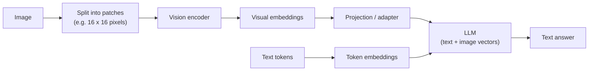
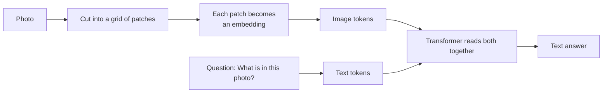
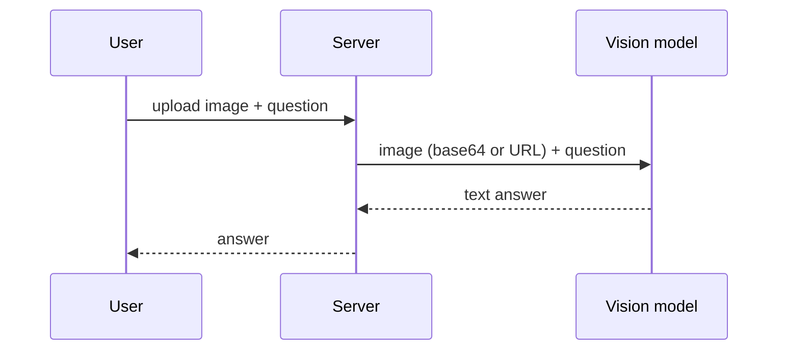

# 16. How AI Understands Images: Build a Multimodal AI App

> **In plain words:** A multimodal model can read more than text, such as images. It cuts the image into small patches, turns each patch into numbers, and reads them together with your question. The model can then describe or answer questions about the image.

## Multimodality

A **multimodal** model accepts more than text: text plus images in, text out (`/chat` with "What is this?" and `cat.png` returns "a cat"). Different from "multi-model" (several separate models).

## Approach 1 (old): convert the image to text first

Use **OCR (Optical Character Recognition)** to turn a screenshot such as `error.png` into `error.txt`, then send the text to a plain LLM. Works for printed text, but it **loses everything that is not text**: layout, charts, colours, objects, the cat.

## Approach 2 (native): let the model "see"

### From pixels to vectors

- An image is a grid of **pixels**; each has **R, G, B** values (for example R 255, G 120, B 30). A 1920 x 1080 image is over two million pixels, far too many to feed directly.
- Split into **patches** (for example 16 x 16 pixels each). A patch might show "a cat's ear", "fur", "eyes", "background".
- A **vision encoder** converts each patch into a **visual embedding** (`[0.28, -0.11, 0.81, ...]`), the image-side equivalent of a token embedding.
- **Patch position** is added (top-left, bottom-right) just as text tokens need positions.
- Raw images may be **compressed or resized** first to bound cost.

### Joining text and image

Text path: `"cat" -> tokenizer -> token ID -> embedding -> [0.31, -0.18, 0.77, ...]`. Image path ends in a similar vector (`ear -> vision encoder -> [0.28, -0.11, 0.81, ...]`). A **projection/adapter** maps visual vectors into the **same space** the LLM uses for text, so the LLM can attend over text and image patches together.

How it learns: from **images paired with descriptions** ("This is a cat" with `cat.png`), so visual patterns line up with language concepts. The LLM supplies language concepts; the encoder supplies visual patterns.

Same lesson as the word "bank" in chapter 2: context decides meaning, and here it applies across modalities.

## Building the app

The demo accepts an image upload plus a question, sends both to a vision-capable model, and returns the text answer. Practical points: limit file size and type, resize before upload, and remember images consume many tokens.

## Picture it

### How an image becomes tokens

### Old way and new way

| | Approach 1 (old): image to text first | Approach 2 (native): model sees the image |
|---|---|---|
| Steps | A separate tool (OCR or caption) makes text, then the LLM reads the text | The image goes straight into the model |
| Detail kept | Lost (colour, layout, small marks) | Kept |
| Complexity | Two systems | One system |
| Weak point | Caption can be wrong | Cost and image size |

### The app

### Things to watch

- Large images cost more tokens.
- Images can hide instructions for the model (prompt injection).
- Photos may contain private data.

## Key points to remember

- **OCR-then-LLM** only keeps text; **native multimodal** keeps visual information.
- Images become **patch embeddings** via a **vision encoder**, aligned to the text space by an **adapter**.
- Training pairs images with captions so vision and language meet.
- Images cost tokens, so control size and quality.

## Interview angles

- "How does an LLM 'see' an image?": split into patches, encode each into vectors, project into the language model's embedding space.
- "Why not OCR everything?": loses layout, charts and non-text content.
- "What to monitor in production?": cost, latency, privacy of uploaded images, prompt injection hidden in images (chapter 19).

## Further reading

- [An Image is Worth 16x16 Words (Vision Transformer)](https://arxiv.org/abs/2010.11929) - How images become patches for a Transformer.
- [Learning Transferable Visual Models From Natural Language Supervision (CLIP)](https://arxiv.org/abs/2103.00020) - Images and text in one shared space.
- [OpenAI: Images and vision](https://platform.openai.com/docs/guides/images-vision) - Send images to a model.
- [Anthropic: Vision](https://docs.anthropic.com/en/docs/build-with-claude/vision) - Send images to Claude.
