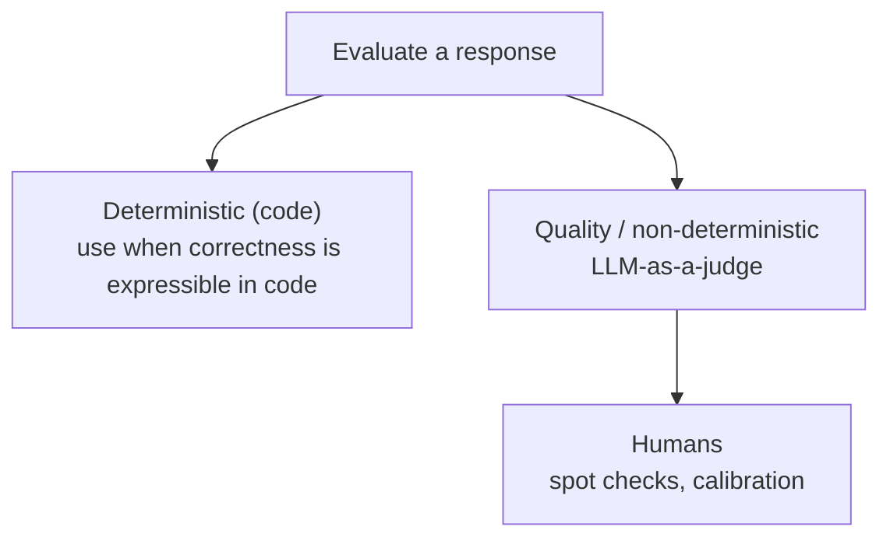
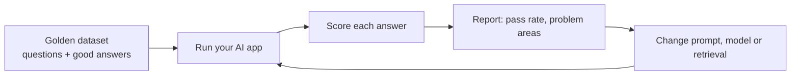
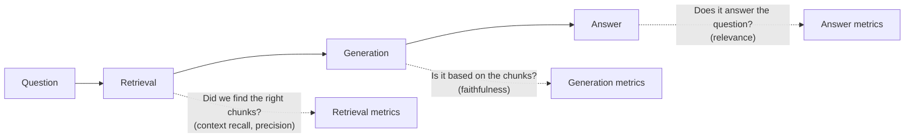

# 17. How to Test AI Applications: GenAI Evals, LLM-as-a-Judge and RAG Testing

> **In plain words:** AI answers change from run to run, so normal tests with one exact answer are not enough. An eval runs your app on many test questions and scores the answers. You use the scores to know if a change made things better or worse.

## Why normal tests are not enough

A classic function is **deterministic**: `sum(4, 5)` is always `9`, so a unit test asserts the exact output. An LLM answers the same question many ways:

- "Products may be returned within 30 days of delivery."
- "You can return your product within 30 days of delivery."
- "Our return window is 30 days after the product is delivered."

All are correct but none match an exact string. So the question changes:

| Classic test | AI eval |
|---|---|
| Did the model produce **exactly** the same result? | Did the model **exhibit the behaviour we wanted**? |

Also, you tweak many things (system prompt, model, chunk size, number of retrieved docs, temperature, adding or removing a tool), and each change can break other cases. Checking 5 queries by hand turns into 500. You need a repeatable process.

## What an eval is

> An AI evaluation (eval) is a systematic way of measuring whether an AI system behaves the way we want.

Three ingredients:

1. **Test input**: "What is the return policy?"
2. **Expected behaviour**: "Must mention the 30-day return window" (or: the right tool was called, with the right arguments).
3. **Evaluation mechanism**: how to decide pass/fail: **code, then LLM-as-a-judge, then humans**.

## Golden dataset

A curated set of questions with expected answers or expected behaviour, to run after every change.

| Application | Dataset columns |
|---|---|
| **Chatbot** | question, expected answer |
| **Agent** | question, expected tool, expected arguments, expected answer |
| **Structured output** | question, exact schema |

Cover four kinds of cases: **normal**, **edge** ("Can I return something after 60 days?"), **out-of-scope**, and **adverse** (attacks, manipulation). Examples: "What is the return period?", "Can I exchange damaged shoes?", "How long does a refund take?", "Can I return a product without the original packaging?".

## Two kinds of evaluation

**Deterministic checks (in code):** is the JSON valid? Do the fields match the schema? Was the right tool called with the right arguments? Did a "no memory" case return the expected fallback? Rule: *if correctness can be expressed clearly in code, use code.*

**LLM-as-a-judge:** a second LLM grades the answer for fuzzy qualities, given the question, the answer and any context, and returns structured scores.

## Quality metrics

| Metric | Question it answers | Example |
|---|---|---|
| **Relevance** | Did it answer the user's question? | Q "return policy?" answered with "our company was founded in 2019" scores low |
| **Correctness** | Is it factually right versus known truth? | Compare with the golden dataset or database |
| **Faithfulness** | Is every claim supported by the **retrieved context**? (RAG) | Context says 30 days; an added "refund within 24 hours" is unsupported |
| **Helpfulness** | Does it actually help the user? | "Can I return damaged shoes?" answered just "Yes" is thin |
| **Hallucination** | Did it invent facts? | Context: 30 days, plus a 15% restocking fee for non-prime; answer ignores or invents terms |

Judge output example: `{ relevance: 5, correctness: 5, faithfulness: 4, helpfulness: 4, hallucination: 1 }`.

### Making a judge reliable

- **Scale:** pick one (1-5 is easier to be consistent with than 1-100).
- **Rubric:** define each level. Example for faithfulness: 5 = every claim supported; 4 = almost all, one minor unsupported detail; 3 = main answer supported but meaningful unsupported claims; 2 = large portions unsupported; 1 = contradicts or ignores the context.
- **Pointwise vs pairwise:** score one answer on its own, or compare two answers and pick the better.
- Ask for a short **reason** with the score.

## Offline vs online

- **Offline**: run the golden dataset before release (CI).
- **Online**: monitor real production traffic, sample for judging and human review.

## Picture it

### The eval loop

### Three ways to score

| Method | How | Good for | Weak point |
|---|---|---|---|
| Rules | Code checks (contains word, valid JSON, length) | Clear facts and formats | Cannot judge meaning |
| LLM-as-a-judge | Another model grades the answer with a rubric | Tone, helpfulness, correctness | Can be biased, needs checking |
| Human review | People read answers | Final truth, hard cases | Slow and costly |

### RAG: test each part

### Offline and online

| | Offline eval | Online eval |
|---|---|---|
| When | Before release | After release |
| Data | Golden dataset | Real user traffic |
| Question answered | "Is the new version better?" | "Is it working for real users?" |

## Key points to remember

- LLM apps need **evals**, not exact-match asserts.
- An eval = **input + expected behaviour + mechanism**.
- Build a **golden dataset** with normal, edge, out-of-scope and adversarial cases.
- **Code for what is checkable; LLM-as-judge for quality; humans to calibrate.**
- Metrics: relevance, correctness, **faithfulness**, helpfulness, hallucination.
- Clear **rubrics and a small scale** make the judge consistent.

## Interview angles

- "How do you test a non-deterministic system?": evals over a golden set, mixing deterministic checks and judged quality metrics.
- "Faithfulness vs correctness?": faithfulness is grounded in the supplied context; correctness is true in the world.
- "What are the risks of LLM-as-a-judge?": bias and inconsistency, mitigated by rubrics, low temperature, human audits.

## Further reading

- [Judging LLM-as-a-Judge with MT-Bench and Chatbot Arena](https://arxiv.org/abs/2306.05685) - Research on using LLMs to grade answers.
- [OpenAI: Working with evals](https://platform.openai.com/docs/guides/evals) - Build and run evals.
- [Anthropic: Create strong empirical evaluations](https://docs.anthropic.com/en/docs/test-and-evaluate/develop-tests) - How to design test cases.
- [Ragas documentation](https://docs.ragas.io/) - Metrics for RAG such as faithfulness and context recall.
- [Hamel Husain: Your AI product needs evals](https://hamel.dev/blog/posts/evals/) - A practical guide from an experienced engineer.
