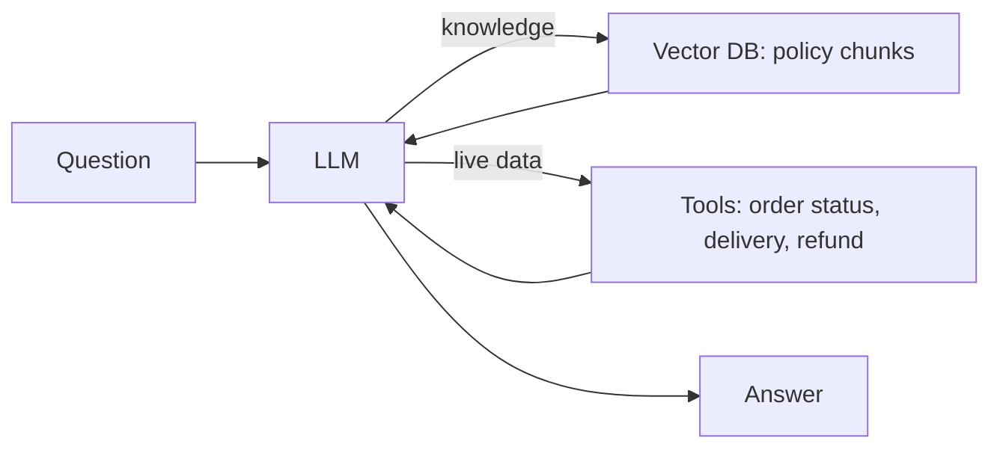
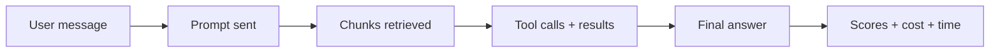
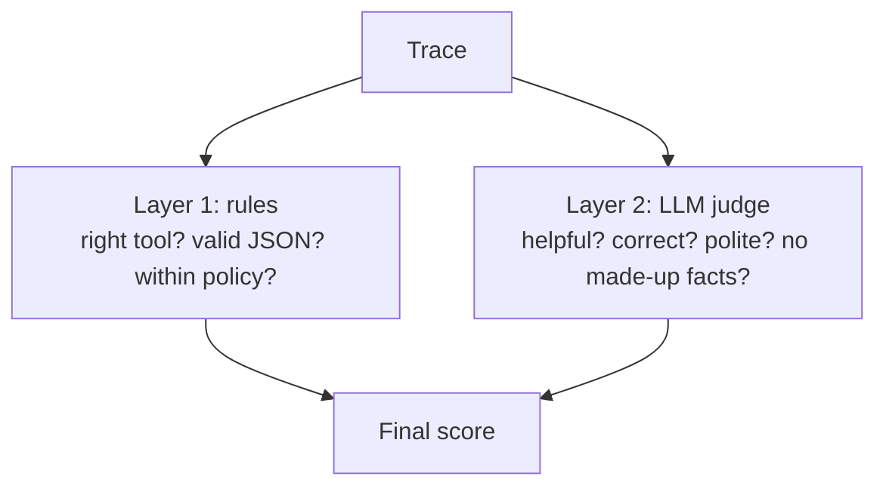

# 18. Building and Testing an E-Commerce AI Chatbot: RAG, Tools and AI Evals

> **In plain words:** An e-commerce chatbot gets three kinds of questions: facts from policy, facts from live order data, and actions. Each can fail in a different way, so you test each one differently. Save a trace of every step so you can see why an answer was wrong.

## The system under test

An e-commerce support chatbot (Client, Server, LLM) with two capabilities:

- **RAG** over policy files: `refund-policy.txt`, `return-policy.txt`, `shipping-policy.txt` in a vector DB.
- **Tools:** `OrderStatusTool`, `DeliveryEstimateTool`, `RefundAmountTool` for live order data.

## Three kinds of question, three ways to fail

| Type | Example | What must go right |
|---|---|---|
| **A: Knowledge-based (RAG)** | "What is your return policy?" | Retrieval finds the right doc; the LLM answers from it |
| **B: Tool-based** | "Status of ORD-101?" | The **correct tool** is called with the **correct order ID** |
| **C: A + B combined** | "My order ORD-102 was delivered 20 days ago. Can I still return it?" | Needs the order's delivery date (tool) **and** the return window (policy) |



## Capture traces, not just answers

To evaluate, the server returns the answer **and** how it got there:

```json
{ "answer": "...", "toolUsed": [], "toolResult": "...",
  "argumentPassed": [], "retrievedDoc": [], "context": "..." }
```

Without these **traces** you cannot tell *why* an answer was wrong (wrong doc? wrong tool? wrong argument?).

## Golden dataset for this app

Each row: question, **expected tool** (for example `OrderStatus`), **expected argument** (`ORD-101`), **expected document** (`return-policy`), and expected answer notes. Stored as `golden-dataset.txt` and driven from a test class (`SupportAgentEvalTest`).

## Two layers of evaluation

| Layer | Checks | Method |
|---|---|---|
| **Deterministic** | Correct tool called? Correct argument? Correct document retrieved? Tool result as expected? | Plain code assertions on the trace |
| **LLM-as-a-judge** | Relevance, correctness, faithfulness, helpfulness, hallucination-free | A judge LLM gets `question + retrieved context + tool results + answer` |

Judge output (5 = good) with a reason:

```json
{ "relevance": 5, "correctness": 5, "faithfulness": 4, "helpfulness": 5,
  "hallucinationFree": 5, "reason": "The answer correctly ..." }
```

Note the naming flip: **hallucinationFree** (5 = good) so every metric reads the same direction.

## Workflow

1. Build the app with traces enabled.
2. Write golden cases covering types A, B and C.
3. Run deterministic checks first (cheap, exact), then the judge for quality.
4. Change something (prompt, chunking, model) and **rerun** to catch regressions.

## Picture it

### Three question types

| Type | Example | Source of truth | Typical failure | How to test |
|---|---|---|---|---|
| Policy | "Can I return after 15 days?" | Policy documents (RAG) | Wrong or old policy | Compare with the policy text |
| Order data | "Where is my order?" | Order API | Wrong order, made-up status | Check the tool call and its result |
| Action | "Cancel my order" | Order API (write) | Cancels without permission | Check approval and the final state |

### What a trace records



Save every box. If the answer is wrong, you can see which step broke.

### Two layers of scoring



### Score direction

Use scores where **higher is always better** (for example `hallucinationFree`, not `hallucination`). Then every chart reads the same way.

## Key points to remember

- Test **retrieval**, **tool use** and **final answer** separately; one overall score hides the cause.
- Return **traces** (answer, tools, arguments, retrieved docs, context) so failures are diagnosable.
- Combine **deterministic assertions** with an **LLM judge**; keep all metrics pointing the same direction.
- Include combined RAG + tool cases; they fail most.

## Interview angles

- "How would you evaluate an agent?": check tool selection, arguments and result in code; judge the final answer's faithfulness and helpfulness.
- "Why log retrieved docs and tool calls?": to localise whether retrieval, tool use or generation failed.
- "What catches regressions?": a versioned golden dataset run in CI (offline eval).

## Further reading

- [OpenAI: Working with evals](https://platform.openai.com/docs/guides/evals) - Build evals for your own app.
- [Ragas documentation](https://docs.ragas.io/) - Metrics for retrieval and answers.
- [OpenTelemetry: Semantic conventions for generative AI](https://opentelemetry.io/docs/specs/semconv/gen-ai/) - A standard way to record AI traces.
- [Hamel Husain: Your AI product needs evals](https://hamel.dev/blog/posts/evals/) - Look at real traces and build evals from them.
- [Anthropic: Writing tools for agents](https://www.anthropic.com/engineering/writing-tools-for-agents) - How to design and test tools the model calls.
