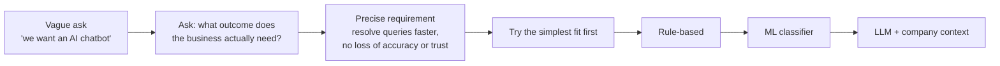
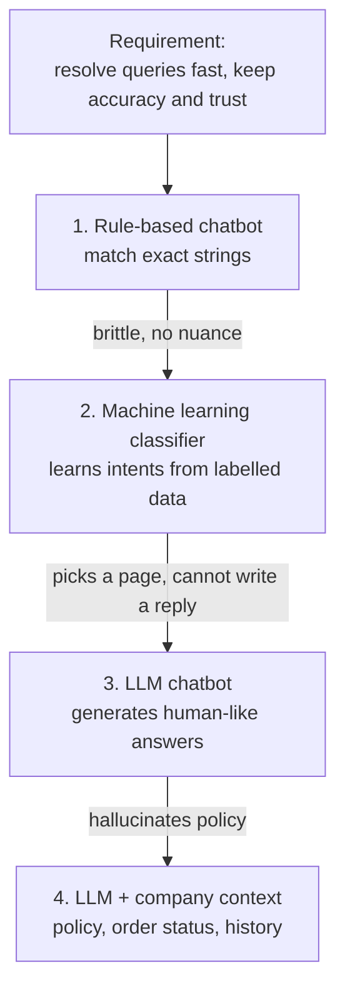
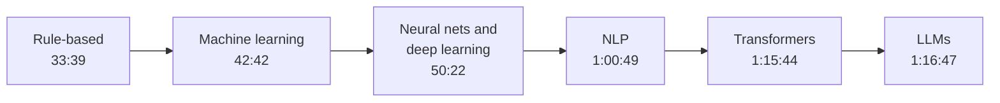
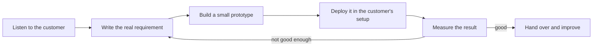
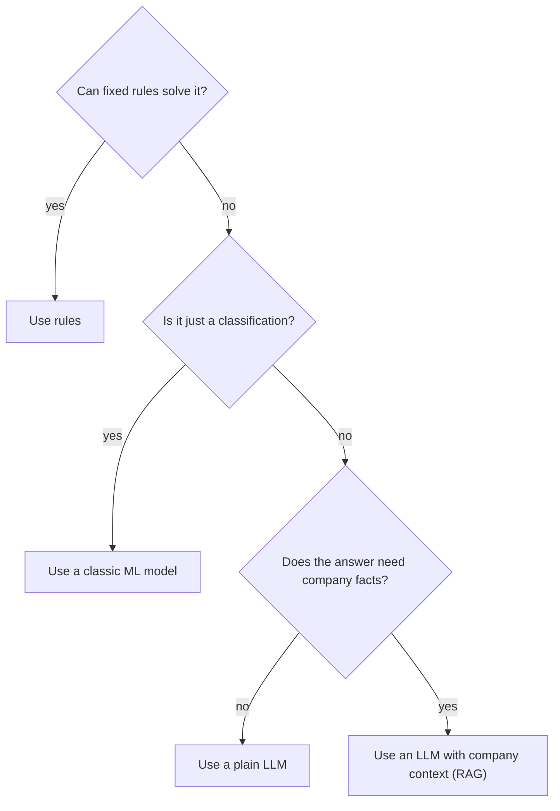

# 1. Forward Deployed Engineering: The Role and the Rise of LLMs

> **In plain words:** A Forward Deployed Engineer (FDE) solves a customer's real problem with software, often with AI. The first job is to find out what the customer really needs. The second job is to pick the simplest tool that works.

## The big idea

A Forward Deployed Engineer (FDE) is not paid to build "an AI chatbot". They are paid to fix a business problem, so most of the job is turning a vague request into a precise, testable requirement, then picking the simplest technology that meets it.

## 1. The role

### The worked example: e-commerce support

- **Situation.** An e-commerce company gets about **50,000 customer support queries a day**. Typical ones: "Where is my order?", "I received the wrong product", "Can I return my product after 15 days?".
- **Today.** A large team of human support executives answers them. Costs: salaries, infrastructure, and a waiting queue when all agents are busy.
- **The ask.** Management says "build an AI chatbot to replace the executives."

### Why "build a chatbot" is not a requirement

The company does not care about a chatbot. It cares about the business outcome. The problems behind the ask:

| Problem | Why it hurts |
|---|---|
| Wait times | If all agents are busy, customers sit in a queue |
| Trivial queries | Most are simple (order tracking, info already on the site) and bury the important cases |
| Working hours | Humans are limited to shifts; customers have problems at 2 a.m. |
| Cost | Salaries and infrastructure for a large team |
| Repetitive work | Executives spend the day on work a machine could do |

The FDE restates the real requirement:

> **Reduce the time to resolve customer problems without reducing accuracy or customer trust.**

"AI chatbot" is a vague term: what kind, with which features? The FDE's value is turning that vague statement into a properly ordered requirement and a solution that fits it. The chatbot (if any) is a means, and it can work 24/7 as a side benefit.

### Walking the solution ladder (what the FDE actually does)

1. **Rule-based chatbot.** Looks for exact strings in the query. If "order status" appears, send the user to the order-tracking screen. Simple, but only works when users phrase things exactly as the rules expect.
2. **Machine learning classifier.** Trained on labelled queries, so it understands that a refund-related question means "show the refund policy". Better, but it **only classifies**. It can route to the order page, the refund policy or the cancellation policy; it **does not generate text**, so it cannot explain "your order has shipped and will arrive in three days".
3. **A modern LLM** (ChatGPT, Claude, Gemini, Grok, DeepSeek and so on, treated here as "an LLM"). It understands natural language such as English or Hindi and writes good, human-sounding answers.

### The catch with a general-purpose LLM

A general LLM does not know your company's internal details.

- User: "Can I return my order after 15 days?"
- LLM: "Yes, you can return it within 30 days." (sounds great, **wrong**)
- Real policy: returns allowed for **7 days only**.

Fix: give the model the missing context together with the question:

| Context fed to the LLM | Example |
|---|---|
| The user's query | "Can I return my order after 15 days?" |
| Company policy | Return window is 7 days; refund and cancellation rules |
| The user's order status | Shipped, delivered, and when |
| Previous conversation | What was already discussed with this user |

With all of that in the prompt, the answer is accurate and phrased well. This is the seed of **RAG** and prompt/context design, which later notes cover.

### Takeaway

The company asked for "an AI chatbot". By checking whether rules or classic ML would do, and finding they would not, the FDE justified an LLM with company context, and shipped a **production-ready solution to the real problem**. That judgement, not the model choice, is the job.

## 2. The evolution of AI

### Where it starts: Alan Turing, 1950

Turing asked: **can a machine perform a task that requires human intelligence?** (This framing led to the Turing Test.)

### Classical computing is deterministic

Computers were built to compute (a calculator is the first example). Everything we did with them shared three traits:

- the **input was clear**,
- instructions were **precisely defined** by us (variables, loops, conditionals, recursion, data structures and algorithms in C++, Java, Python, JavaScript),
- the output was **deterministic**, with one predefined result (2 + 2 is always 4).

### Why human intelligence does not fit that mould

Human intelligence covers understanding languages, reading emotion and sarcasm, solving unfamiliar problems, deciding with incomplete data, explaining ideas as stories, writing songs and poems. If we could express it as a set of instructions, a computer could run it. **The problem: nobody has even defined human intelligence precisely**, so we cannot write the instructions.

This gap is why the field moved from hand-written rules toward systems that learn from data.

### Timeline

| Era | Idea | Limit |
|---|---|---|
| **Rule-based systems** | Complex "if-else" logic written by people | Brittle; cannot handle the nuance of human language |
| **Machine learning** | No explicit rules. Models learn from **labelled training data** to predict, e.g. classify images as dog or cat | Needs labelled data; predicts or classifies rather than generates |
| **Neural networks and deep learning** | Mimic the structure of the brain; find complex patterns humans miss | Needs lots of data and compute |
| **Natural language processing** | Process human text, which is hard because of sarcasm, context and grammar. Early statistical models (**N-grams**) and sequential models (**RNNs**) | Struggled with **long-term memory and context loss** |
| **Transformers** | Paper **"Attention Is All You Need"**. An **attention** mechanism processes the whole sequence at once and captures relationships between **distant words** | Foundation of modern LLMs |

Compare this to the support-bot ladder in section 1: rule-based, then ML, then LLM is the same story at product scale.

## 3. The rise of LLMs

Modern LLMs such as ChatGPT sit on the Transformer architecture. GPT stands for:

| Letter | Meaning | What it says |
|---|---|---|
| **G**enerative | Creates new text | Output is generated, not looked up |
| **P**re-trained | Learned from massive datasets beforehand | General knowledge, but not *your* company's facts (see the return-policy example) |
| **T**ransformer | The engine | Attention over the whole sequence |

## Picture it

### The FDE work cycle

### FDE compared with other roles

| | Software engineer | Solutions engineer | Forward deployed engineer |
|---|---|---|---|
| Main goal | Build the product | Help sell the product | Make the product work for one customer |
| Works with | Own team | Sales and customers | The customer's team and data |
| Writes code | A lot | A little (demos) | A lot, often at the customer's site |
| Success means | Product quality | Deals won | The customer's problem is solved |

### Choosing the simplest tool

## Key points to remember

- Start from the **business outcome**, not the technology. Rewrite "build an AI chatbot" as a measurable goal.
- Pick the **simplest tool that meets the requirement**: rules, then classic ML, then an LLM.
- A classifier **routes**; an LLM **generates**. Generation is the missing piece for human-like replies.
- A general LLM **will confidently invent** company policy. Ground it with policy, order status and conversation history.
- Classic software is deterministic; AI deals with fuzzy human input, which is why the field moved to learning from data.
- Transformers (attention over the full sequence) fixed the long-context problem that N-grams and RNNs had.

## Interview angles

- "Walk me through how you would scope an AI support assistant for a retailer": restate the outcome, compare rules, classifier and LLM, then ground the LLM in company data.
- "Why not just plug ChatGPT in?": hallucinated policy (the 30 days versus 7 days example) and no access to order data.
- "What does GPT stand for and why does it matter?": generative, pre-trained, transformer.
- "Why did Transformers replace RNNs?": attention handles long-range dependencies and processes sequences in parallel.

## Further reading

- [Palantir: A day in the life of a Forward Deployed Software Engineer](https://blog.palantir.com/a-day-in-the-life-of-a-palantir-forward-deployed-software-engineer-45ef2de257b1) - What the FDE job looks like in practice.
- [Alan Turing: Computing Machinery and Intelligence (1950)](https://academic.oup.com/mind/article/LIX/236/433/986238) - The original paper that asks if machines can think.
- [Attention Is All You Need (2017)](https://arxiv.org/abs/1706.03762) - The paper that introduced the Transformer.
- [Language Models are Few-Shot Learners (GPT-3)](https://arxiv.org/abs/2005.14165) - Shows how large pre-trained models can do many tasks.
- [Anthropic: Building effective agents](https://www.anthropic.com/engineering/building-effective-agents) - Advice to start with the simplest solution first.
