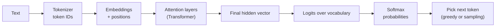
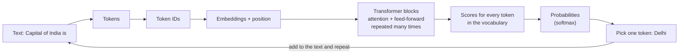
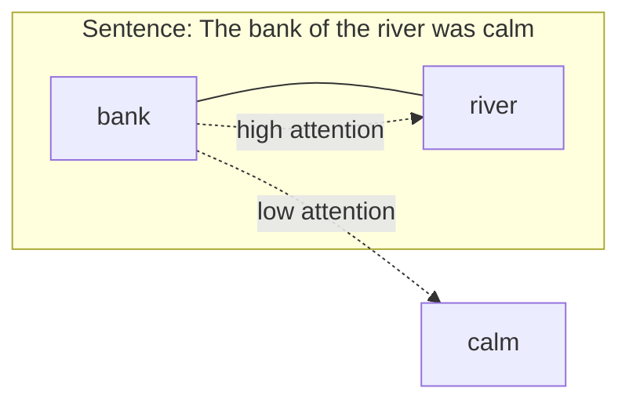

# 2. How LLMs Actually Work: Tokens, Attention and Transformers

> **In plain words:** An LLM reads text as small pieces called tokens. It turns each token into numbers, lets the tokens look at each other (attention), and then guesses the next token. It repeats this again and again to write a full answer.

## Core idea: an LLM predicts the next token

Given the text so far, an LLM produces a **probability distribution over its vocabulary** for the next token, picks one, appends it, and repeats. "Capital of India is" gives Delhi 0.94, Kolkata 0.4 (raw scores), and so on. Everything else in this note explains how that distribution is produced.

## 1. Tokens and token IDs

Models do not read words; they read numbers. A **tokenizer** splits text into tokens and maps each to an ID ("Capital of India is Delhi" becomes `101 25 45 11 67 99`-style IDs).

| Tokenization style | Idea | Trade-off |
|---|---|---|
| Per word | Each word is a token | "Automatically", "Automatic", "Automate", "Automation" all need separate IDs; huge vocabulary |
| Per character | `a=1, b=2 ... z=26` | Tiny vocabulary but very long sequences |
| Sub-word (what real models use) | Common pieces shared across words | Balance of both |

Rule of thumb: **1 token is about 4 characters**.

## 2. Order matters: positions

"Dog bites man" `[23, 34, 56]` and "man bites dog" `[56, 34, 23]` contain the same tokens in a different order, so the model needs tokens **plus positions**.

## 3. Embeddings: meaning as vectors

The same word can mean different things ("bank" in *I deposited money at the bank* versus *the bank of a river*). Each token ID is mapped to a **vector embedding** that encodes meaning along many dimensions. Toy example with dimensions Royalty / Food / Living / Technology:

| Word | Royalty | Food | Living | Technology |
|---|---|---|---|---|
| King | 0.95 | 0.01 | 0.91 | 0.02 |
| Banana | 0.01 | 0.95 | 0.20 | 0.01 |
| Laptop | 0.01 | 0.00 | 0.00 | 0.97 |

Related words end up close together (king and queen share royalty, leadership, monarchy; banana sits with fruit, food, sweet).

## 4. Attention: which other tokens matter for this one?

Example: "Rohit gave Aditya his laptop because **his** laptop was broken". To resolve "his", the model weights the other tokens: Rohit 30%, Aditya 60%, the rest about 1% each.

**Query / Key / Value (QKV):**

| Part | Plain meaning |
|---|---|
| **Query (Q)** | What information am I looking for? |
| **Key (K)** | What kind of information do I offer? |
| **Value (V)** | Here is the information I can contribute |

Library analogy: you search "Best Java Course" (query), titles/tags are keys, the content you get back is the value.

For "The cat sat **on** the mat", the query of "on" is compared against the keys of every token: *The* is low relevance, *cat* medium, *mat* high. Those scores become weights `w1, w2, w3`, and the output is a weighted sum of values: `Z = w1*value(The) + w2*value(cat) + w3*value(mat)`. That is **self-attention**: every token attends to the others in the same sequence.

Why three vectors instead of one? The analogy: a person has technical skills, location and values. Different questions need different views of the same thing, so each token gets separate Q, K and V projections.

**An e-commerce analogy:** "when is a query urgent?" can be a weighted sum of signals (`x1` contains "urgent", `x2` payment declined, `x3` account locked): `Z = x1w1 + x2w2 + x3w3`. Attention learns such weights automatically.

## 5. From Transformer output to next token

1. Stacked attention layers (the **Transformer**) turn "The capital of India is" into a final vector, `H_final`.
2. `H_final` is compared with the vector of every vocabulary entry (Delhi, Kolkata, USA ...), giving **logits** (raw scores, such as 12.1 and 8.1).
3. **Softmax** converts logits into a **probability distribution** (Delhi 90%, Kolkata 5%, remaining 5%).

One-line definition: *given the preceding tokens, produce a probability distribution for the next token*.

## 6. Choosing the token: decoding

| Strategy | What it does |
|---|---|
| **Greedy** | Always take the highest-probability token. Predictable, repetitive |
| **Sampling** | Draw randomly in proportion to the probabilities. "Hi, how are you" can reply "I am fine" (50), "I am doing well" (40), "Great" (5), "Shut up" (5) |

### Temperature

Divide the raw scores by **T** before softmax. Using scores 5, 4, 3, 2, 1:

| T | Scores after dividing | Effect |
|---|---|---|
| 1 | 5, 4, 3, 2, 1 | Baseline |
| 0.5 | 10, 8, 6, 4, 2 | Gaps widen: sharper, more deterministic |
| 2 | 2.5, 2, 1.5, 1, 0.5 | Gaps shrink: flatter, more random and creative |

Low T suits factual tasks (support answers, extraction); higher T suits brainstorming. Example prompt: "Which is a popular programming language?" with candidates Python, Java, C++, Rust, Go.

## Picture it

### One full trip through the model

### What temperature does

The same scores can give a sharp or a flat set of probabilities.

| Token | Low temperature (0.2) | High temperature (1.5) |
|---|---|---|
| Delhi | 0.97 | 0.55 |
| Mumbai | 0.02 | 0.25 |
| Paris | 0.01 | 0.20 |
| Result | Almost always "Delhi" | Can pick surprising words |

(Numbers are only an example to show the shape.)

### Attention in one picture

The word "bank" pays most attention to "river", so the model reads "bank" as a river bank, not a money bank.

## Key points to remember

- An LLM is a **next-token predictor** over a vocabulary; a "chat" is that loop repeated.
- Tokens become IDs, IDs become **embeddings**, and **positions** are added so order is not lost.
- **Self-attention** (Q, K, V) lets each token pull in information from the tokens that matter.
- Output is **logits, then softmax, then a distribution**; **temperature** reshapes it before sampling.
- Hallucinations are a natural result: the model returns a likely continuation, not a verified fact.

## Interview angles

- "Explain attention without maths": each token asks what it needs, others advertise what they hold, and a weighted mix of the useful ones is returned.
- "What does temperature do?": scales logits; lower is sharper and more deterministic, higher is flatter.
- "Why do positions matter?": attention alone is order-blind; "dog bites man" must differ from "man bites dog".
- "Why can't an LLM be fully deterministic?": sampling; even at T=0 hardware and batching effects can vary.

## Further reading

- [Attention Is All You Need (2017)](https://arxiv.org/abs/1706.03762) - The original Transformer paper.
- [Jay Alammar: The Illustrated Transformer](https://jalammar.github.io/illustrated-transformer/) - Step-by-step pictures of how a Transformer works.
- [OpenAI Tokenizer](https://platform.openai.com/tokenizer) - Type text and see how it is split into tokens.
- [tiktoken (OpenAI tokenizer library)](https://github.com/openai/tiktoken) - Count tokens in your own code.
- [Hugging Face: How to generate text](https://huggingface.co/blog/how-to-generate) - Greedy, beam search, top-k and top-p explained.
- [The Curious Case of Neural Text Degeneration (top-p sampling)](https://arxiv.org/abs/1904.09751) - The paper behind nucleus (top-p) sampling.
