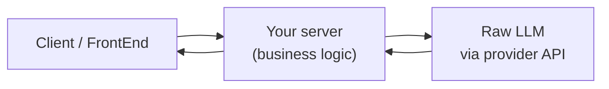
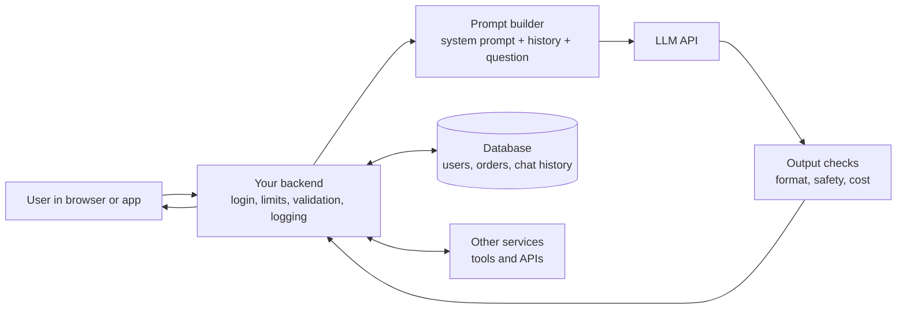

# 3. Integrating an LLM with Your Application

> **In plain words:** A model alone is not a product. A real app wraps the model with a user interface, a backend, safety checks and data. The backend calls the model through an API.

## ChatGPT is not an LLM; it is an application

> A **raw LLM** is a capability. A **GenAI application** is the software built around that capability.

The analogy: **car and engine**. The engine alone does nothing for a customer; the car (UI, controls, safety) is the product.

"ChatGPT" is a client plus a server plus an LLM. When you integrate an LLM you build the server (and often the client) yourself.

## Calling the model

1. Try the model in the provider's playground (platform.openai.com/chat).
2. Get an **API key** and call the API from **Postman** first, then from your application.
3. The key is your **authentication**; keep it on the server, never in the client.

Demos in the repo: Node.js, Python and **Java Spring Boot** (Spring AI `ChatClient`), the same pattern in three stacks.

## What a raw LLM cannot do on its own

| Limit | Example | Fix |
|---|---|---|
| **Knowledge cut-off** | Trained until 2024; asked in 2026 | Give it data/tools |
| **Weak exact arithmetic** | `8745873 x 5608241`: model returns a wrong number, correct is 49,048,963,539,393 | Let it call a **calculator** tool |
| **No live data** | "What is the weather?" | **Weather API** tool |
| **No execution** | Cannot run code | **Compiler** tool |

So the application sits between the user and the model and can give the model tools. (Tools are covered in depth in note 5.)

## The integration flow

`Client` sends a request to `Server`, the server calls the `LLM` (with an API key), and the answer flows back. Typical Spring example: `Company -> Customers`, `Query -> summarize`, using the `ChatClient`.

## Picture it

### The car and the engine

### Who does what

| Part | Job | Example |
|---|---|---|
| Model (engine) | Understands and writes text | GPT, Claude, Gemini |
| Backend (car body) | Keeps keys safe, adds rules and data | Express, FastAPI, Spring |
| Frontend (dashboard) | Shows the chat, takes input | React, mobile app |
| Database | Remembers users and history | Postgres, Redis |

### What to protect

- Keep the API key on the server. Never put it in browser code.
- Set a timeout and a retry limit for each model call.
- Log the cost (tokens) of each call.

## Key points to remember

- Distinguish the **model** (capability) from the **application** (product).
- The server owns the API key, prompts, tools and business logic.
- Always remember cut-off dates and arithmetic weakness: both are solved by **connecting tools and data**, not by a bigger prompt.
- The same architecture works in any stack (Node, Python, Spring); only the SDK calls change.

## Interview angles

- "Is ChatGPT an LLM?": no; the app wraps a model with UI, memory, tools and safety.
- "Why not call the LLM directly from the browser?": it would expose the API key and skip server-side control.
- "Give two things an LLM gets wrong alone": recent facts and large exact calculations.

## Further reading

- [OpenAI: Text generation guide](https://platform.openai.com/docs/guides/text) - How to call a model from code.
- [Anthropic: Messages API](https://docs.anthropic.com/en/api/messages) - Request and response format for Claude.
- [Anthropic: Getting started with the API](https://docs.anthropic.com/en/api/getting-started) - API keys, first request, errors.
- [Spring AI reference](https://docs.spring.io/spring-ai/reference/) - Calling LLMs from a Spring Boot app.
- [FastAPI documentation](https://fastapi.tiangolo.com/) - The Python web framework used in the demos.
