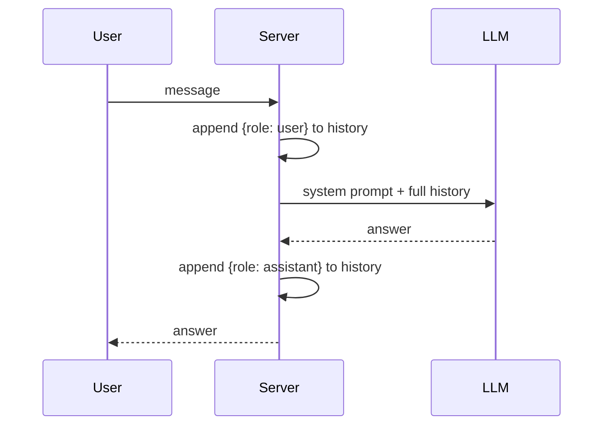
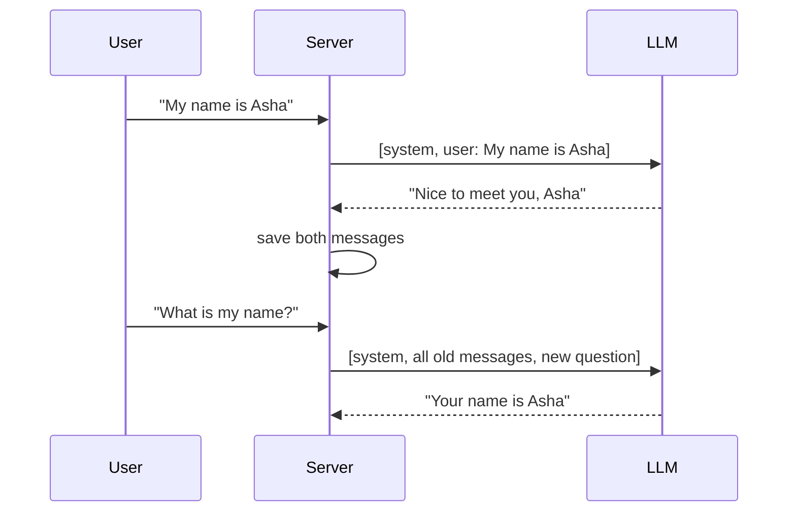
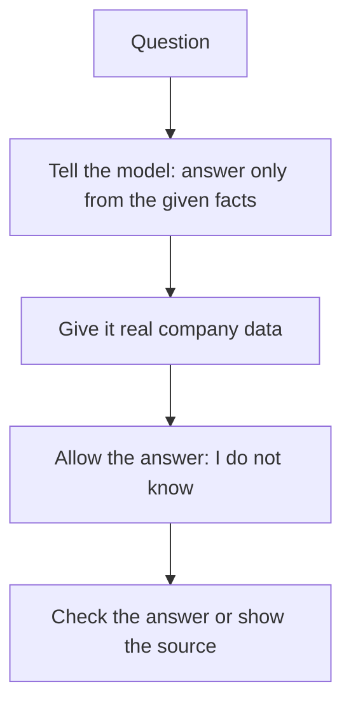

# 4. Build Your First AI Chatbot: Context Window, Memory and Hallucinations

> **In plain words:** An LLM forgets everything between calls. To make a chatbot, your server must save the chat and send it again with each new question. The model can only read a limited amount of text at once (the context window), and it can still make up facts (hallucinate).

## What the demo builds

A customer-support chatbot for a food-ordering app called **Tomato**, exposed as `POST /api/chat` (and `DELETE /api` to clear the chat). Three steps happen on every message:



### The system prompt does the shaping

The prompt (in the FastAPI demo) tells the model it is a support executive for Tomato, should identify the **main problem and urgency**, use empathetic professional language ("I understand your frustration"), and **refuse anything outside** ordering, refunds, order tracking and company policy.

### Memory is just the history you resend

The model is **stateless**. "Memory" is the server keeping a list of `{role, content}` messages and sending the whole list each time. The demo keeps one in-memory `history` guarded by a lock, so it is shared by everyone: fine for a demo, wrong for production (one history **per user or session**).

## Context window

The model can only see a limited number of tokens per call (system prompt + history + new message + the reply). A long conversation eventually overflows, so real systems trim, summarise or select what to resend. Larger histories also cost more and add latency.

## Hallucinations

An LLM generates a plausible continuation, not a verified fact. With no company data it may invent a return policy. The system prompt narrows scope, but real grounding needs data in the prompt (see RAG in note 11).

## Picture it

### What fits in the context window

```text
|<------------------------ context window (for example 128,000 tokens) ------------------------>|
+-----------------+----------------------------------------+------------------+----------------+
| System prompt   | Chat history (grows every turn)        | New question     | Room for the   |
| (rules, role)   | user, assistant, user, assistant ...   |                  | answer         |
+-----------------+----------------------------------------+------------------+----------------+
```

When the window is full, you must cut, summarise or search the old text.

### Memory is just a list that you resend



### Defences against hallucination



## Key points to remember

- A chatbot is `system prompt + history + model`. The **server owns the history**.
- The system prompt sets role, tone and **boundaries**.
- Memory costs tokens; it is limited by the context window.
- Scope limits help but do not stop hallucination; grounding does.

## Interview angles

- "How does a chatbot remember?": it does not; the app resends the conversation.
- "Why is a global history list a bug in production?": all users share it. Key by session.
- "What happens when the chat gets long?": truncate, summarise or retrieve.

## Further reading

- [Anthropic: Context windows](https://docs.anthropic.com/en/docs/build-with-claude/context-windows) - How the window works and what happens at the limit.
- [Anthropic: Reduce hallucinations](https://docs.anthropic.com/en/docs/test-and-evaluate/strengthen-guardrails/reduce-hallucinations) - Practical steps to get fewer made-up answers.
- [OpenAI: Prompt engineering guide](https://platform.openai.com/docs/guides/prompt-engineering) - How to write clear system prompts.
- [Lost in the Middle (2023)](https://arxiv.org/abs/2307.03172) - Models use facts at the start and end better than in the middle.
- [A Survey on Hallucination in Large Language Models](https://arxiv.org/abs/2311.05232) - Why models hallucinate and how people reduce it.
