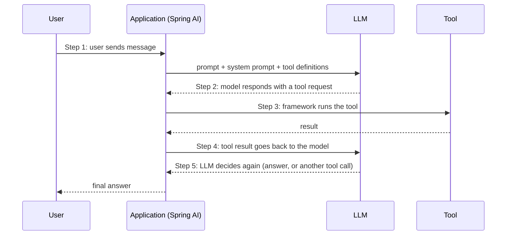
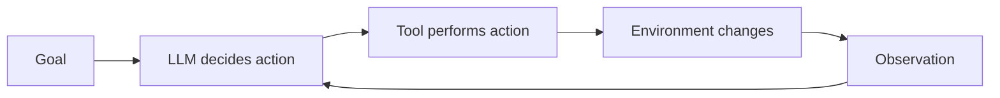
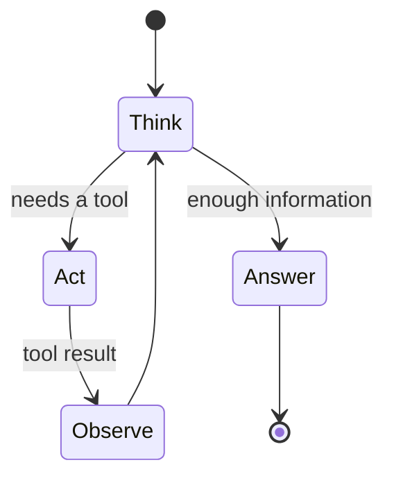
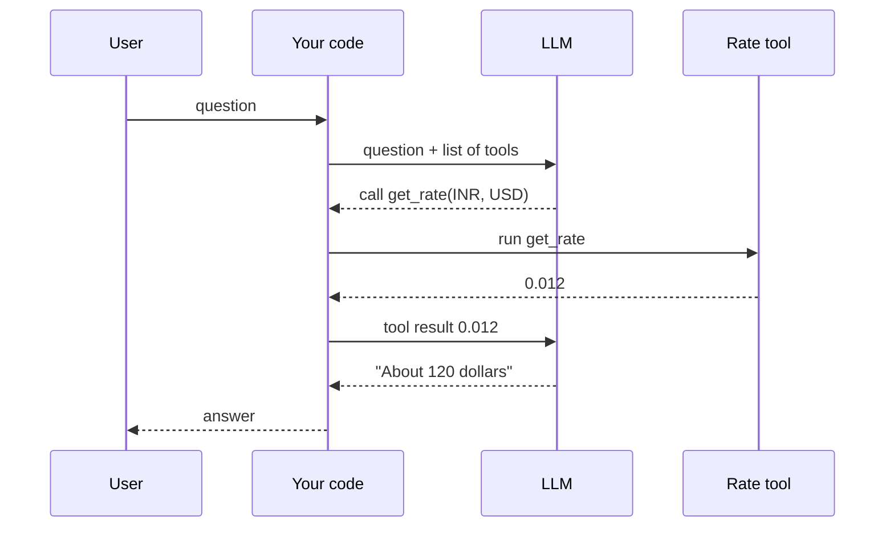

# 5. Introduction to AI Agents: Build Your First Agent

> **In plain words:** An agent is an LLM that can use tools and can repeat steps until the job is done. The model does not run the tool itself. It asks, your code runs the tool, and the result goes back to the model.

## From LLM to tools

An LLM only produces next tokens. To act, it needs **tools**: functions the app exposes (calculator, currency exchange, weather, compiler, file operations).

Example: user says "I have 10,000 rupees. How many dollars will I get at today's rate?"

1. The model cannot know the live rate, so it asks for the **Currency Exchange** tool (`{from: INR, to: USD}`).
2. The app runs it and returns `1 dollar = 95 rupees`.
3. The model may call the **calculator** (`{operation: "/", a: 10000, b: 95}`) and gets about 105.
4. It answers: "You will receive about $105."

Large multiplications (such as `94,256,438,941,170`) are handed to a calculator for the same reason: models are unreliable at exact arithmetic.

### The five-step tool-calling loop (with Spring AI)

Key point: **the model never runs code**. It asks; your application executes and reports back.

### Two kinds of tools

| Type | Examples | Risk |
|---|---|---|
| **Informative** | calculator, exchange rate, weather | Low: only reads |
| **Action** | send email, create user, refund a user | High: changes the world |

## Agent = LLM + tools + a loop

> LLM + tools -> AI agents. Multiple steps toward a **goal**.

The six parts of an agent:

| Part | Role | Portfolio-site example |
|---|---|---|
| 1. Goal | What to achieve | "Create a portfolio website" |
| 2. Decision maker | The LLM | Chooses the next action |
| 3. Action | A tool it can call | `createDir`, `createFile`, `readFile`, `writeFile` |
| 4. Environment | Where actions apply | The `/portfolio` folder on disk |
| 5. Observation | Result of the action | Did the file get created, is content right? |
| 6. Loop | What next? | Repeat until the goal is met |

### Mini project: a website-generating agent

Ask "Make me a portfolio website" (HTML, CSS, JS). Instead of giving the LLM a shell, give it **safe file tools** (`createDir`, `createFile`, `readFile`, `writeFile`) pointing at a chosen folder. It plans: create `portfolio/`, then `index.html`, `style.css`, `script.js`, writes each, and checks.

Why not just let it run `mkdir`/`touch`? A raw command line is far too powerful; restricted tools inside a **sandbox** limit the damage.

## Picture it

### The agent loop

### Example: "I have 10,000 rupees. How many dollars is that today?"

### Workflow or agent?

| | Workflow | Agent |
|---|---|---|
| Who picks the steps? | You (fixed code path) | The model |
| Predictable? | High | Lower |
| Cost and time | Low and stable | Higher and varies |
| Use when | Steps are known | Steps depend on the situation |

## Key points to remember

- Tool calling = model **requests**, app **executes**, model **continues**.
- Separate **informative** tools from **action** tools; guard the latter.
- An agent is a loop: decide, act, observe, repeat, until the goal is met.
- Constrain agents with narrow tools and a sandbox.

## Interview angles

- "What is an AI agent?": an LLM that uses tools in a loop toward a goal.
- "How does tool calling actually work?": the model emits a structured request; the application runs the function and returns the result.
- "How do you keep an agent safe?": minimal tools, sandboxed environment, approval for risky actions (see note 19).

## Further reading

- [Anthropic: Building effective agents](https://www.anthropic.com/engineering/building-effective-agents) - Clear guide on workflows versus agents.
- [ReAct: Synergizing Reasoning and Acting in Language Models](https://arxiv.org/abs/2210.03629) - The think, act, observe pattern.
- [OpenAI: Function calling](https://platform.openai.com/docs/guides/function-calling) - How tool calls work in the API.
- [Anthropic: Tool use overview](https://docs.anthropic.com/en/docs/agents-and-tools/tool-use/overview) - Tool calls with Claude.
- [Toolformer (2023)](https://arxiv.org/abs/2302.04761) - Research on models that learn when to use tools.
