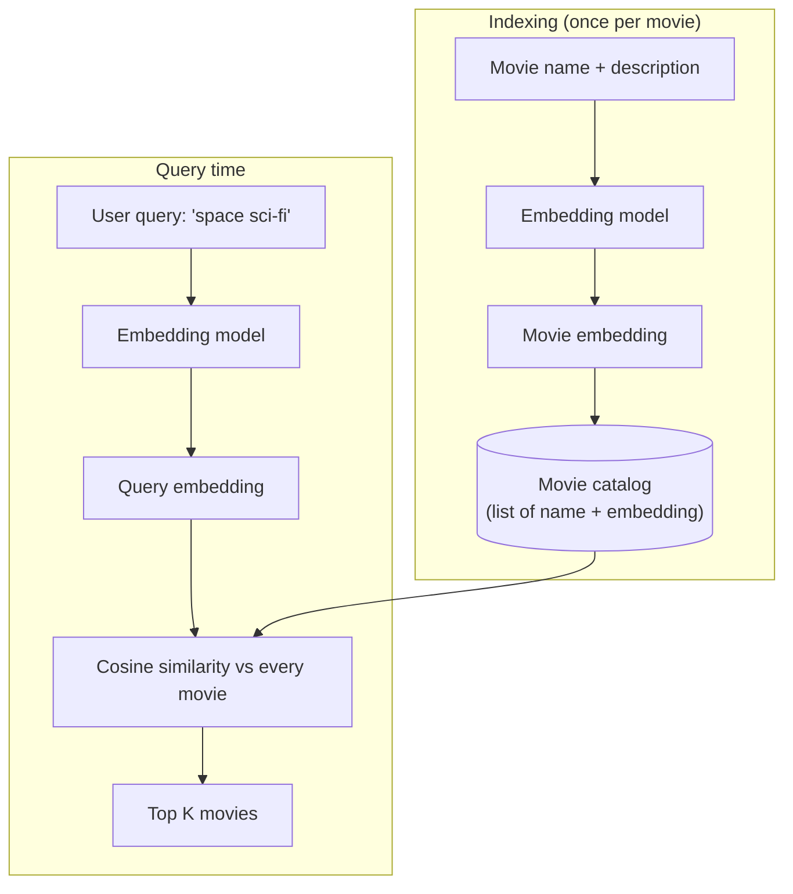
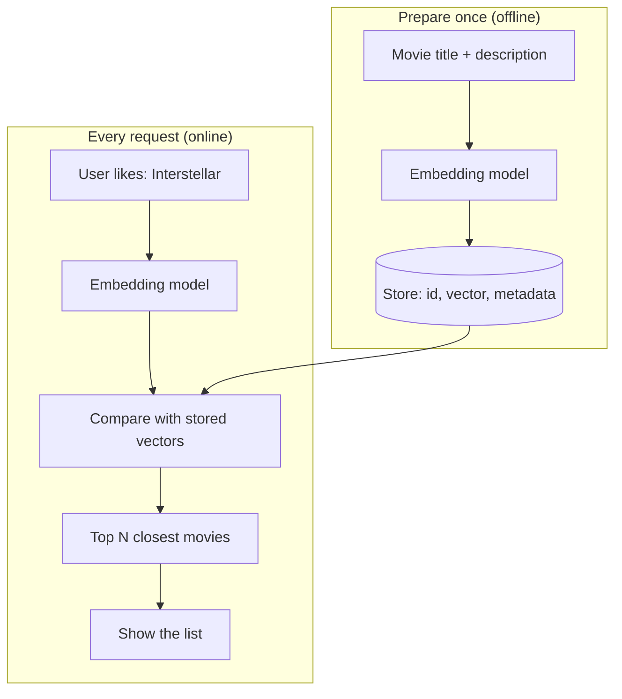

# 8. Build a Netflix-Style Recommendation System with Vector Embeddings

> **In plain words:** To recommend a movie, turn every movie into an embedding. Then turn what the user likes into an embedding too. The movies whose embeddings are closest are the best picks.

## Embedding model vs LLM

Both start with tokens and neural networks, but the output differs:

| | LLM | Embedding model |
|---|---|---|
| Output | **Next token** generation | An **embedding vector** (`[...]`) |
| Use | Write answers | Compare meaning, search, recommend |

## The recommendation engine

Goal: a user types "space sci-fi", and we return Interstellar, Martian, Gravity ...

1. For each movie, embed its **name + description** and store the vector next to the title.
2. Embed the user's query with the **same** embedding model.
3. Compute **cosine similarity** between the query and each movie; sort; return the top K.

**Same model for both sides** is essential; vectors from different models live in different spaces.

### Worked cosine example

`A = [1, 2, 3]`, `B = [4, 5, 6]`:

- dot product = 1x4 + 2x5 + 3x6 = **32**
- `|A| = sqrt(14)`, `|B| = sqrt(77)`
- cosine = `32 / (sqrt(14) x sqrt(77))` is about **0.975**, so the two vectors point almost the same way.

### Adding an LLM on top

For a nicer reply, hand the retrieved movies to an LLM:

- System prompt: "recommend movies from this list".
- Query: "space sci-fi". Context: Movie1, Movie2 ... (Interstellar, Martian, Gravity).

This is the **retrieve, then generate** pattern that becomes RAG (note 11).

### Other signals mentioned

Real recommenders also use **user history**, **ratings** and **other users' behaviour** (collaborative filtering), combined with content similarity.

## Picture it

### Two stages: prepare once, answer many times

### Cosine score by hand (tiny example)

Take two 2-number vectors: A = (3, 4) and B = (4, 3).

| Step | Work | Result |
|---|---|---|
| Dot product | 3x4 + 4x3 | 24 |
| Length of A | square root of (9 + 16) | 5 |
| Length of B | square root of (16 + 9) | 5 |
| Cosine | 24 / (5 x 5) | 0.96 |

0.96 is close to 1, so A and B point almost the same way.

### Embedding model or LLM?

| | Embedding model | LLM |
|---|---|---|
| Output | A list of numbers | Text |
| Used for | Search, matching, recommending | Writing, answering |
| Cost per call | Low | Higher |

## Key points to remember

- Embed items **once**, embed the query **at request time**, then rank by similarity.
- Use the **same embedding model** for documents and queries.
- Embedding models output vectors; LLMs output tokens.
- Retrieval finds relevant items; an LLM can then phrase the result.

## Interview angles

- "Design a semantic movie search": embed catalog offline, embed query online, nearest neighbours by cosine.
- "What happens if I switch embedding models?": you must re-embed everything.
- "Cold-start for new movies?": content embeddings help because they need no user history.

## Further reading

- [OpenAI: Embeddings guide (use cases)](https://platform.openai.com/docs/guides/embeddings) - Includes search and recommendation examples.
- [Item2Vec: Neural Item Embedding for Collaborative Filtering](https://arxiv.org/abs/1603.04259) - Embeddings for items such as products or movies.
- [Sentence Transformers documentation](https://www.sbert.net/) - Open-source models that make text embeddings.
- [Google Machine Learning Crash Course: Recommendation systems](https://developers.google.com/machine-learning/recommendation) - Free course on how recommenders work.
- [Wikipedia: Cosine similarity](https://en.wikipedia.org/wiki/Cosine_similarity) - The formula and its meaning.
