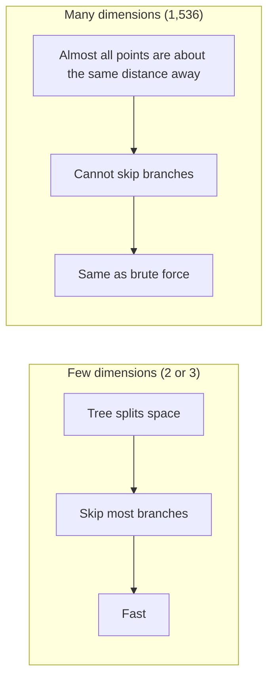

# 9. Why We Need Vector Databases: KNN and Vector Search

> **In plain words:** Comparing a query with every stored vector is too slow when you have millions of them. Normal database indexes do not help because vectors have so many dimensions. So we need a special kind of database.

## Two problems once you have embeddings

1. **How do I store vectors?**
2. **How do I search them efficiently?** (query `[x, y, z]` against 30 movies is easy; against millions it is not)

### Problem 1: can a relational database store them?

You can: serialize to JSON or binary in a column, or use a modern database's vector type/extension. But the model of a traditional DB is **exact matching** (`WHERE genre = 'sci-fi'`, `year > 2010`, `BETWEEN`, `IN`, `JOIN`), true/false. Vector search is **similarity matching** (high or low match, ranked). A vector DB stores `id, embedding, metadata` and is built for the second job. Query example: "a mind-bending space-related movie".

## Brute-force KNN and its cost

**K-Nearest Neighbours (exact):** compare the query with **every** vector and keep the top K.

- 100 vectors means 100 comparisons.
- 100,000,000 vectors means 100,000,000 comparisons.
- One comparison costs about `D` operations, so one query costs **N x D**.

With 10 million vectors of 1536 dimensions: `10,000,000 x 1536 = 15.36 billion` operations **per query**.

### Memory cost

| Step | Value |
|---|---|
| One dimension (float32) | 4 bytes |
| One 1536-d vector | 1536 x 4 = 6144 bytes (about **6 KB**) |
| 10 million vectors | about **60 GB** |

So: heavy **compute** and heavy **storage**.

## Can a classic index help?

For ordinary data, an index narrows the search: `SELECT * FROM emp WHERE id = 6` jumps straight to the row, and sorted 1-D values (12, 35, 42, 67, 86, 99) let you binary-search toward 38.

In **2-D**, a **k-d tree** splits space by coordinates. Query `Q = [7, 6]` among `A[2,3] B[8,7] C[4,5] D[7,2] E[1,8] F[6,6]`:

1. Search the side that contains the query first.
2. Track the **best distance** found so far.
3. Compute the distance from the query to the **splitting plane**.
4. If `distance_to_plane < best_distance`, the other side might hold something closer: search it too.
5. Otherwise **prune** the other side safely.

## The curse of dimensionality

At 1536 dimensions, pruning stops working. The careful statement:

> It does not mean one extra dimension suddenly breaks search. It means every extra dimension adds more ways for points to differ and more regions that might contain a neighbour. As dimensions grow, we can safely eliminate less and less of the search space, until an exact structure ends up inspecting so much data that it behaves almost like **brute force**.

So exact tree indexes do not rescue high-dimensional vector search. That motivates **approximate** methods (next note).

## Picture it

### How the work grows (brute force, 1,536 dimensions)

| Stored vectors | Multiplications per query | Memory (float32) |
|---|---|---|
| 10,000 | about 15 million | about 61 MB |
| 1 million | about 1.5 billion | about 6 GB |
| 100 million | about 154 billion | about 614 GB |

Each vector uses 1,536 x 4 bytes = 6,144 bytes.

### Why tree indexes stop working

This problem is called the **curse of dimensionality**.

### The way out

## Key points to remember

- Traditional DB: **exact** match. Vector DB: **similar** match, ranked by score, plus metadata.
- Exact KNN costs `N x D` per query and `N x 4 x D` bytes of memory.
- k-d trees prune well in low dimensions but degrade towards brute force in very high dimensions.

## Interview angles

- "Why not store embeddings in Postgres?": you can (pgvector) but you still need an efficient ANN index at scale.
- "Estimate memory for 10M 1536-d float32 vectors": about 60 GB.
- "What is the curse of dimensionality for search?": distances concentrate and pruning stops helping.

## Further reading

- [Wikipedia: Curse of dimensionality](https://en.wikipedia.org/wiki/Curse_of_dimensionality) - Why distance gets less useful in high dimensions.
- [Pinecone: What is a vector database?](https://www.pinecone.io/learn/vector-database/) - Simple overview of why we need one.
- [FAISS (Facebook AI Similarity Search)](https://github.com/facebookresearch/faiss) - Open-source library for fast vector search.
- [pgvector](https://github.com/pgvector/pgvector) - Add vector search to PostgreSQL.
- [ANN Benchmarks](http://ann-benchmarks.com/) - Speed and accuracy charts for ANN tools.
