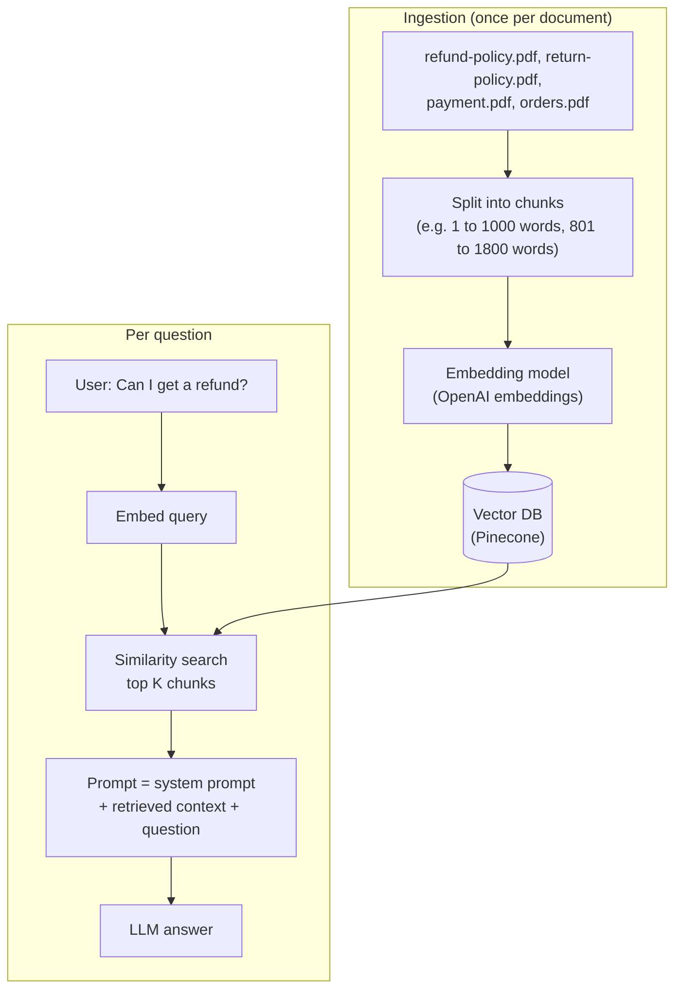
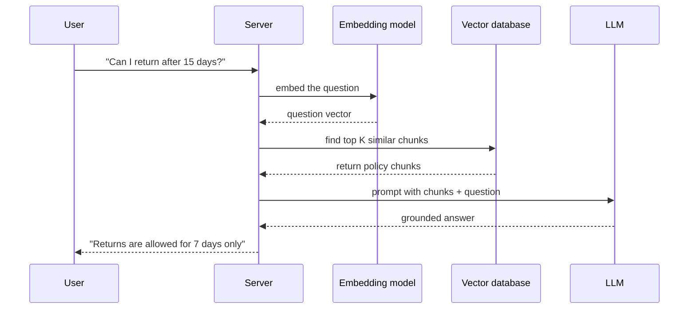

# 11. RAG Explained with a Real Project: AI Customer Support Chatbot

> **In plain words:** RAG means Retrieval-Augmented Generation. First you find the company documents that match the question. Then you give those documents to the LLM and ask it to answer from them. This lowers made-up answers.

## Step 1: the model has no memory (so we add it)

"My name is Aditya" then "What is my name?" fails if each call is independent. The server keeps the **history** (input and output messages) and resends it, as in note 4.

## Step 2: how do we teach it the company's policies?

Example: a food-delivery company, **Tomato**. Questions need Tomato's refund policy, return policy, payment-delay rules and order tracking.

### Attempt A: put everything in the system prompt

"You are an AI assistant integrated with a food delivery company called Tomato. Refund policy: ... Return policy: ... Payment: ..." Works for a small policy set, but:

- every call pays for **all** the text (cost, latency, context limit);
- it does not scale to hundreds of PDFs;
- irrelevant text can distract the model.

### Attempt B: RAG, Retrieval Augmented Generation

Put in the prompt only the **few relevant pieces** for this question.



1. **Ingest:** split each document into chunks, embed every chunk, store `chunk + vector (+ metadata)` in a vector DB.
2. **Retrieve:** embed the question, find the nearest chunks (for example "refund policy page", "payment page").
3. **Generate:** give the LLM the system prompt, the retrieved **context** and the question; it answers from the context.

Chunk windows **overlap** (chunk 1 = words 1 to 1000, chunk 2 = words 801 to 1800) so a sentence cut at a boundary still appears whole in one chunk.

## The project (all three stacks)

- A `/api/query` endpoint plus an **upload** endpoint for documents ("Upload Book.pdf" -> chunk -> embed -> vector DB).
- Services used: **OpenAI embedding model**, **Pinecone** vector DB, **OpenAI LLM**. Config via `OPENAI_API_KEY` and `PINECONE_API_KEY` environment variables.
- Same structure in JavaScript, Python and Spring.

## Picture it

### What one RAG request looks like



### The prompt the model really sees

```text
SYSTEM: You are a support agent. Answer ONLY from the context.
        If the answer is not in the context, say "I do not know".

CONTEXT:
[1] Returns are accepted within 7 days of delivery.
[2] Refunds are sent to the original payment method in 5 days.

QUESTION: Can I return my order after 15 days?
```

### Two parts to build

| Part | When | Steps |
|---|---|---|
| Indexing | Before users arrive, and when documents change | Load, split into chunks, embed, store |
| Answering | Every question | Embed, search, build prompt, ask the LLM |

## Key points to remember

- **RAG = retrieve relevant text, then generate with that text as context.**
- It fixes the "LLM invents our policy" problem without retraining the model.
- Two pipelines: **ingestion** (chunk, embed, store) and **query** (embed, search, prompt).
- Overlapping chunks protect meaning at boundaries.
- Keys for the embedding model, vector DB and LLM live in environment variables.

## Interview angles

- "RAG vs fine-tuning?": RAG injects fresh, private knowledge at query time; fine-tuning changes model behaviour.
- "Why not stuff all docs into the prompt?": cost, latency, context limits, distraction.
- "What goes wrong in RAG?": bad chunking, wrong retrieval, stale index (note 12 fixes these).

## Further reading

- [Retrieval-Augmented Generation for Knowledge-Intensive NLP Tasks (2020)](https://arxiv.org/abs/2005.11401) - The original RAG paper.
- [OpenAI: Retrieval guide](https://platform.openai.com/docs/guides/retrieval) - Semantic search and RAG with the API.
- [Pinecone: Retrieval-Augmented Generation](https://www.pinecone.io/learn/retrieval-augmented-generation/) - Plain-language overview.
- [LangChain: Build a RAG app](https://python.langchain.com/docs/tutorials/rag/) - A hands-on tutorial in Python.
- [Anthropic: Contextual Retrieval](https://www.anthropic.com/news/contextual-retrieval) - A way to make retrieval more accurate.
