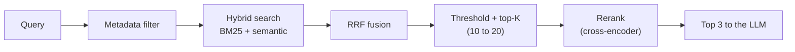
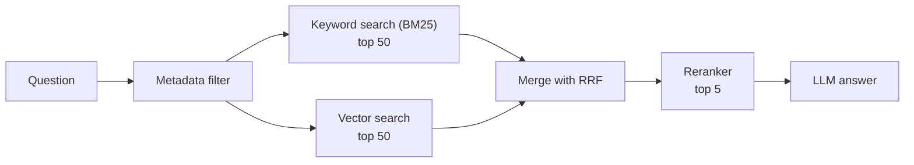
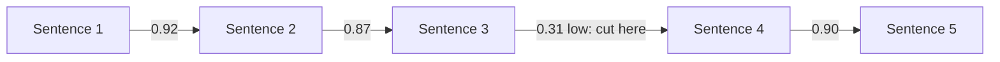

# 12. Advanced RAG: Chunking, Hybrid Search, Reranking and More

> **In plain words:** Simple RAG often fails. Chunks can be cut in the wrong place, similar documents can be mixed up, and the right chunk may not be at the top. Advanced RAG fixes this with better chunking, metadata filters, hybrid search and reranking.

## Why simple RAG fails

Simple RAG: question, embed, similarity search, top-K, LLM, answer. A failing case, with three documents:

1. General Return Policy: returns within **30 days**.
2. Electronics Return Policy: returns within **7 days**, subject to inspection.
3. Damaged Product Policy: report damage within **48 hours**.

Query: "Can I return my damaged headphones after 10 days?" If retrieval brings back only the general policy, the LLM answers from the wrong context ("yes, 30 days"). **Good answers need the right context**, so every stage of retrieval is tuned.

## 1. Chunking techniques

| Technique | How | Notes |
|---|---|---|
| **Fixed-size** | Cut every N tokens, for example **400-600 tokens**, with **10-20% overlap** | Simple; overlap preserves boundary sentences. Risk: splits a rule from its exception |
| **Structural / document-aware** | Split on title, sub-headings, paragraphs, sections, tables | Overlap usually not needed; keeps meaning units whole |
| **Semantic** | Embed each sentence; compare neighbours; **start a new chunk where similarity drops** | Example: s1-s2 0.92, s2-s3 0.87, **s3-s4 0.31 (break)**, s4-s5 0.94, s5-s6 0.88. So `s1+s2+s3` become chunk 1 (returns) and `s4+s5+s6` chunk 2 (shipping) |

Example of why chunk size matters: an "Electronics Return Policy" with the 7-day rule in one chunk and "items physically damaged by the customer are not eligible" in another can answer "Can I return a physically damaged electronic product?" wrongly.

## 2. How much to retrieve

- **Top-K**: take the K best matches (for example 3 to 5); too large adds irrelevant text, too small can miss the answer.
- **Similarity threshold**: drop matches below a score (for example 0.8). For "Who won the IPL in 2026?" against a store policy index, scores like 0.31, 0.19, 0.06 are all below the threshold, so retrieve nothing and let the bot say it does not know.

## 3. Metadata filtering

Store metadata with each chunk (product model, category, region, date) and **filter before or while searching**. Example: three similar docs (AX-204 manual, BX-900 manual, a general charging guide). For "Does the AX-204 wireless headphone support fast charging?", pure semantic search may return the BX-900 doc; filtering on model = AX-204 returns the right one.

## 4. Hybrid search: keyword plus semantic

| Search | Strength | Weakness |
|---|---|---|
| **Keyword (BM25)** | Exact tokens: model numbers, codes, names | Misses paraphrases |
| **Semantic (embeddings)** | Meaning and paraphrase | Can blur exact identifiers |

Run both, then merge the two ranked lists with **Reciprocal Rank Fusion (RRF)**:

`RRF(d) = sum over lists of 1 / (60 + rank_in_list)`

Example: doc A is rank 1 in one list and rank 3 in the other: `1/(60+1) + 1/(60+3)`. Documents that rank well in **both** rise to the top, without needing to compare raw scores from two different systems.

## 5. Reranking (two-stage retrieval)

1. **Stage 1:** retrieve a wider set (10 to 20 candidates) cheaply with vector/hybrid search.
2. **Stage 2:** a **cross-encoder reranking model** reads `query + document` **together** and outputs a relevance score. More accurate than comparing precomputed vectors, but slower, so it is only run on the shortlist.
3. Return the **top 3** to the LLM.

Example: for "Can I return my damaged headphones after 10 days?", initial results might be 1 General Return, 2 Electronics Return, 3 Refund Processing, 4 Damaged Product Reporting, 5 Exchange; reranking promotes the ones that actually answer the question.

## Picture it

### Problem and fix

| What goes wrong | Why | Fix |
|---|---|---|
| Answer is cut in half | Chunk boundary is in the wrong place | Better chunking (structure or semantic) |
| Wrong product manual used | Similar documents look alike | Metadata filter (model, region, date) |
| Exact code like "AX-204" is missed | Embeddings are weak at exact words | Hybrid search (keyword + meaning) |
| Right chunk is rank 7, not rank 1 | Fast search is rough | Reranker |
| Too much text in the prompt | K is too big | Tune K, rerank, then keep the top few |

### A better pipeline

### Merging two lists with Reciprocal Rank Fusion (RRF)

Score = 1 / (60 + rank), added for every list.

| Document | Rank in keyword list | Rank in vector list | RRF score |
|---|---|---|---|
| A | 1 | 3 | 1/61 + 1/63 = 0.0323 |
| B | 2 | 1 | 1/62 + 1/61 = 0.0325 |

B wins because it is good in both lists.

### Where to cut a chunk

## Key points to remember

- Simple RAG = embed, nearest K. **Advanced RAG improves every step**: chunking, filtering, search type, score cut-offs, reranking.
- Chunk by **meaning** (structure or semantics), keep modest overlap for fixed-size.
- Use a **threshold** so the bot can say "I don't know".
- **Hybrid + RRF** handles both exact IDs and paraphrases.
- **Rerank** a wide candidate set into a tight top 3.

## Interview angles

- "Retrieval returns the wrong policy; how do you debug?": inspect chunks, add metadata filters, hybrid search, rerank, tune K and threshold.
- "Why hybrid search?": embeddings miss exact identifiers; BM25 misses paraphrase.
- "Bi-encoder vs cross-encoder?": bi-encoder embeds separately (fast, indexable); cross-encoder scores the pair jointly (accurate, slow).
- "How do you decide chunk size?": by document structure and answer granularity; measure retrieval quality with evals (notes 17 and 18).

## Further reading

- [Anthropic: Contextual Retrieval](https://www.anthropic.com/news/contextual-retrieval) - Adds context to each chunk and mixes BM25 with embeddings.
- [Pinecone: Chunking strategies](https://www.pinecone.io/learn/chunking-strategies/) - Fixed, recursive and semantic chunking.
- [Reciprocal Rank Fusion (Cormack et al.)](https://plg.uwaterloo.ca/~gvcormac/cormacksigir09-rrf.pdf) - The paper behind RRF.
- [Wikipedia: Okapi BM25](https://en.wikipedia.org/wiki/Okapi_BM25) - The usual keyword scoring formula.
- [Cohere: Rerank overview](https://docs.cohere.com/docs/rerank-overview) - How reranking works.
- [Retrieval-Augmented Generation for Large Language Models: A Survey](https://arxiv.org/abs/2312.10997) - A wide overview of RAG methods.
