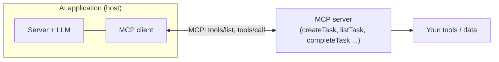
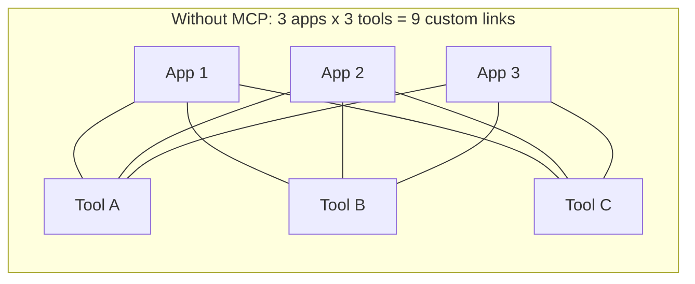
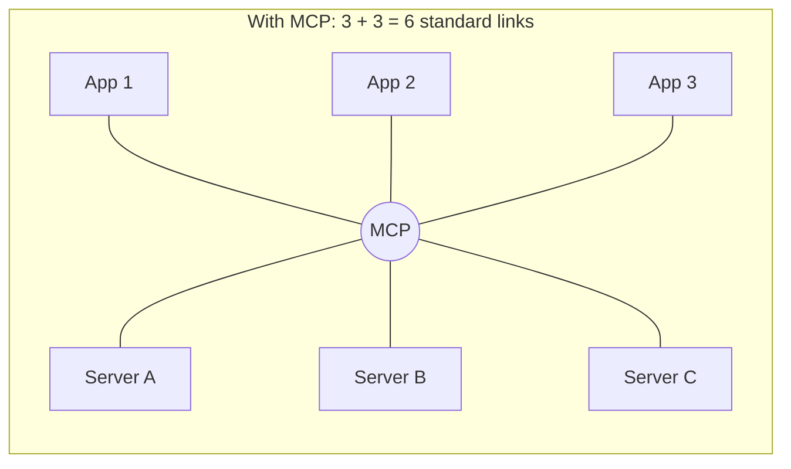
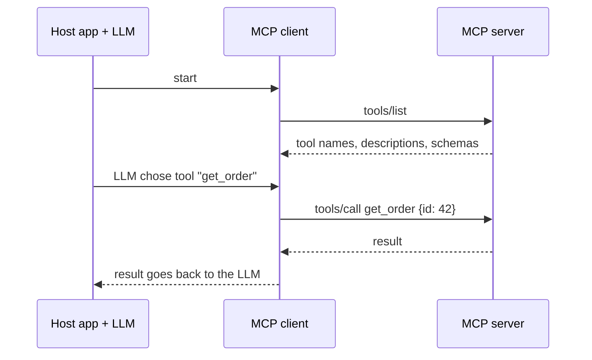

# 14. MCP Server Explained: Model Context Protocol for AI Agents

> **In plain words:** MCP (Model Context Protocol) is a standard way to connect AI apps to tools and data. Write a tool once as an MCP server, and any MCP-ready app can use it.

## The integration problem

So far each AI application defines its own tools (calculator, weather API, compiler) in its own format. With App1, App2, App3 each wiring up the same tools separately, you repeat work and every pairing is bespoke. Question like "What is the temperature in Delhi right now?" needs a weather tool; "5 x 10" needs a calculator; each app invents its own call shape (`{num1: 2, num2: 3, operator: "add"}`).

## MCP: a standard plug

> **MCP (Model Context Protocol)** is a standard protocol through which AI applications can connect to external tools and data.



- **MCP server**: exposes capabilities (for example a To-Do server with `createTask`, `listTask`, `completeTask`).
- **MCP client**: lives inside the AI application and talks to the server.
- **Host**: the AI application (server + LLM + MCP client) that uses them.
- Build the server once; **any MCP-capable app** can use it (the same spirit as USB: one standard connector).

## How a call works

1. The client asks `tools/list` and learns each tool's **name, description and input schema**:

   ```json
   { "name": "createTask", "description": "Creates a new task",
     "inputSchema": { "type": "object", "properties": { "title": { "type": "string" } } } }
   ```

2. The user says "Add 'Go to Gym' as my task". The LLM, knowing the tools, produces structured output `{ createTask: { title: "Go to Gym" } }`.
3. The client sends `tools/call` to the MCP server, which runs it and returns the result to the LLM.

(This is the tool-calling loop from note 5, with the tool definitions and execution moved behind a standard interface.)

## The three things an MCP server can offer

| Primitive | Meaning | Mental model |
|---|---|---|
| **Tools** | Actions the model can invoke | "I want my AI to **do** something" |
| **Resources** | Data/content exposed as context | "I want my AI to **know** something" |
| **Prompts** | Reusable instruction templates | "I want **reusable instructions** for AI" |

Note 15 covers resources and prompts. (The notes link resources such as `refundPolicy`, `returnPolicy`, `payment` back to RAG-style knowledge.)

## Transports

| Transport | When |
|---|---|
| **STDIO** | Server runs as a local process next to the client |
| **Streamable HTTP** | Server is remote, called over HTTP |

## Picture it

### Without MCP and with MCP





### How a call works



### Transports

| Transport | Where the server runs | Use for |
|---|---|---|
| stdio | On your own machine, as a child process | Local tools |
| Streamable HTTP | On a remote server | Shared or hosted tools |

## Key points to remember

- MCP standardises **how AI apps discover and call tools/data**, avoiding per-app glue.
- Roles: **host** (app + LLM), **MCP client**, **MCP server**.
- Discovery is `tools/list`; execution is `tools/call`; tool schemas drive the LLM's structured output.
- Servers can offer **tools, resources and prompts**.
- Choose **STDIO** (local) or **Streamable HTTP** (remote).

## Interview angles

- "What problem does MCP solve?": the N apps x M tools integration problem, using one protocol.
- "MCP vs a plain function-calling tool?": MCP standardises discovery, schema and transport, so tools are reusable across apps.
- "Local vs remote MCP server?": STDIO for local processes; streamable HTTP for hosted services.
- "Security?": MCP tool output and descriptions are untrusted input (see note 19).

## Further reading

- [Model Context Protocol: Introduction](https://modelcontextprotocol.io/introduction) - Official overview.
- [MCP Specification](https://modelcontextprotocol.io/specification) - The full protocol rules.
- [Anthropic: Introducing the Model Context Protocol](https://www.anthropic.com/news/model-context-protocol) - The launch announcement.
- [MCP reference servers](https://github.com/modelcontextprotocol/servers) - Ready-made example servers.
- [JSON-RPC 2.0 specification](https://www.jsonrpc.org/specification) - The message format MCP uses.
