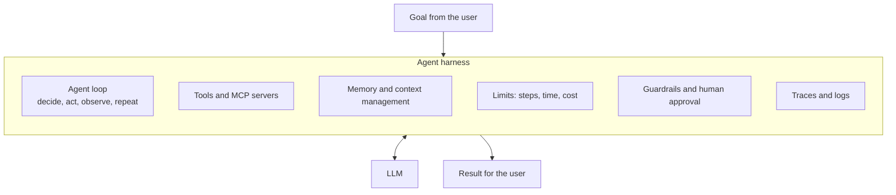
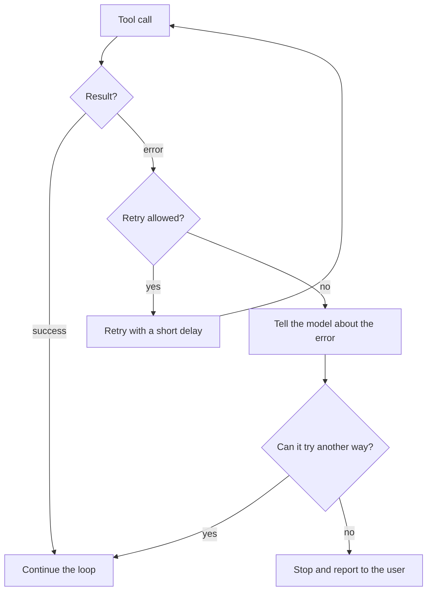

# 20. Agent Harness: Building Reliable AI Agents

> **In plain words:** The agent harness is all the code around the model. It runs the loop, gives the model tools, manages memory, sets limits and records what happened. A good model in a poor harness fails. A good harness makes the same model reliable.

## What is a harness?

A model only reads text and writes text. Everything else comes from the harness.



## How it connects to earlier notes

| Part of the harness | What it does | Earlier note |
|---|---|---|
| Agent loop | Decide, act, observe, repeat | Note 5 |
| Tools and MCP | Let the agent act in the real world | Notes 5, 14, 15 |
| Memory and context window | Keep the right facts in view | Notes 4 and 11 |
| Retrieval | Fetch facts the model does not have | Notes 11 and 12 |
| Structured outputs | Make tool calls and results safe to parse | Note 13 |
| Evals and traces | Measure and debug behaviour | Notes 17 and 18 |
| Guardrails and approvals | Stop harmful actions | Note 19 |

## The loop in code form

```text
messages = [system_prompt, user_goal]
for step in 1 .. MAX_STEPS:
    reply = llm(messages, tools)
    if reply has no tool call:
        return reply                       # the agent is done
    check_policy(reply.tool_call)          # guardrail, maybe ask a human
    result = run_tool(reply.tool_call)     # with a timeout
    messages += [reply, result]            # observe
    messages = manage_context(messages)    # trim or summarise if too long
    log(step, reply, result)               # trace
return "I could not finish. Here is what I did."
```

## What happens when things go wrong



## Design questions and good answers

| Question | A good answer |
|---|---|
| How does the agent know it is done? | The model gives a final answer with no tool call, or a clear success check passes. |
| How does it know it is stuck? | A step limit, a time limit and a check for repeated identical actions. |
| How is context kept small over a long task? | Drop old tool output, summarise earlier steps, save notes to a file, and retrieve details when needed. |
| Which actions need a human? | Payments, deletes, sending messages, changing permissions. Your code enforces this, not the prompt. |
| What is logged? | Every prompt, tool call, result, cost and time, so a run can be replayed and scored. |

## Key points to remember

- The harness matters as much as the model.
- Always set limits: maximum steps, time and cost.
- Keep the tool list small and the tool descriptions clear.
- Manage context on purpose. Do not let it grow without control.
- Save traces. You cannot fix what you cannot see.
- Enforce safety in code, not only in the prompt.

## Interview angles

- "What is an agent harness?" The code around the model: loop, tools, memory, limits, guardrails and logging.
- "How do you stop an agent from looping forever?" Step and time limits, repeat detection, and a clear way to give up.
- "How do you test an agent?" Replay traces on a golden set of tasks, then score the final result and the steps taken.
- "Why can a small model do well in a good harness?" Tools, retrieval and checks supply what the model lacks.

## Further reading

- [Anthropic: Building effective agents](https://www.anthropic.com/engineering/building-effective-agents) - when to use workflows and when to use agents.
- [Anthropic: Effective context engineering for AI agents](https://www.anthropic.com/engineering/effective-context-engineering-for-ai-agents) - how to manage what the model sees.
- [Anthropic: Effective harnesses for long-running agents](https://www.anthropic.com/engineering/effective-harnesses-for-long-running-agents) - keeping long tasks on track.
- [Anthropic: Writing tools for agents](https://www.anthropic.com/engineering/writing-tools-for-agents) - how to design good tools.
- [ReAct: Synergizing Reasoning and Acting in Language Models](https://arxiv.org/abs/2210.03629) - the think, act, observe pattern.
- [OWASP Top 10 for LLM Applications](https://genai.owasp.org/llm-top-10/) - security risks for agents.
- [Model Context Protocol](https://modelcontextprotocol.io/introduction) - the standard for connecting tools.
